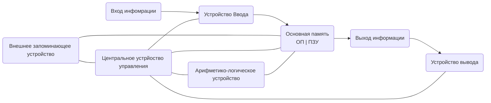

### Классификация и остав ЭВМ
1. По элементной базе⁠​‌​‌​​‌‌​‌​​​​​‌​‌​​​‌‌​​‌​​​​​‌​‌​‌​‌​‌​‌​‌​‌​​​‌​​‌​​​​​‌‌​​​‌‌‌​‌​​​​‌​‌​​​​‌‌‌​‌​​​​‌​‌‌​​​​‌‌​‌​​​‌‌​​​​‌​​‌‌​‌​​​‌‌​​​‌‌​​‌‌​‌​​​‌‌​​​‌‌‌‌‌‌​‌​​​​‌​‌‌‌‌​‌‌‌​‌​​​​‌​‌‌‌‌‌​‌‌​‌​​​​‌​‌‌​​‌​​​‌​​​​​‌‌​‌​​​​‌​​‌‌​‌​‌‌​‌​​​​‌​‌‌​​​​‌‌​‌​​​​‌​‌‌‌‌​​‌‌​‌​​​​‌​‌‌‌​​​‌‌​‌​​​​‌​‌‌‌​‌‌‌‌​‌​​​‌‌​​​‌‌​​​​‌​​​​​‌‌​‌​​​​‌​‌​​​​‌‌‌​‌​​​​‌​‌‌​​​​‌‌​‌​​​​‌​‌‌‌‌​​‌‌​‌​​​​‌​‌‌​​​​‌‌​‌​​​‌‌​​​​​‌​‌‌​‌​​​​‌​‌‌‌‌‌​‌‌​‌​​​​‌​‌‌​​‌​‌‌​‌​​​​‌​‌‌‌​​​‌‌​‌​​​‌‌​​​​‌‌‌​‌‌‌‌‌​​‌‌​‌​​​​‌​​‌‌​​​‌‌​‌​​​​‌​‌‌‌‌​‌‌‌​‌​​​‌‌​​​​‌​​‌‌​‌​​​​‌​‌‌‌‌‌​‌‌​‌​​​‌‌​​​​​​​‌‌​‌​​​​‌​‌‌‌‌​​‌‌​‌​​​​‌​‌‌​​​​‌‌​‌​​​‌‌​​​​​‌​‌‌​‌​​​​‌​‌‌‌​​​‌‌​‌​​​​‌​‌‌‌​‌​‌‌​‌​​​​‌​‌‌​​​​​​‌​‌‌‌‌‌‌​‌​​​​‌​​‌‌​‌​‌‌​‌​​​​‌​‌‌‌‌‌​‌‌​‌​​​​‌​‌‌‌‌​‌‌‌​‌​​​‌‌​​​​​​‌‌‌​‌​​​​‌​‌‌‌‌‌‌‌‌​‌​​​​‌​‌‌​‌​‌‌‌​‌​​​​‌​‌‌‌​‌​‌‌​‌​​​‌‌​​​​​‌​‌‌​‌​​​‌‌​​​‌​‌‌​​‌​​​​​‌‌​‌​​​​‌​‌‌‌​‌‌‌‌​‌​​​​‌​‌‌​‌​‌‌‌​‌​​​​‌​‌‌‌​‌​‌‌​‌​​​‌‌​​​​‌‌​‌‌​‌​​​​‌​‌‌‌​​​‌‌​‌​​​​‌​‌‌‌​​‌​​‌​‌‌‌‌‌‌​‌​​​​‌​​‌‌​​​‌‌​‌​​​​‌​‌‌‌‌​‌‌‌​‌​​​‌‌​​​​‌​​‌‌​‌​​​​‌​‌‌‌‌‌​‌‌​‌​​​‌‌​​​​​​​‌‌​‌​​​​‌​‌‌‌‌​​‌‌​‌​​​​‌​‌‌​​​​‌‌​‌​​​‌‌​​​​‌‌​‌‌​‌​​​​‌​‌‌‌​​​‌‌​‌​​​‌‌​​​‌‌‌‌​​‌​​​​​‌‌​‌​​​​‌​‌‌‌​​​​​‌​​​​​‌‌​‌​​​​‌​‌‌‌​​​‌‌​‌​​​​‌​‌‌‌‌​‌‌‌​‌​​​‌‌​​​​‌​​‌‌​‌​​​​‌​‌‌‌‌‌​‌‌​‌​​​‌‌​​​​​​​‌‌​‌​​​​‌​‌‌‌‌​​‌‌​‌​​​​‌​‌‌​​​​‌‌​‌​​​‌‌​​​​​‌​‌‌​‌​​​​‌​‌‌‌​​​‌‌​‌​​​​‌​‌‌‌​‌​‌‌​‌​​​​‌​‌‌​​​​​​‌​​​​​​​‌‌​​‌​​​‌‌​​‌​​​‌​‌‌‌​​​‌‌​​​‌​​‌‌​​​​​​‌​‌‌‌​​​‌‌​​‌​​​‌‌​‌‌​​​‌​‌‌‌​​‌‌​‌‌​‌​‌‌​​‌​​​‌‌​‌​​‌​‌​​‌​​‌‌​​​​​‌‌​​‌​​‌‌‌⁣
2. По производительности
	1. Супер ЭВМ
	2. ЭВМ общего назначения
	3. Мини ЭВМ
	4. Микро ЭВМ
3. По типу обработки сигналов 

Компьютер (ЭВМ) является единым комплексом из нескольких устройств, где каждое устройство представляет собой автономмный, кон⁠​‌​‌​​‌‌​‌​​​​​‌​‌​​​‌‌​​‌​​​​​‌​‌​‌​‌​‌​‌​‌​‌​​​‌​​‌​​​​​‌‌​​​‌‌‌​‌​​структивно законченный модуль с типвоым напряжением. В основе его работы лежит принцип открытой архитектуры.

### Понятие архитектуры и структуры ЭВМ
​‌‌‌​‌​​​​‌​‌‌​​​​‌‌​‌​​​‌‌​​​​‌​​‌‌​‌​​​‌‌​​​‌‌​​‌‌​‌​​​‌‌​​​‌‌‌‌‌‌​‌​​​​‌​‌‌‌‌​‌‌‌​‌​​​​‌​‌‌‌‌‌​‌‌​‌​​​​‌​‌‌​​‌​​​‌​​​​​‌‌​‌​​​​‌​​‌‌​‌​‌‌​‌​​​​‌​‌‌​​​​‌‌​‌​​​​‌​‌‌‌‌​​‌‌​‌​​​​‌​‌‌‌​​​‌‌​‌​​​​‌​‌‌‌​‌‌‌‌​‌​​​‌‌​​​‌‌​​​​‌​​​​​‌‌​‌​​​​‌​‌​​​​‌‌‌​‌​​​​‌​‌‌​​
[[Архитерктура ЭВМ|Архитектура]] компьютера определяется совокупностью ее свойств, существенных для пользователя 
Выделяют 5 базовых элементов комьютера:
1. Арифметико-логическое устройство АЛУ
2. Устройство управления УУ
3. Запоминающее устройство ЗУ
4. Система ввода информации СВИ
5. Система вывода информации СВывИ

​​‌‌​‌​​​​‌​‌‌‌‌​​‌‌​‌​​​​‌​‌‌​​​​‌‌​‌​​​‌‌​​​​​‌​‌‌​‌​​​​‌​‌‌‌‌‌​‌‌​‌​​​​‌​‌‌​​‌​‌‌​‌​​​​‌​‌‌‌​​​‌‌​‌​​​‌‌​​​​‌‌‌​‌‌‌‌‌​​‌‌​‌​​​​‌​​‌‌​​​‌‌​‌​​​​‌​‌‌‌‌​‌‌‌​‌​​​‌‌​​​​‌​​‌‌​‌​​​​‌​‌‌‌‌‌​‌‌​‌​​​‌‌​​​​​​​‌‌​‌​​​​‌​‌‌‌‌​​‌‌​‌​​​​‌​‌‌​​​​‌‌​‌​​​‌‌​​​​​‌​‌‌​‌​​​​‌​‌‌‌​​​‌‌​‌​​​​‌​‌‌‌​‌​‌‌​‌​​​​‌​‌‌​​​​​​‌​‌‌‌‌‌‌​‌​​​​‌​​‌‌​‌​‌‌​‌​​​​‌​‌‌‌‌‌​‌‌​‌​​​​‌​‌‌‌‌​‌‌‌​‌​​​‌‌​​​​​​‌‌‌​‌​​​​‌​‌‌‌‌‌‌‌‌​‌​​​​‌​‌‌​‌​‌‌‌​‌​​​​‌​‌‌‌​‌​‌‌​‌​​​‌‌​​​​​‌​‌‌​‌​​​‌‌​​​‌​‌‌​​‌​​​​​‌‌​‌​​​​‌​‌‌‌​‌‌‌‌​‌​​​​‌​‌‌​‌​‌‌‌​‌​​​​‌​‌‌‌​‌​‌‌​‌​​​‌‌​​​​‌‌​‌‌​‌​​​​‌​‌‌‌​​​‌‌​‌​​​​‌​‌‌‌​​‌​​‌​‌‌‌‌‌‌​‌​​​​‌​​‌‌​​​‌‌​‌​​​​‌​‌‌‌‌​‌‌‌​‌​​​‌‌​​​​‌​​‌‌​‌​​​​‌​‌‌‌‌‌​‌‌​‌​​​‌‌​​​​​​​‌‌​‌​​​​‌​‌‌‌‌​​‌‌​‌​​​​‌​‌‌​​​​‌‌​‌​​​‌‌​​​​‌‌​‌‌​‌​​​​‌​‌‌‌​​​‌‌​‌​​​‌‌​​​‌‌‌‌​​‌​​​​​‌‌​‌​​​​‌​‌‌‌​​​​​‌​​​​​‌‌​‌​​​​‌​‌‌‌​​​‌‌​‌​​​​‌​‌‌‌‌​‌‌‌​‌​​​‌‌​​​​‌​​‌‌​‌​​​​‌​‌‌‌‌‌​‌‌​‌​​​‌‌​​​​​​​‌‌​‌​​​​‌​‌‌‌‌​​‌‌​‌​​​​‌​‌‌​​​​‌‌​‌​​​‌‌​​​​​‌​‌‌​‌​​​​‌​‌‌‌​​​‌‌​‌​​​​‌​‌‌‌​‌​‌‌​‌​​​​‌​‌‌​​​​​​‌​​​​​​​‌‌​​‌​​​‌‌​​‌​​​‌​‌‌‌​​​‌‌​​​‌​​‌‌​​​​​​‌​‌‌‌​​​‌‌​​‌​​​‌‌​‌‌​​​‌​‌‌‌​​‌‌​‌‌​‌​‌‌​​‌​​​‌‌​‌​​‌​‌​​‌​​‌‌​​​​​‌‌​​‌​​‌‌‌⁣
Устройство ввода служит для преобразования информации в закодированную последовательность сигналов и записи этой последовательности в основную память, к ним относятся: клавиатура (основная), манипуляторы (мышь, тачпад, трекпад, граф планшет), сканеры (камера и микрофон)

Устройство вывода служит для преобразования результатов обработки сигналов в информацию в удобном для пользователя виде
К ним относятся: монитор, принтеры, 
⁠​‌​‌​​‌‌​‌​​​​​‌​‌​​​‌‌​​‌​​​​​‌​‌​‌​‌​‌​‌​‌​‌​​​‌​​‌​​​​​‌‌​​​‌‌‌​‌​​​​‌​‌​​​​‌‌‌​‌​​​​‌​‌‌​​​​‌‌​‌​​​‌‌​​​​‌​​‌‌​‌​​​‌‌​​​‌‌​​‌‌​‌​​​‌‌​​​‌‌‌‌‌‌​‌​​​​‌​‌‌‌‌​‌‌‌​‌​​​​‌​‌‌‌‌‌​‌‌​‌​​​​‌​‌‌​​‌​​​‌​​​​​‌‌​‌​​​​‌​​‌‌​‌​‌‌​‌​​​​‌​‌‌​​​​‌‌​‌​​​​‌​‌‌‌‌​​‌‌​‌​
Центральное устройство управления осуществялет управление аппаратными и программными ресурсами ЭВМ, производит чтение команд из основной памяти, определяет адреса операндов команд, тип операции и передает сигнал в основную память и арифметико-логическое устройство 

Арифметико - логическое устрйоство выполняет арифметические и логические операции над данными и вырабатывает различные условия, влияющие на вход вычислительного процесса

ЦУУ и АЛУ в совокупности представляют собой процессор. Это осноное устрйоство которое является преобразователем инфомрации ​​​‌​‌‌‌​​​‌‌​‌​​​​‌​‌‌‌​‌‌‌‌​‌​поступающее из памяти и внешних устройств. Основные функции:
- Выборка команд из памяти
- Кодирование и декодирование
- Выполнение арифметических и логических операций
- Согласование работы узлов компьютера

Процессор и основная память в совокупности составляют центральное устройство или ядро ЭВМ
Остальные устрйоства считаются внешними устрйоствами ЭВМ
⁠​‌​‌​​‌‌​‌​​​​​‌​‌​​​‌‌​​‌​​​​​‌​‌​‌​‌​‌​‌​‌​‌​​​‌​​‌​​​​​‌‌​​​‌‌‌​‌​​​​‌​‌​​​​‌‌‌​‌​​​​‌​‌‌​​​​‌‌​‌​​​‌‌​​​​‌​​‌‌​‌​​​‌‌​​​‌‌​​‌‌​‌​​​‌‌​​​‌‌‌‌‌‌​‌​​​​‌​‌‌‌‌​‌‌‌​‌​​​​‌​‌‌‌‌‌​‌‌​‌​​​​‌​‌‌​​‌​​​‌​​​​​‌‌​‌​​​​‌​​‌‌​‌​‌‌​‌​​​​‌​‌‌​​​​‌‌​‌​​​​‌​‌‌‌‌​​‌‌​‌​​​​‌​‌‌‌​​​‌‌​‌​​​​‌​‌‌‌​‌‌‌‌​‌​​​‌‌​​​‌‌​​​​‌​​​​​‌‌​‌​​​​‌​‌​​​​‌‌‌​‌​​​​‌​‌‌​​​​‌‌​‌​​​​‌​‌‌‌‌​​‌‌​‌​​​​‌​‌‌​​​​‌‌​‌​​​‌‌​​​​​‌​‌‌​‌​​​​‌​‌‌‌‌‌​‌‌​‌​​​​‌​‌‌​​‌​‌‌​‌​​​​‌​‌‌‌​​​‌‌​‌​​​‌‌​​​​‌‌‌​‌‌‌‌‌​​‌‌​‌​​​​‌​​‌‌​​​‌‌​‌​​​​‌​‌‌‌‌​‌‌‌​‌​​​‌‌​​​​‌​​‌‌​‌​​​​‌​‌‌‌‌‌​‌‌​‌​​​‌‌​​​​​​​‌‌​‌​​​​‌​‌‌‌‌​​‌‌​‌​​​​‌​‌‌​​​​‌‌​‌​​​‌‌​​​​​‌​‌‌​‌​​​​‌​‌‌‌​​​‌‌​‌​​​​‌​‌‌‌​‌​‌‌​‌​​​​‌​‌‌​​​​​​‌​‌‌‌‌‌‌​‌​​​​‌​​‌‌​‌​‌‌​‌​​​​‌​‌‌‌‌‌​‌‌​‌​​​​‌​‌‌‌‌​‌‌‌​‌​​​‌‌​​​​​​‌‌‌​‌​​​​‌​‌‌‌‌‌‌‌‌​‌​​​​‌​‌‌​‌​‌‌‌​‌​​​​‌​‌‌‌​‌​‌‌​‌​​​‌‌​​​​​‌​‌‌​‌​​​‌‌​​​‌​‌‌​​‌​​​​​‌‌​‌​​​​‌​‌‌‌​‌‌‌‌​‌​​​​‌​‌‌​‌​‌‌‌​‌​​​​‌​‌‌‌​‌​‌‌​‌​​​‌‌​​​​‌‌​‌‌​‌​​​​‌​‌‌‌​​​‌‌​‌​​​​‌​‌‌‌​​‌​​‌​‌‌‌‌‌‌​‌​​​​‌​​‌‌​​​‌‌​‌​​​​‌​‌‌‌‌​‌‌‌​‌​​​‌‌​​​​‌​​‌‌​‌​​​​‌​‌‌‌‌‌​‌‌​‌​​​‌‌​​​​​​​‌‌​‌​​​​‌​‌‌‌‌​​‌‌​‌​​​​‌​‌‌​​​​‌‌​‌​​​‌‌​​​​‌‌​‌‌​‌​​​​‌​‌‌‌​​​‌‌​‌​​​‌‌​​​‌‌‌‌​​‌​​​​​‌‌​‌​​​​‌​‌‌‌​​​​​‌​​​​​‌‌​‌​​​​‌​‌‌‌​​​‌‌​‌​​​​‌​‌‌‌‌​‌‌‌​‌​​​‌‌​​​​‌​​‌‌​‌​​​​‌​‌‌‌‌‌​‌‌​‌​​​‌‌​​​​​​​‌‌​‌​​​​‌​‌‌‌‌​​‌‌​‌​​​​‌​‌‌​​​​‌‌​‌​​​‌‌​​​​​‌​‌‌​‌​​​​‌​‌‌‌​​​‌‌​‌​​​​‌​‌‌‌​‌​‌‌​‌​​​​‌​‌‌​​​​​​‌​​​​​​​‌‌​​‌​​​‌‌​​‌​​​‌​‌‌‌​​​‌‌​​​‌​​‌‌​​​​​​‌​‌‌‌​​​‌‌​​‌​​​‌‌​‌‌​​​‌​‌‌‌​​‌‌​‌‌​‌​‌‌​​‌​​​‌‌​‌​​‌​‌​​‌​​‌‌​​​​​‌‌​​‌​​‌‌‌⁣
