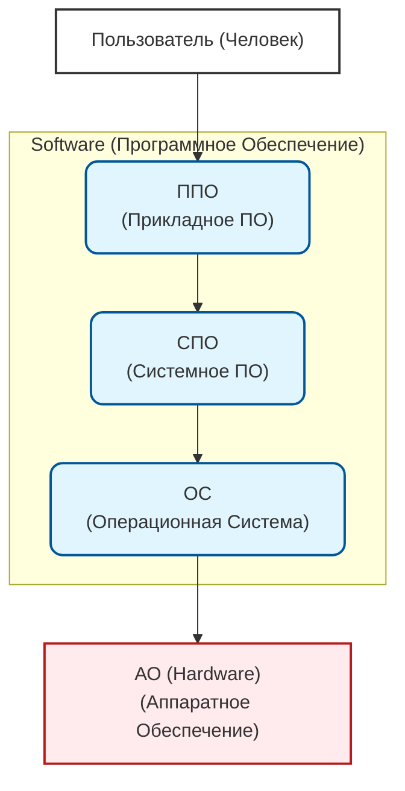

### Структура информатики 
###### [[Информатика]] - наука изучающая :
1. Методы реализации [информационных процессов](Информационный%20процесс.md) средствами вычислительной техники (СВТ)⁠​‌​‌​​‌‌​‌​​​​​‌​‌​​​‌‌​​‌​​​​​‌​‌​‌​‌​‌​‌​‌​‌​​​‌​​‌​​​​​‌‌​​​‌‌‌​‌​​​​‌​‌​​​​‌‌‌​‌​​​​‌​‌‌​​​​‌‌​‌​​​‌‌​​​​‌​​‌‌​‌​​​‌‌​​​‌‌​​‌‌​‌​​​‌‌​​​‌‌‌‌‌‌​‌​​​​‌​‌‌‌‌​‌‌‌​‌​​​​‌​‌‌‌‌‌​‌‌​‌​​​​‌​‌‌​​‌​​​‌​​​​​‌‌​‌​​​​‌​​‌‌​‌​‌‌​‌​​​​‌​‌‌​​​​‌‌​‌​​​​‌​‌‌‌‌​​‌‌​‌​​​​‌​‌‌‌​​​‌‌​‌​​​​‌​‌‌‌​‌‌‌‌​‌​​​‌‌​​​‌‌​​​​‌​​​​​‌‌​‌​​​​‌​‌​​​​‌‌‌​‌​​​​‌​‌‌​​​​‌‌​‌​​​​‌​‌‌‌‌​​‌‌​‌​​​​‌​‌‌​​​​‌‌​‌​​​‌‌​​​​​‌​‌‌​‌​​​​‌​‌‌‌‌‌​‌‌​‌​​​​‌​‌‌​​‌​‌‌​‌​​​​‌​‌‌‌​​​‌‌​‌​​​‌‌​​​​‌‌‌​‌‌‌‌‌​​‌‌​‌​​​​‌​​‌‌​​​‌‌​‌​​​​‌​‌‌‌‌​‌‌‌​‌​​​‌‌​​​​‌​​‌‌​‌​​​​‌​‌‌‌‌‌​‌‌​‌​​​‌‌​​​​​​​‌‌​‌​​​​‌​‌‌‌‌​​‌‌​‌​​​​‌​‌‌​​​​‌‌​‌​​​‌‌​​​​​‌​‌‌​‌​​​​‌​‌‌‌​​​‌‌​‌​​​​‌​‌‌‌​‌​‌‌​‌​​​​‌​‌‌​​​​​​‌​‌‌‌‌‌‌​‌​​​​‌​​‌‌​‌​‌‌​‌​​​​‌​‌‌‌‌‌​‌‌​‌​​​​‌​‌‌‌‌​‌‌‌​‌​​​‌‌​​​​​​‌‌‌​‌​​​​‌​‌‌‌‌‌‌‌‌​‌​​​​‌​‌‌​‌​‌‌‌​‌​​​​‌​‌‌‌​‌​‌‌​‌​​​‌‌​​​​​‌​‌‌​‌​​​‌‌​​​‌​‌‌​​‌​​​​​‌‌​‌​​​​‌​‌‌‌​‌‌‌‌​‌​​​​‌​‌‌​‌​‌‌‌​‌​​​​‌​‌‌‌​‌​‌‌​‌​​​‌‌​​​​‌‌​‌‌​‌​​​​‌​‌‌‌​​​‌‌​‌​​​​‌​‌‌‌​​‌​​‌​‌‌‌‌‌‌​‌​​​​‌​​‌‌‌‌​‌‌​‌​​​‌‌​​​​​​‌‌‌​‌​​​​‌​‌‌‌‌​‌‌‌​‌​​​​‌​‌‌‌‌‌​‌‌​‌​​​​‌​‌‌​​‌​‌‌​‌​​​‌‌​​​‌​‌‌​​‌​​​​​‌‌​‌​​​​‌​​‌‌‌‌‌‌‌​‌​​​‌‌​​​​​​​‌‌​‌​​​​‌​‌‌‌‌‌​‌‌​‌​​​‌‌​​​​‌​​​​‌​‌‌‌​​​‌​​​​​‌‌​‌​​​​‌​​‌​‌​​‌‌​‌​​​​‌​‌‌​‌​‌‌‌​‌​​​‌‌​​​‌‌‌‌‌‌​‌​​​‌‌​​​​​‌​‌‌​‌​​​​‌​‌‌​‌​‌‌‌​‌​​​​‌​‌‌‌​‌‌‌‌​‌​​​‌‌​​​‌‌​​‌‌​‌​​​​‌​‌‌‌‌​‌‌‌​‌​​​​‌​‌‌‌‌‌​‌‌​‌​​​‌‌​​​​​​‌‌‌​‌​​​‌‌​​​​​‌​‌‌​‌​​​​‌​‌‌‌​​​​​‌​​​​​​​‌‌​​​‌​​‌‌​‌‌‌​​‌​‌‌‌​​​‌‌​​​​​​‌‌‌​​‌​​‌​‌‌‌​​​‌‌​​‌​​​‌‌​‌‌​​​‌​‌‌‌​​‌‌​‌‌​‌​‌‌​​‌​​​​​‌‌​​​​‌‌​‌​‌‌​‌​​‌​​​​‌‌​​‌‌​⁣
2. Состав, структуру, общие принципы функционирования СВТ
3. Принципы управления СВТ

### Переход к аппаратному обеспечению 
Джон фон Нейман сформулировал основные принципы построения [[ЭВМ]]:
1. Основными блоками машины являются:
	- [[АЛУ|Арифметико-логическое устройство (АЛУ)]]
	- [[УУ|Устройство управления (УУ)]]
	- [[ЗУ|Запоминающее устройство (ЗУ)]]
	- [[Устройство ввода|Устройство ввода]] и [[Устройство вывода|вывода]] (УВВ)
2. Программы и данные хранятся в одной и той же [[Память|памяти]] (принцип совместного хранения программ и данных в памяти компьютера) 
3. [[АЛУ]] и [[УУ]] обычно объединены в центральный [[Процессор|процессор]] (ЦП), который определяет действия, подлежащие выполнению, путём считывания команд из [[ОЗУ|оперативной памяти]]. 
4. Внутренний код машины двоичен
⁠​‌​‌​​‌‌​‌​​​​​‌​‌​​​‌‌​​‌​​​​​‌​‌​‌​‌​‌​‌​‌​‌​​​‌​​‌​​​​​‌‌​​​‌‌‌​‌​​​​‌​‌​​​​‌‌‌​‌​​​​‌​‌‌​​​​‌‌​‌​​​‌‌​​​​‌​​‌‌​‌​​​‌‌​​​‌‌​​‌‌​‌​​​‌‌​​​‌‌‌‌‌‌​‌​​​​‌​‌‌‌‌​‌‌‌​‌​​​​‌​‌‌‌‌‌​‌‌​‌​​​​‌​‌‌​​‌​​​‌​​​​​‌‌​‌​​​​‌​​‌‌​‌​‌‌​‌​​​​‌​‌‌​​​​‌‌​‌​​​​‌​‌‌‌‌​​‌‌​‌​​​​‌​‌‌‌​​​‌‌​‌​​​​‌​‌‌‌​‌‌‌‌​‌​​​‌‌​​​‌‌​​​​‌​​​​​‌‌​‌​​​​‌​‌​​​​‌‌‌​‌​​​​‌​‌‌​​​​‌‌​‌​​​​‌​‌‌‌‌​​‌‌​‌​​​​‌​‌‌​​​​‌‌​‌​​​‌‌​​​​​‌​‌‌​‌​​​​‌​‌‌‌‌‌​‌‌​‌​​​​‌​‌‌​​‌​‌‌​‌​​​​‌​‌‌‌​​​‌‌​‌​​​‌‌​​​​‌‌‌​‌‌‌‌‌​​‌‌​‌​​​​‌​​‌‌​​​‌‌​‌​​​​‌​‌‌‌‌​‌‌‌​‌​​​‌‌​​​​‌​​‌‌​‌​​​​‌​‌‌‌‌‌​‌‌​‌​​​‌‌​​​​​​​‌‌​‌​​​​‌​‌‌‌‌​​‌‌​‌​​​​‌​‌‌​​​​‌‌​‌​​​‌‌​​​​​‌​‌‌​‌​​​​‌​‌‌‌​​​‌‌​‌​​​​‌​‌‌‌​‌​‌‌​‌​​​​‌​‌‌​​​​​​‌​‌‌‌‌‌‌​‌​​​​‌​​‌‌​‌​‌‌​‌​​​​‌​‌‌‌‌‌​‌‌​‌​​​​‌​‌‌‌‌​‌‌‌​‌​​​‌‌​​​​​​‌‌‌​‌​​​​‌​‌‌‌‌‌‌‌‌​‌​​​​‌​‌‌​‌​‌‌‌​‌​​​​‌​‌‌‌​‌​‌‌​‌​​​‌‌​​​​​‌​‌‌​‌​​​‌‌​​​‌​‌‌​​‌​​​​​‌‌​‌​​​​‌​‌‌‌​‌‌‌‌​‌​​​​‌​‌‌​‌​‌‌‌​‌​​​​‌​‌‌‌​‌​‌‌​‌​​​‌‌​​​​‌‌​‌‌​‌​​​​‌​‌‌‌​​​‌‌​‌​​​​‌​‌‌‌​​‌​​‌​‌‌‌‌‌‌​‌​​​​‌​​‌‌‌‌​‌‌​‌​​​‌‌​​​​​​‌‌‌​‌​​​​‌​‌‌‌‌​‌‌‌​‌​​​​‌​‌‌‌‌‌​‌‌​‌​​​​‌​‌‌​​‌​‌‌​‌​​​‌‌​​​‌​‌‌​​‌​​​​​‌‌​‌​​​​‌​​‌‌‌‌‌‌‌​‌​​​‌‌​​​​​​​‌‌​‌​​​​‌​‌‌‌‌‌​‌‌​‌​​​‌‌​​​​‌​​​​‌​‌‌‌​​​‌​​​​​‌‌​‌​​​​‌​​‌​‌​​‌‌​‌​​​​‌​‌‌​‌​‌‌‌​‌​​​‌‌​​​‌‌‌‌‌‌​‌​​​‌‌​​​​​‌​‌‌​‌​​​​‌​‌‌​‌​‌‌‌​‌​​​​‌​‌‌‌​‌‌‌‌​‌​​​‌‌​​​‌‌​​‌‌​‌​​​​‌​‌‌‌‌​‌‌‌​‌​​​​‌​‌‌‌‌‌​‌‌​‌​​​‌‌​​​​​​‌‌‌​‌​​​‌‌​​​​​‌​‌‌​‌​​​​‌​‌‌‌​​​​​‌​​​​​​​‌‌​​​‌​​‌‌​‌‌‌​​‌​‌‌‌​​​‌‌​​​​​​‌‌‌​​‌​​‌​‌‌‌​​​‌‌​​‌​​​‌‌​‌‌​​​‌​‌‌‌​​‌‌​‌‌​‌​‌‌​​‌​​​​​‌‌​​​​‌‌​‌​‌‌​‌​​‌​​​​‌‌​​‌‌​⁣
