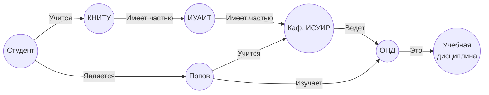

# [[База знаний|Базы знаний]]
- Предназначены для хранения [[Знания|знаний]] являющихся основой любой интеллектуальной системой.⁠​‌​‌​​‌‌​‌​​​​​‌​‌​​​‌‌​​‌​​​​​‌​‌​‌​‌​‌​‌​‌​‌​​​‌​​‌​​​​​‌‌​​​‌‌‌​‌​​​​‌​‌​​​​‌‌‌​‌​​​​‌​‌‌​​​​‌‌​‌​​​‌‌​​​​‌​​‌‌​‌​​​‌‌​​​‌‌​​‌‌​‌​​​‌‌​​​‌‌‌‌‌‌​‌​​​​‌​‌‌‌‌​‌‌‌​‌​​​​‌​‌‌‌‌‌​‌‌​‌​​​​‌​‌‌​​‌​​​‌​​​​​‌‌​‌​​​​‌​​‌‌​‌​‌‌​‌​​​​‌​‌‌​​​​‌‌​‌​​​​‌​‌‌‌‌​​‌‌​‌​​​​‌​‌‌‌​​​‌‌​‌​​​​‌​‌‌‌​‌‌‌‌​‌​​​‌‌​​​‌‌​​​​‌​​​​​‌‌​‌​​​​‌​‌​​​​‌‌‌​‌​​​​‌​‌‌​​​​‌‌​‌​​​​‌​‌‌‌‌​​‌‌​‌​​​​‌​‌‌​​​​‌‌​‌​​​‌‌​​​​​‌​‌‌​‌​​​​‌​‌‌‌‌‌​‌‌​‌​​​​‌​‌‌​​‌​‌‌​‌​​​​‌​‌‌‌​​​‌‌​‌​​​‌‌​​​​‌‌‌​‌‌‌‌‌​​‌‌​‌​​​​‌​​‌‌​​​‌‌​‌​​​​‌​‌‌‌‌​‌‌‌​‌​​​‌‌​​​​‌​​‌‌​‌​​​​‌​‌‌‌‌‌​‌‌​‌​​​‌‌​​​​​​​‌‌​‌​​​​‌​‌‌‌‌​​‌‌​‌​​​​‌​‌‌​​​​‌‌​‌​​​‌‌​​​​​‌​‌‌​‌​​​​‌​‌‌‌​​​‌‌​‌​​​​‌​‌‌‌​‌​‌‌​‌​​​​‌​‌‌​​​​​​‌​‌‌‌‌‌‌​‌​​​​‌​​‌‌​‌​‌‌​‌​​​​‌​‌‌‌‌‌​‌‌​‌​​​​‌​‌‌‌‌​‌‌‌​‌​​​‌‌​​​​​​‌‌‌​‌​​​​‌​‌‌‌‌‌‌‌‌​‌​​​​‌​‌‌​‌​‌‌‌​‌​​​​‌​‌‌‌​‌​‌‌​‌​​​‌‌​​​​​‌​‌‌​‌​​​‌‌​​​‌​‌‌​​‌​​​​​‌‌​‌​​​​‌​‌‌‌​‌‌‌‌​‌​​​​‌​‌‌​‌​‌‌‌​‌​​​​‌​‌‌‌​‌​‌‌​‌​​​‌‌​​​​‌‌​‌‌​‌​​​​‌​‌‌‌​​​‌‌​‌​​​​‌​‌‌‌​​‌​​‌​‌‌‌‌‌‌​‌​​​​‌​​‌‌‌‌​‌‌​‌​​​‌‌​​​​​​‌‌‌​‌​​​​‌​‌‌‌‌​‌‌‌​‌​​​​‌​‌‌‌‌‌​‌‌​‌​​​​‌​‌‌​​‌​‌‌​‌​​​‌‌​​​‌​‌‌​​‌​​​​​‌‌​‌​​​​‌​​‌‌‌‌‌‌‌​‌​​​‌‌​​​​​​​‌‌​‌​​​​‌​‌‌‌‌‌​‌‌​‌​​​‌‌​​​​‌​​​​‌​‌‌‌​​​‌​​​​​‌‌​‌​​​​‌​​‌​‌​​‌‌​‌​​​​‌​‌‌​‌​‌‌‌​‌​​​‌‌​​​‌‌‌‌‌‌​‌​​​‌‌​​​​​‌​‌‌​‌​​​​‌​‌‌​‌​‌‌‌​‌​​​​‌​‌‌‌​‌‌‌‌​‌​​​‌‌​​​‌‌​​‌‌​‌​​​​‌​‌‌‌‌​‌‌‌​‌​​​​‌​‌‌‌‌‌​‌‌​‌​​​‌‌​​​​​​‌‌‌​‌​​​‌‌​​​​​‌​‌‌​‌​​​​‌​‌‌‌​​​​​‌​​​​​​​‌‌​​​‌​​‌‌‌​​‌​​‌​‌‌‌​​​‌‌​​​‌​​‌‌​​​‌​​‌​‌‌‌​​​‌‌​​‌​​​‌‌​‌‌​​​‌​‌‌‌​​‌‌​‌‌​‌​‌‌​​‌​​‌​​‌‌‌‌‌‌​​​‌‌‌‌​​‌​​‌‌‌​​​‌‌​​‌⁣
**Знания делят на:**
1. [[Процедурные знания|Процедурные]]
2. [[Декларативные знания|Декларативные]]

**Классы моделей знаний:**
1. Логические модели
	- Предметная область описывается в виде набора аксиом; Вся информация, необходимая для решения задач рассматривается как совокупность правил и утдверждений.
	- Знания отражают совокупность логических формул, получение новых знаний сводится к реализации процедур логического вывода.
	
>*Логическая модель применима в исследовательских идеальных системах, т.к. предъявляет высокие требования и ограничения предметной области*
	
>*В промышленных экспертных системах используются ее различные модификации и расширения*
	
2. Продукционные модели
	*от англ. production - правила вывода, порождающие правила*
	- Продукционная модель, основанная на правилах позволяет представить знания в виде предложений:
	  ```ЕСЛИ(список условие) ТО (действие, ... ,действие)```
		*условие - предложение по которому происходит поиск в базе знаний
		действие - операция, выполняемая при успешно осуществленном поиске
	- В продукционной модели база знаний состоит из совокупности подобных правил.
	**Достоинства:**
	-  Привлекает разработчиков наглядностью, модульностью, легкостью внесения дополнений и изменений простотой механизма логического вывода.
	
>*Чаще всего используется в промышленных экспертных системах.*
	
1. [[Семантика|Семантические]] сети
	- Ориентированный граф, вершины которого есть понятия, а ребра - отношения между ними. Наиболее общая модель знаний.
	
	**Достоинства сетевых моделей:**
	1. Большие выразительные возможности
	2. Наглядность - системы знаний представлены графически
	3. Близость структуры сети, представляющей систему знаний к семантической структуре фразе на естественном языке
	4. Соответствие с современным представлением об организации долговременной памяти человека
	
	**Недостатки:**
	1. Сетевая модель не содержит ясного представления о структуре предметной области, поэтому ее формирование и модификация затруднительны.
	2. Сложность поиска вывода на семантических сетях.

2. Фрэймовые модели
⁠​‌​‌​​‌‌​‌​​​​​‌​‌​​​‌‌​​‌​​​​​‌​‌​‌​‌​‌​‌​‌​‌​​​‌​​‌​​​​​‌‌​​​‌‌‌​‌​​​​‌​‌​​​​‌‌‌​‌​​​​‌​‌‌​​​​‌‌​‌​​​‌‌​​​​‌​​‌‌​‌​​​‌‌​​​‌‌​​‌‌​‌​​​‌‌​​​‌‌‌‌‌‌​‌​​​​‌​‌‌‌‌​‌‌‌​‌​​​​‌​‌‌‌‌‌​‌‌​‌​​​​‌​‌‌​​‌​​​‌​​​​​‌‌​‌​​​​‌​​‌‌​‌​‌‌​‌​​​​‌​‌‌​​​​‌‌​‌​​​​‌​‌‌‌‌​​‌‌​‌​​​​‌​‌‌‌​​​‌‌​‌​​​​‌​‌‌‌​‌‌‌‌​‌​​​‌‌​​​‌‌​​​​‌​​​​​‌‌​‌​​​​‌​‌​​​​‌‌‌​‌​​​​‌​‌‌​​​​‌‌​‌​​​​‌​‌‌‌‌​​‌‌​‌​​​​‌​‌‌​​​​‌‌​‌​​​‌‌​​​​​‌​‌‌​‌​​​​‌​‌‌‌‌‌​‌‌​‌​​​​‌​‌‌​​‌​‌‌​‌​​​​‌​‌‌‌​​​‌‌​‌​​​‌‌​​​​‌‌‌​‌‌‌‌‌​​‌‌​‌​​​​‌​​‌‌​​​‌‌​‌​​​​‌​‌‌‌‌​‌‌‌​‌​​​‌‌​​​​‌​​‌‌​‌​​​​‌​‌‌‌‌‌​‌‌​‌​​​‌‌​​​​​​​‌‌​‌​​​​‌​‌‌‌‌​​‌‌​‌​​​​‌​‌‌​​​​‌‌​‌​​​‌‌​​​​​‌​‌‌​‌​​​​‌​‌‌‌​​​‌‌​‌​​​​‌​‌‌‌​‌​‌‌​‌​​​​‌​‌‌​​​​​​‌​‌‌‌‌‌‌​‌​​​​‌​​‌‌​‌​‌‌​‌​​​​‌​‌‌‌‌‌​‌‌​‌​​​​‌​‌‌‌‌​‌‌‌​‌​​​‌‌​​​​​​‌‌‌​‌​​​​‌​‌‌‌‌‌‌‌‌​‌​​​​‌​‌‌​‌​‌‌‌​‌​​​​‌​‌‌‌​‌​‌‌​‌​​​‌‌​​​​​‌​‌‌​‌​​​‌‌​​​‌​‌‌​​‌​​​​​‌‌​‌​​​​‌​‌‌‌​‌‌‌‌​‌​​​​‌​‌‌​‌​‌‌‌​‌​​​​‌​‌‌‌​‌​‌‌​‌​​​‌‌​​​​‌‌​‌‌​‌​​​​‌​‌‌‌​​​‌‌​‌​​​​‌​‌‌‌​​‌​​‌​‌‌‌‌‌‌​‌​​​​‌​​‌‌‌‌​‌‌​‌​​​‌‌​​​​​​‌‌‌​‌​​​​‌​‌‌‌‌​‌‌‌​‌​​​​‌​‌‌‌‌‌​‌‌​‌​​​​‌​‌‌​​‌​‌‌​‌​​​‌‌​​​‌​‌‌​​‌​​​​​‌‌​‌​​​​‌​​‌‌‌‌‌‌‌​‌​​​‌‌​​​​​​​‌‌​‌​​​​‌​‌‌‌‌‌​‌‌​‌​​​‌‌​​​​‌​​​​‌​‌‌‌​​​‌​​​​​‌‌​‌​​​​‌​​‌​‌​​‌‌​‌​​​​‌​‌‌​‌​‌‌‌​‌​​​‌‌​​​‌‌‌‌‌‌​‌​​​‌‌​​​​​‌​‌‌​‌​​​​‌​‌‌​‌​‌‌‌​‌​​​​‌​‌‌‌​‌‌‌‌​‌​​​‌‌​​​‌‌​​‌‌​‌​​​​‌​‌‌‌‌​‌‌‌​‌​​​​‌​‌‌‌‌‌​‌‌​‌​​​‌‌​​​​​​‌‌‌​‌​​​‌‌​​​​​‌​‌‌​‌​​​​‌​‌‌‌​​​​​‌​​​​​​​‌‌​​​‌​​‌‌‌​​‌​​‌​‌‌‌​​​‌‌​​​‌​​‌‌​​​‌​​‌​‌‌‌​​​‌‌​​‌​​​‌‌​‌‌​​​‌​‌‌‌​​‌‌​‌‌​‌​‌‌​​‌​​‌​​‌‌‌‌‌‌​​​‌‌‌‌​​‌​​‌‌‌​​​‌‌​​‌⁣
