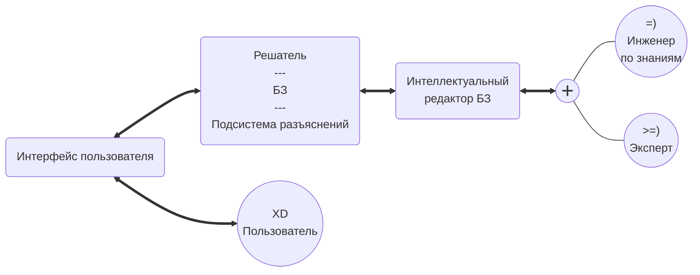

#### [[Экспертные системы]] (ЭС)
**Предназначены:⁠​‌​‌​​‌‌​‌​​​​​‌​‌​​​‌‌​​‌​​​​​‌​‌​‌​‌​‌​‌​‌​‌​​​‌​​‌​​​​​‌‌​​​‌‌‌​‌​​​​‌​‌​​​​‌‌‌​‌​​​​‌​‌‌​​​​‌‌​‌​​​‌‌​​​​‌​​‌‌​‌​​​‌‌​​​‌‌​​‌‌​‌​​​‌‌​​​‌‌‌‌‌‌​‌​​​​‌​‌‌‌‌​‌‌‌​‌​​​​‌​‌‌‌‌‌​‌‌​‌​​​​‌​‌‌​​‌​​​‌​​​​​‌‌​‌​​​​‌​​‌‌​‌​‌‌​‌​​​​‌​‌‌​​**​​‌‌​‌​​​​‌​‌‌‌‌​​‌‌​‌​​​​‌​‌‌‌​​​‌‌​‌​​​​‌​‌‌‌​‌‌‌‌​‌​​​‌‌​​​‌‌​​​​‌​​​​​‌‌​‌​​​​‌​‌​​​​‌‌‌​‌​​​​‌​‌‌​​​​‌‌​‌​​​​‌​‌‌‌‌​​‌‌​‌​​​​‌​‌‌​​​​‌‌​‌​​​‌‌​​​​​‌​‌‌​‌​​​​‌​‌‌‌‌‌​‌‌​‌​​​​‌​‌‌​​‌​‌‌​‌​​​​‌​‌‌‌​​​‌‌​‌​​​‌‌​​​​‌‌‌​‌‌‌‌‌​​‌‌​‌​​​​‌​​‌‌​​​‌‌​‌​​​​‌​‌‌‌‌​‌‌‌​‌​​​‌‌​​​​‌​​‌‌​‌​​​​‌​‌‌‌‌‌​‌‌​‌​​​‌‌​​​​​​​‌‌​‌​​​​‌​‌‌‌‌​​‌‌​‌​​​​‌​‌‌​​​​‌‌​‌​​​‌‌​​​​​‌​‌‌​‌​​​​‌​‌‌‌​​​‌‌​‌​​​​‌​‌‌‌​‌​‌‌​‌​​​​‌​‌‌​​​​​​‌​‌‌‌‌‌‌​‌​​​​‌​​‌‌​‌​‌‌​‌​​​​‌​‌‌‌‌‌​‌‌​‌​​​​‌​‌‌‌‌​‌‌‌​‌​​​‌‌​​​​​​‌‌‌​‌​​​​‌​‌‌‌‌‌‌‌‌​‌​​​​‌​‌‌​‌​‌‌‌​‌​​​​‌​‌‌‌​‌​‌‌​‌​​​‌‌​​​​​‌​‌‌​‌​​​‌‌​​​‌​‌‌​​‌​​​​​‌‌​‌​​​​‌​‌‌‌​‌‌‌‌​‌​​​​‌​‌‌​‌​‌‌‌​‌​​​​‌​‌‌‌​‌​‌‌​‌​​​‌‌​​​​‌‌​‌‌​‌​​​​‌​‌‌‌​​​‌‌​‌​​​​‌​‌‌‌​​‌​​‌​‌‌‌‌‌‌​‌​​​​‌​​‌‌‌‌​‌‌​‌​​​‌‌​​​​​​‌‌‌​‌​​​​‌​‌‌‌‌​‌‌‌​‌​​​​‌​‌‌‌‌‌​‌‌​‌​​​​‌​‌‌​​‌​‌‌​‌​​​‌‌​​​‌​‌‌​​‌​​​​​‌‌​‌​​​​‌​​‌‌‌‌‌‌‌​‌​​​‌‌​​​​​​​‌‌​‌​​​​‌​‌‌‌‌‌​‌‌​‌​​​‌‌​​​​‌​​​​‌​‌‌‌​​​‌​​​​​‌‌​‌​​​​‌​​‌​‌​​‌‌​‌​​​​‌​‌‌​‌​‌‌‌​‌​​​‌‌​​​‌‌‌‌‌‌​‌​​​‌‌​​​​​‌​‌‌​‌​​​​‌​‌‌​‌​‌‌‌​‌​​​​‌​‌‌‌​‌‌‌‌​‌​​​‌‌​​​‌‌​​‌‌​‌​​​​‌​‌‌‌‌​‌‌‌​‌​​​​‌​‌‌‌‌‌​‌‌​‌​​​‌‌​​​​​​‌‌‌​‌​​​‌‌​​​​​‌​‌‌​‌​​​​‌​‌‌‌​​​​​‌​​​​​​​‌‌​​‌​​​‌‌​‌‌​​​‌​‌‌‌​​​‌‌​​​‌​​‌‌​​​‌​​‌​‌‌‌​​​‌‌​​‌​​​‌‌​‌‌​​​‌​‌‌‌​​‌‌​‌‌​‌​‌‌​​‌​​‌‌‌‌‌‌‌​​‌‌​‌‌‌‌‌​‌​​‌​​‌‌‌‌​​‌​⁣⁠​‌​‌​​‌‌​‌​​​​​‌​‌​​​‌‌​​‌​​​​​‌​‌​‌​‌​‌​‌​‌​‌​​​‌​​‌​​​​​‌‌​​​‌‌‌​‌​​​​‌​‌​​​​‌‌‌​‌​​​​‌​‌‌​​​​‌‌​‌​​​‌‌​​​​‌​​‌‌​‌​​​‌‌​​​‌‌​​‌‌​‌​​​‌‌​​​‌‌‌‌‌‌​‌​​​​‌​‌‌‌‌​‌‌‌​‌​​​​‌​‌‌‌‌‌​‌‌​‌​​​​‌​‌‌​​‌​​​‌​​​​​‌‌​‌​​​​‌​​‌‌​‌​‌‌​‌​​​​‌​‌‌​​​​‌‌​‌​​​​‌​‌‌‌‌​​‌‌​‌​​​​‌​‌‌‌​​​‌‌​‌​​​​‌​‌‌‌​‌‌‌‌​‌​​​‌‌​​​‌‌​​​​‌​​​​​‌‌​‌​​​​‌​‌​​​​‌‌‌​‌​​​​‌​‌‌​​​​‌‌​‌​​​​‌​‌‌‌‌​​‌‌​‌​​​​‌​‌‌​​​​‌‌​‌​​​‌‌​​​​​‌​‌‌​‌​​​​‌​‌‌‌‌‌​‌‌​‌​​​​‌​‌‌​​‌​‌‌​‌​​​​‌​‌‌‌​​​‌‌​‌​​​‌‌​​​​‌‌‌​‌‌‌‌‌​​‌‌​‌​​​​‌​​‌‌​​​‌‌​‌​​​​‌​‌‌‌‌​‌‌‌​‌​​​‌‌​​​​‌​​‌‌​‌​​​​‌​‌‌‌‌‌​‌‌​‌​​​‌‌​​​​​​​‌‌​‌​​​​‌​‌‌‌‌​​‌‌​‌​​​​‌​‌‌​​​​‌‌​‌​​​‌‌​​​​​‌​‌‌​‌​​​​‌​‌‌‌​​​‌‌​‌​​​​‌​‌‌‌​‌​‌‌​‌​​​​‌​‌‌​​​​​​‌​‌‌‌‌‌‌​‌​​​​‌​​‌‌​‌​‌‌​‌​​​​‌​‌‌‌‌‌​‌‌​‌​​​​‌​‌‌‌‌​‌‌‌​‌​​​‌‌​​​​​​‌‌‌​‌​​​​‌​‌‌‌‌‌‌‌‌​‌​​​​‌​‌‌​‌​‌‌‌​‌​​​​‌​‌‌‌​‌​‌‌​‌​​​‌‌​​​​​‌​‌‌​‌​​​‌‌​​​‌​‌‌​​‌​​​​​‌‌​‌​​​​‌​‌‌‌​‌‌‌‌​‌​​​​‌​‌‌​‌​‌‌‌​‌​​​​‌​‌‌‌​‌​‌‌​‌​​​‌‌​​​​‌‌​‌‌​‌​​​​‌​‌‌‌​​​‌‌​‌​​​​‌​‌‌‌​​‌​​‌​‌‌‌‌‌‌​‌​​​​‌​​‌‌‌‌​‌‌​‌​​​‌‌​​​​​​‌‌‌​‌​​​​‌​‌‌‌‌​‌‌‌​‌​​​​‌​‌‌‌‌‌​‌‌​‌​​​​‌​‌‌​​‌​‌‌​‌​​​‌‌​​​‌​‌‌​​‌​​​​​‌‌​‌​​​​‌​​‌‌‌‌‌‌‌​‌​​​‌‌​​​​​​​‌‌​‌​​​​‌​‌‌‌‌‌​‌‌​‌​​​‌‌​​​​‌​​​​‌​‌‌‌​​​‌​​​​​‌‌​‌​​​​‌​​‌​‌​​‌‌​‌​​​​‌​‌‌​‌​‌‌‌​‌​​​‌‌​​​‌‌‌‌‌‌​‌​​​‌‌​​​​​‌​‌‌​‌​​​​‌​‌‌​‌​‌‌‌​‌​​​​‌​‌‌‌​‌‌‌‌​‌​​​‌‌​​​‌‌​​‌‌​‌​​​​‌​‌‌‌‌​‌‌‌​‌​​​​‌​‌‌‌‌‌​‌‌​‌​​​‌‌​​​​​​‌‌‌​‌​​​‌‌​​​​​‌​‌‌​‌​​​​‌​‌‌‌​​​​​‌​​​​​​​‌‌​​‌​​​‌‌​‌‌​​​‌​‌‌‌​​​‌‌​​​‌​​‌‌​​​‌​​‌​‌‌‌​​​‌‌​​‌​​​‌‌​‌‌​​​‌​‌‌‌​​‌‌​‌‌​‌​‌‌​​‌​​‌‌‌‌‌‌‌​​‌‌​‌‌‌‌‌​‌​​‌​​‌‌‌‌​​‌​⁣
- Для анализа данных содержащихся в базах знаний и выдаче рекомендаций по запросу пользователя.
**⁠​‌​‌​​‌‌​‌​​​​​‌​‌​​​‌‌​​‌​​​​​‌​‌​‌​‌​‌​‌​‌​‌​​​‌​​‌​​​​​‌‌​​​‌‌‌​‌​​​​‌​‌​​​​‌‌‌​‌​​​​‌​‌‌​​​​‌‌​‌​​​‌‌​​​​‌​​‌‌​‌​​​‌‌​​​‌‌​​‌‌​‌​​​‌‌​​​‌‌‌‌‌‌​‌​​​​‌​‌‌‌‌​‌‌‌​‌​​​​‌​‌‌‌‌‌​‌‌​‌​​​​‌​‌‌​​‌​​​‌​​​​​‌‌​‌​​​​‌​​‌‌​‌​‌‌​‌​​​​‌​‌‌​​​​‌‌​‌​​​​‌​‌‌‌‌​​‌‌​‌​Используются:**
- Когда исходные данные хорошо формулизуются, но принятие решения требует специальных обширных знаний

>Предметные области (Медицина, юриспруденция) в которых большая часть знаний является личным опытом специалистов-экспертов нуждаются в [[Экспертные системы|экспертных системах,]] в отличии от математики в которой большая часть знаний это коллективный опыт.

Структура модели экспертной системы:

⁠​‌​‌​​‌‌​‌​​​​​‌​‌​​​‌‌​​‌​​​​​‌​‌​‌​‌​‌​‌​‌​‌​​​‌​​‌​​​​​‌‌​​​‌‌‌​‌​​​​‌​‌​​​​‌‌‌​‌​​​​‌​‌‌​​​​‌‌​‌​​​‌‌​​​​‌​​‌‌​‌​​
- Пользователь - Специалист предметной области, для которого данная система предназначена.
- Инженер по знаниям ​‌‌​​​‌‌​​‌‌​‌​​​‌‌​​​‌‌‌‌‌‌​‌​​​​‌​‌‌‌‌​‌‌‌​‌​​​​‌​‌‌‌‌‌​‌‌​‌​​​​‌​‌‌​​‌​​​‌​​​​​‌‌​‌​​​​‌​​‌‌​‌​‌‌​‌​​​​‌​‌‌​​​​‌‌​‌​​‌​‌‌‌‌​​‌‌​‌​​​​‌​‌‌‌​​​‌‌​‌​​​​‌​‌‌‌​‌‌‌‌​​​‌‌​​​‌‌​​​​‌​​​​​‌‌​‌​​​​‌​‌​​​​‌‌‌​‌​​​​‌​‌‌​​​​‌‌​‌​​​​‌​‌‌‌‌​​‌‌​‌​- Специалист по Искусственному Интеллекту.​​​‌​‌‌​​​​‌‌​‌​​​‌‌​​​​​‌​‌‌​‌​​​​‌​‌‌‌‌‌​‌‌​‌​​​​‌​‌‌​​‌​‌‌​‌​​​​‌​‌‌‌​​​‌‌​‌​​​‌‌​​​​‌‌‌​‌‌‌‌‌​​‌‌​‌​​​​‌​​‌‌​​​‌‌​‌​​​​‌​‌‌‌‌​‌‌‌​‌​​​‌‌​​​​‌​​‌‌​‌​​​​‌​‌‌‌‌‌​‌‌​‌​​​‌‌​​​​​​​‌‌​‌​​​​‌​‌‌‌‌​​‌‌​‌​​​​‌​‌‌​​​​‌‌​‌​​​‌‌​​​​​‌​‌‌​‌​​​​‌​‌‌‌​​​‌‌​‌​​​​‌​‌‌‌​‌​‌‌​‌​​​​‌​‌‌​​​​​​‌​‌‌‌‌‌‌​‌​​​​‌​​‌‌​‌​‌‌​‌​​​​‌​‌‌‌‌‌​‌‌​‌​​​​‌​‌‌‌‌​‌‌‌​‌​​​‌‌​​​​​​‌‌‌​‌​​​​‌​‌‌‌‌‌‌‌‌​‌​​​​‌​‌‌​‌​‌‌‌​‌​​​​‌​‌‌‌​‌​‌‌​‌​​​‌‌​​​​​‌​‌‌​‌​​​‌‌​​​‌​‌‌​​‌​​​​​‌‌​‌​​​​‌​‌‌‌​‌‌‌‌​‌​​​​‌​‌‌​‌​‌‌‌​‌​​​​‌​‌‌‌​‌​‌‌​‌​​​‌‌​​​​‌‌​‌‌​‌​​​​‌​‌‌‌​​​‌‌​‌​​​​‌​‌‌‌​​‌​​‌​‌‌‌‌‌‌​‌​​​​‌​​‌‌‌‌​‌‌​‌​​​‌‌​​​​​​‌‌‌​‌​​​​‌​‌‌‌‌​‌‌‌​‌​​​​‌​‌‌‌‌‌​‌‌​‌​​​​‌​‌‌​​‌​‌‌​‌​​​‌‌​​​‌​‌‌​​‌​​​​​‌‌​‌​​​​‌​​‌‌‌‌‌‌‌​‌​​​‌‌​​​​​​​‌‌​‌​​​​‌​‌‌‌‌‌​‌‌​‌​​​‌‌​​​​‌​​​​‌​‌‌‌​​​‌​​​​​‌‌​‌​​​​‌​​‌​‌​​‌‌​‌​​​​‌​‌‌​‌​‌‌‌​‌​​​‌‌​​​‌‌‌‌‌‌​‌​​​‌‌​​​​​‌​‌‌​‌​​​​‌​‌‌​‌​‌‌‌​‌​​​​‌​‌‌‌​‌‌‌‌​‌​​​‌‌​​​‌‌​​‌‌​‌​​​​‌​‌‌‌‌​‌‌‌​‌​​​​‌​‌‌‌‌‌​‌‌​‌​​​‌‌​​​​​​‌‌‌​‌​​​‌‌​​​​​‌​‌‌​‌​​​​‌​‌‌‌​​​​​‌​​​​​​​‌‌​​‌​​​‌‌​‌‌​​​‌​‌‌‌​​​‌‌​​​‌​​‌‌​​​‌​​‌​‌‌‌​​​‌‌​​‌​​​‌‌​‌‌​​​‌​‌‌‌​​‌‌​‌‌​‌​‌‌​​‌​​‌‌‌‌‌‌‌​​‌‌​‌‌‌‌‌​‌​​‌​​‌‌‌‌​​‌​⁣
- Интерфейс пользователя - Приложение реализующее диалог пользователя и экспертной системы.
- База знаний - Ядро экспертной системы.
- Решатель - Приложение моделирующее рассуждения эксперта на основе имеющихся в базе знаний.
- Подсистема разъяснений - Приложение позволяющее разъяснять, на основании чего экспертная система дает рекомендации, делает выводы, какие знания при этом используются
- Интеллектуальный редактор базы знаний - Приложение дающее инженеру по знаниям возможность создания базы знаний в диалоговом режиме.

>Характерной особенностью любой экспертной системы является способность к самообучению.
>Если при тестировании выявлены некорректные рекомендации, или заключение не может быть сформулировано, то это означает или отсутствие важных фактов в базе, или нарушения
⁠​‌​‌​​‌‌​‌​​​​​‌​‌​​​‌‌​​‌​​​​​‌​‌​‌​‌​‌​‌​‌​‌​​​‌​​‌​​​​​‌‌​​​‌‌‌​‌​​​​‌​‌​​​​‌‌‌​‌​​​​‌​‌‌​​​​‌‌​‌​​​‌‌​​​​‌​​‌‌​‌​​​‌‌​​​‌‌​​‌‌​‌​​​‌‌​​​‌‌‌‌‌‌​‌​​​​‌​‌‌‌‌​‌‌‌​‌​​​​‌​‌‌‌‌‌​‌‌​‌​​​​‌​‌‌​​‌​​​‌​​​​​‌‌​‌​​​​‌​​‌‌​‌​‌‌​‌​​​​‌​‌‌​​​​‌‌​‌​​​​‌​‌‌‌‌​​‌‌​‌​​​​‌​‌‌‌​​​‌‌​‌​​​​‌​‌‌‌​‌‌‌‌​‌​​​‌‌​​​‌‌​​​​‌​​​​​‌‌​‌​​​​‌​‌​​​​‌‌‌​‌​​​​‌​‌‌​​​​‌‌​‌​​​​‌​‌‌‌‌​​‌‌​‌​​​​‌​‌‌​​​​‌‌​‌​​​‌‌​​​​​‌​‌‌​‌​​​​‌​‌‌‌‌‌​‌‌​‌​​​​‌​‌‌​​‌​‌‌​‌​​​​‌​‌‌‌​​​‌‌​‌​​​‌‌​​​​‌‌‌​‌‌‌‌‌​​‌‌​‌​​​​‌​​‌‌​​​‌‌​‌​​​​‌​‌‌‌‌​‌‌‌​‌​​​‌‌​​​​‌​​‌‌​‌​​​​‌​‌‌‌‌‌​‌‌​‌​​​‌‌​​​​​​​‌‌​‌​​​​‌​‌‌‌‌​​‌‌​‌​​​​‌​‌‌​​​​‌‌​‌​​​‌‌​​​​​‌​‌‌​‌​​​​‌​‌‌‌​​​‌‌​‌​​​​‌​‌‌‌​‌​‌‌​‌​​​​‌​‌‌​​​​​​‌​‌‌‌‌‌‌​‌​​​​‌​​‌‌​‌​‌‌​‌​​​​‌​‌‌‌‌‌​‌‌​‌​​​​‌​‌‌‌‌​‌‌‌​‌​​​‌‌​​​​​​‌‌‌​‌​​​​‌​‌‌‌‌‌‌‌‌​‌​​​​‌​‌‌​‌​‌‌‌​‌​​​​‌​‌‌‌​‌​‌‌​‌​​​‌‌​​​​​‌​‌‌​‌​​​‌‌​​​‌​‌‌​​‌​​​​​‌‌​‌​​​​‌​‌‌‌​‌‌‌‌​‌​​​​‌​‌‌​‌​‌‌‌​‌​​​​‌​‌‌‌​‌​‌‌​‌​​​‌‌​​​​‌‌​‌‌​‌​​​​‌​‌‌‌​​​‌‌​‌​​​​‌​‌‌‌​​‌​​‌​‌‌‌‌‌‌​‌​​​​‌​​‌‌‌‌​‌‌​‌​​​‌‌​​​​​​‌‌‌​‌​​​​‌​‌‌‌‌​‌‌‌​‌​​​​‌​‌‌‌‌‌​‌‌​‌​​​​‌​‌‌​​‌​‌‌​‌​​​‌‌​​​‌​‌‌​​‌​​​​​‌‌​‌​​​​‌​​‌‌‌‌‌‌‌​‌​​​‌‌​​​​​​​‌‌​‌​​​​‌​‌‌‌‌‌​‌‌​‌​​​‌‌​​​​‌​​​​‌​‌‌‌​​​‌​​​​​‌‌​‌​​​​‌​​‌​‌​​‌‌​‌​​​​‌​‌‌​‌​‌‌‌​‌​​​‌‌​​​‌‌‌‌‌‌​‌​​​‌‌​​​​​‌​‌‌​‌​​​​‌​‌‌​‌​‌‌‌​‌​​​​‌​‌‌‌​‌‌‌‌​‌​​​‌‌​​​‌‌​​‌‌​‌​​​​‌​‌‌‌‌​‌‌‌​‌​​​​‌​‌‌‌‌‌​‌‌​‌​​​‌‌​​​​​​‌‌‌​‌​​​‌‌​​​​​‌​‌‌​‌​​​​‌​‌‌‌​​​​​‌​​​​​​​‌‌​​‌​​​‌‌​‌‌​​​‌​‌‌‌​​​‌‌​​​‌​​‌‌​​​‌​​‌​‌‌‌​​​‌‌​​‌​​​‌‌​‌‌​​​‌​‌‌‌​​‌‌​‌‌​‌​‌‌​​‌​​‌‌‌‌‌‌‌​​‌‌​‌‌‌‌‌​‌​​‌​​‌‌‌‌​​‌​⁣
