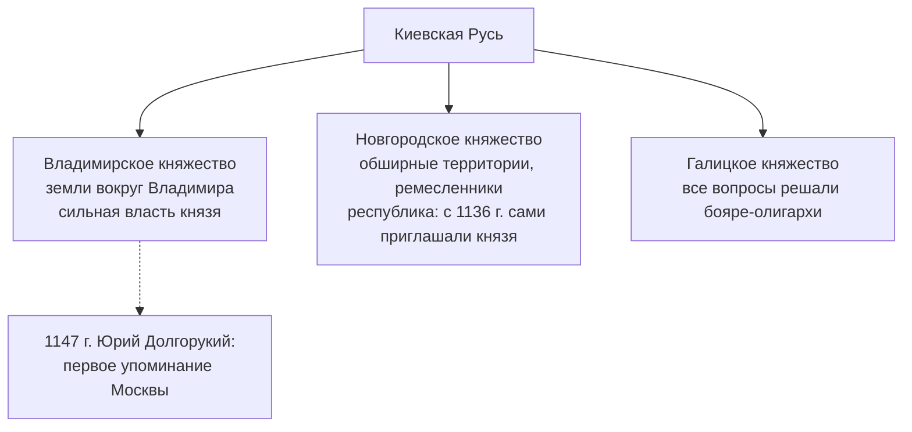

*Продолжение курса. Предыдущая лекция — [[История России 25.09.26|«Введение в курс»]]. Следующая — [[История России 09.10.26|«Русь и Золотая Орда. Объединение Руси»]].*⁠​‌​‌​​‌‌​‌​​​​​‌​‌​​​‌‌​​‌​​​​​‌​‌​‌​‌​‌​‌​‌​‌​​​‌​​‌​​​​​‌‌​​​‌‌‌​‌​​​​‌​‌​​​​‌‌‌​‌​​​​‌​‌‌​​​​‌‌​‌​​​‌‌​​​​‌​​‌‌​‌​​​‌‌​​​‌‌​​‌‌​‌​​​‌‌​​​‌‌‌‌‌‌​‌​​​​‌​‌‌‌‌​‌‌‌​‌​​​​‌​‌‌‌‌‌​‌‌​‌​​​​‌​‌‌​​‌​​​‌​​​​​‌‌​‌​​​​‌​​‌‌​‌​‌‌​‌​​​​‌​‌‌​​​​‌‌​‌​​​​‌​‌‌‌‌​​‌‌​‌​​​​‌​‌‌‌​​​‌‌​‌​​​​‌​‌‌‌​‌‌‌‌​‌​​​‌‌​​​‌‌​​​​‌​​​​​‌‌​‌​​​​‌​‌​​​​‌‌‌​‌​​​​‌​‌‌​​​​‌‌​‌​​​​‌​‌‌‌‌​​‌‌​‌​​​​‌​‌‌​​​​‌‌​‌​​​‌‌​​​​​‌​‌‌​‌​​​​‌​‌‌‌‌‌​‌‌​‌​​​​‌​‌‌​​‌​‌‌​‌​​​​‌​‌‌‌​​​‌‌​‌​​​‌‌​​​​‌‌‌​‌‌‌‌‌​​‌‌​‌​​​​‌​​‌‌​​​‌‌​‌​​​‌‌​​​​​​‌‌‌​‌​​​‌‌​​​​​‌​‌‌​‌​​​​‌​‌‌‌‌‌​‌‌​‌​​​‌‌​​​​​​​‌‌​‌​​​​‌​‌‌‌​​​‌‌​‌​​​‌‌​​​‌‌‌‌​​‌​​​​​‌‌​‌​​​​‌​‌​​​​​‌‌​‌​​​​‌​‌‌‌‌‌​‌‌​‌​​​‌‌​​​​​​‌‌‌​‌​​​‌‌​​​​​​‌‌‌​‌​​​​‌​‌‌‌​​​‌‌​‌​​​​‌​‌‌‌​​​​​‌​‌‌‌‌‌‌​‌​​​​‌​​‌‌​‌​‌‌​‌​​​​‌​‌‌‌‌‌​‌‌​‌​​​​‌​‌‌‌‌​‌‌‌​‌​​​‌‌​​​​​​‌‌‌​‌​​​​‌​‌‌‌‌‌‌‌‌​‌​​​​‌​‌‌​‌​‌‌‌​‌​​​​‌​‌‌‌​‌​‌‌​‌​​​‌‌​​​​​‌​‌‌​‌​​​‌‌​​​‌​‌‌​​‌​​​​​‌‌​‌​​​​‌​‌‌‌​‌‌‌‌​‌​​​​‌​‌‌​‌​‌‌‌​‌​​​​‌​‌‌‌​‌​‌‌​‌​​​‌‌​​​​‌‌​‌‌​‌​​​​‌​‌‌‌​​​‌‌​‌​​​​‌​‌‌‌​​‌​​‌​‌‌‌‌‌‌​‌​​​​‌​​‌‌​​​‌‌​‌​​​‌‌​​​​​​‌‌‌​‌​​​‌‌​​​​​‌​‌‌​‌​​​​‌​‌‌‌‌‌​‌‌​‌​​​‌‌​​​​​​​‌‌​‌​​​​‌​‌‌‌​​​‌‌​‌​​​‌‌​​​‌‌‌‌​​‌​​​​​‌‌​‌​​​​‌​‌​​​​​‌‌​‌​​​​‌​‌‌‌‌‌​‌‌​‌​​​‌‌​​​​​​‌‌‌​‌​​​‌‌​​​​​​‌‌‌​‌​​​​‌​‌‌‌​​​‌‌​‌​​​​‌​‌‌‌​​​​​‌​​​​​​​‌‌​​​​​​‌‌​​‌‌​​‌​‌‌‌​​​‌‌​​​‌​​‌‌​​​​​​‌​‌‌‌​​​‌‌​​‌​​​‌‌​‌‌​​​‌​‌‌‌​​‌‌​‌‌​‌​‌‌​​‌​​​​‌‌‌‌​​​‌​‌‌‌‌​​‌‌​‌‌‌‌‌​‌‌‌​​‌⁣

> «Мы слишком великие, чтобы быть эгоистами»
>
> «География — это судьба»

## План лекции

1. [Восток и Запад: два пути развития](#восток-и-запад-два-пути-развития)
2. [Вклад античности: основатели демократии](#вклад-античности-основатели-демократии)
3. [Начало государственности на Руси](#начало-государственности-на-руси)
4. [Русь и Золотая Орда](#русь-и-золотая-орда)

---

# Восток и Запад: два пути развития

| Критерий  | Восток                                               | Запад (античность)                               |
| --------- | ---------------------------------------------------- | ------------------------------------------------ |
| Экономика | Государственная и [[Община\|общинная собственность]] | Элементы частной собственности                   |
| Политика  | Деспотия, насилие, постоянные войска                 | Разделение властей, всеобщая воинская повинность |
| Религия   | Обслуживает государство                              | «Диалог» с богами                                |

## Вклад античности: основатели демократии

1. **Солон** (VI век до н.э.) — запретил долговое рабство.
2. **Перикл** — ввёл [[Мистофория|мистофорию]] (плату за государственные должности из казны), расширил права Народного собрания.
3. **Александр Македонский** — разбил персов, попытался создать единое евразийское сообщество.
4. **Цезарь** — самопровозглашённый диктатор, централизовал власть.
5. **Август** — заменил демократию империей.

---

# Начало государственности на Руси

> ***План лекции:***
>
> **Киевская Русь, 882–1097 (по другой периодизации — 1125) гг.**
>
> - [[#Население]]
> - [[#Особенности]]
> - [[#Расцвет Киевской Руси. Крещение 988. Ярослав Мудрый]]
> - [[#Раздробленность]]

## Население

| Народ      | Образ жизни | Основное занятие |
| ---------- | ----------- | ---------------- |
| Финно-угры | Бродячий    | Собирательство   |
| Тюрки      | Кочевой     | Скотоводство     |
| Славяне    | Оседлый     | Земледелие       |

## Особенности

- Не было античности.
- Всё начиналось с нуля: не было городов и ремёсел.
- Государство охраняло торговый путь из Балтийского моря в Чёрное («из варяг в греки»).
- Катализатором образования государства стали [[Норманна|норманны]] — Рюрик.

## Расцвет Киевской Руси. Крещение 988. Ярослав Мудрый

- **862 г.** — призвание Рюрика.
- **882 г.** — Киев становится столицей Древнерусского государства.
- **988 г.** — [[Крещение Руси]]: христианство становится государственной религией.
	- Идея подчинения князю.
	- Появление письменности → [[Повесть Временных Лет|летописи]].
	- Единая народность на основе общей религии и языка.
	- Церковь как общественный институт.
	- Строительство храмов.
	- Единство русских земель.
- **1019–1054 гг.** — правление Ярослава Мудрого:
	- первый свод законов — ***[[Русская Правда]]***;
	- династические браки с европейскими монархами;
	- появление [[Былина|былин]];
	- появление понятий о добре и зле.

## Раздробленность

- Закономерный процесс: [[Дружина|дружинники]] оседали на земле и строили свои храмы.

> Богаче храм → приезжают купцы → земля становится богаче → обеспечиваешь себе место в раю.

- Процесс был прерван нашествием шведов и немцев, а затем монголов: из-за раздробленности государство ослабло.

## Итоги Киевской Руси

Киевская Русь — государство:

- европейское;
- городское (большой процент городов);
- грамотное;
- не было феодальным.

Распалось примерно на 150 княжеств, из которых выделяются три главных центра:

- Крестовый поход на Новгород с целью окатоличивания:
	- ***[[Невская битва]]*** — 1240 г. (Александру Невскому 20 лет);
	- ***[[Ледовое побоище]]*** — 1242 г.

## Историки

==Татищев== — первый писал историю с точки зрения научных методов.
==Карамзин== — первый написал «Историю государства Российского» по заданию царя.
==Сергей Соловьёв== — автор «Истории России с древнейших времён», автор концепции о роли географии и природы в истории.
==Ключевский== — автор «Курса русской истории», выдающийся историк, мастер исторического афоризма.

## События в мире

| Европа                                                | Византия                              | Арабы                                                          |
| ----------------------------------------------------- | ------------------------------------- | -------------------------------------------------------------- |
| [[Крестовый поход\|Крестовые походы]], 1096–1291 гг.  | 395 г. — отделение от Запада          | 622 г. — Мухаммед переселяется из Мекки в Медину (хиджра)      |
| 1024 г. — угасание Константинополя                    | 1453 г. — завоевание турками-османами | 632 г. — образование [[Халифат\|Халифата]] на основе идей ислама |
| С XII века — университеты                             |                                       |                                                                |
| Английский парламент, 1265 г.                         |                                       |                                                                |

---

# Русь и Золотая [[Орда|орда]]

> **План:**
>
> 1. Монгольское нашествие.
> 2. Покорение. Отношения с Золотой Ордой.

## Монгольское нашествие

Чингиз-хана избирают великим ханом: он получил поддержку большинства вождей на съезде ([[Курултай|курултае]]), и ему поручили завоевать пространство «от моря до моря».

Монголы заимствовали у китайцев военные технологии — стенобитные приспособления для разрушения городов — и привлекли грамотных китайских чиновников; в делопроизводстве использовался уйгурский язык.

> %%Самостоятельный ответ%%
>
> В чём факторы силы монгольского войска и причины победы?

1. **Железная дисциплина и организация.** Строгая иерархия, деление войска по десятичной системе (десятки, сотни, тысячи, [[Тумен|тумены]]) и беспрекословное подчинение вождям.
2. **Тактика и стратегия (блицкриг).** Исключительная мобильность конницы, обманные манёвры (ложное отступление), охваты и стремительные удары.
3. **Заимствование военных технологий.** Передовые китайские и среднеазиатские осадные орудия (стенобитные машины, катапульты), привлечение инженеров для штурма укреплённых городов.
4. **Психологическая война и террор.** Жестокое уничтожение городов, оказавших сопротивление, ради запугивания остальных и принуждения к сдаче без боя.
5. **Разведка и логистика.** Тщательная предварительная разведка вражеских земель, продуманные пути снабжения и связи ([[Ямская служба]]).
6. **Идеология.** Вера в высшее предназначение покорить пространство «от моря до моря».

---

*Продолжение — [[История России 09.10.26|«Русь и Золотая Орда. Объединение Руси»]].*

⁠​‌​‌​​‌‌​‌​​​​​‌​‌​​​‌‌​​‌​​​​​‌​‌​‌​‌​‌​‌​‌​‌​​​‌​​‌​​​​​‌‌​​​‌‌‌​‌​​​​‌​‌​​​​‌‌‌​‌​​​​‌​‌‌​​​​‌‌​‌​​​‌‌​​​​‌​​‌‌​‌​​​‌‌​​​‌‌​​‌‌​‌​​​‌‌​​​‌‌‌‌‌‌​‌​​​​‌​‌‌‌‌​‌‌‌​‌​​​​‌​‌‌‌‌‌​‌‌​‌​​​​‌​‌‌​​‌​​​‌​​​​​‌‌​‌​​​​‌​​‌‌​‌​‌‌​‌​​​​‌​‌‌​​​​‌‌​‌​​​​‌​‌‌‌‌​​‌‌​‌​​​​‌​‌‌‌​​​‌‌​‌​​​​‌​‌‌‌​‌‌‌‌​‌​​​‌‌​​​‌‌​​​​‌​​​​​‌‌​‌​​​​‌​‌​​​​‌‌‌​‌​​​​‌​‌‌​​​​‌‌​‌​​​​‌​‌‌‌‌​​‌‌​‌​​​​‌​‌‌​​​​‌‌​‌​​​‌‌​​​​​‌​‌‌​‌​​​​‌​‌‌‌‌‌​‌‌​‌​​​​‌​‌‌​​‌​‌‌​‌​​​​‌​‌‌‌​​​‌‌​‌​​​‌‌​​​​‌‌‌​‌‌‌‌‌​​‌‌​‌​​​​‌​​‌‌​​​‌‌​‌​​​‌‌​​​​​​‌‌‌​‌​​​‌‌​​​​​‌​‌‌​‌​​​​‌​‌‌‌‌‌​‌‌​‌​​​‌‌​​​​​​​‌‌​‌​​​​‌​‌‌‌​​​‌‌​‌​​​‌‌​​​‌‌‌‌​​‌​​​​​‌‌​‌​​​​‌​‌​​​​​‌‌​‌​​​​‌​‌‌‌‌‌​‌‌​‌​​​‌‌​​​​​​‌‌‌​‌​​​‌‌​​​​​​‌‌‌​‌​​​​‌​‌‌‌​​​‌‌​‌​​​​‌​‌‌‌​​​​​‌​‌‌‌‌‌‌​‌​​​​‌​​‌‌​‌​‌‌​‌​​​​‌​‌‌‌‌‌​‌‌​‌​​​​‌​‌‌‌‌​‌‌‌​‌​​​‌‌​​​​​​‌‌‌​‌​​​​‌​‌‌‌‌‌‌‌‌​‌​​​​‌​‌‌​‌​‌‌‌​‌​​​​‌​‌‌‌​‌​‌‌​‌​​​‌‌​​​​​‌​‌‌​‌​​​‌‌​​​‌​‌‌​​‌​​​​​‌‌​‌​​​​‌​‌‌‌​‌‌‌‌​‌​​​​‌​‌‌​‌​‌‌‌​‌​​​​‌​‌‌‌​‌​‌‌​‌​​​‌‌​​​​‌‌​‌‌​‌​​​​‌​‌‌‌​​​‌‌​‌​​​​‌​‌‌‌​​‌​​‌​‌‌‌‌‌‌​‌​​​​‌​​‌‌​​​‌‌​‌​​​‌‌​​​​​​‌‌‌​‌​​​‌‌​​​​​‌​‌‌​‌​​​​‌​‌‌‌‌‌​‌‌​‌​​​‌‌​​​​​​​‌‌​‌​​​​‌​‌‌‌​​​‌‌​‌​​​‌‌​​​‌‌‌‌​​‌​​​​​‌‌​‌​​​​‌​‌​​​​​‌‌​‌​​​​‌​‌‌‌‌‌​‌‌​‌​​​‌‌​​​​​​‌‌‌​‌​​​‌‌​​​​​​‌‌‌​‌​​​​‌​‌‌‌​​​‌‌​‌​​​​‌​‌‌‌​​​​​‌​​​​​​​‌‌​​​​​​‌‌​​‌‌​​‌​‌‌‌​​​‌‌​​​‌​​‌‌​​​​​​‌​‌‌‌​​​‌‌​​‌​​​‌‌​‌‌​​​‌​‌‌‌​​‌‌​‌‌​‌​‌‌​​‌​​​​‌‌‌‌​​​‌​‌‌‌‌​​‌‌​‌‌‌‌‌​‌‌‌​​‌⁣
