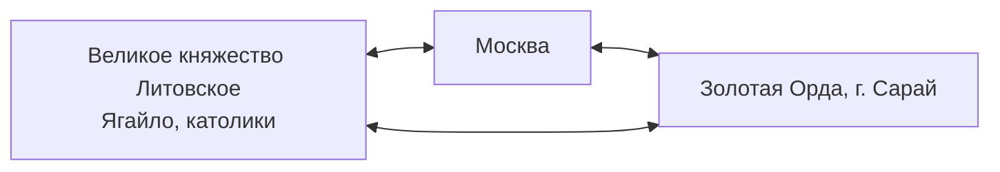

*Продолжение лекции [[История России 03.10.26|«Начало государственности на Руси. Русь и Золотая Орда»]].*⁠​‌​‌​​‌‌​‌​​​​​‌​‌​​​‌‌​​‌​​​​​‌​‌​‌​‌​‌​‌​‌​‌​​​‌​​‌​​​​​‌‌​​​‌‌‌​‌​​​​‌​‌​​​​‌‌‌​‌​​​​‌​‌‌​​​​‌‌​‌​​​‌‌​​​​‌​​‌‌​‌​​​‌‌​​​‌‌​​‌‌​‌​​​‌‌​​​‌‌‌‌‌‌​‌​​​​‌​‌‌‌‌​‌‌‌​‌​​​​‌​‌‌‌‌‌​‌‌​‌​​​​‌​‌‌​​‌​​​‌​​​​​‌‌​‌​​​​‌​​‌‌​‌​‌‌​‌​​​​‌​‌‌​​​​‌‌​‌​​​​‌​‌‌‌‌​​‌‌​‌​​​​‌​‌‌‌​​​‌‌​‌​​​​‌​‌‌‌​‌‌‌‌​‌​​​‌‌​​​‌‌​​​​‌​​​​​‌‌​‌​​​​‌​‌​​​​‌‌‌​‌​​​​‌​‌‌​​​​‌‌​‌​​​​‌​‌‌‌‌​​‌‌​‌​​​​‌​‌‌​​​​‌‌​‌​​​‌‌​​​​​‌​‌‌​‌​​​​‌​‌‌‌‌‌​‌‌​‌​​​​‌​‌‌​​‌​‌‌​‌​​​​‌​‌‌‌​​​‌‌​‌​​​‌‌​​​​‌‌‌​‌‌‌‌‌​​‌‌​‌​​​​‌​​‌‌​​​‌‌​‌​​​‌‌​​​​​​‌‌‌​‌​​​‌‌​​​​​‌​‌‌​‌​​​​‌​‌‌‌‌‌​‌‌​‌​​​‌‌​​​​​​​‌‌​‌​​​​‌​‌‌‌​​​‌‌​‌​​​‌‌​​​‌‌‌‌​​‌​​​​​‌‌​‌​​​​‌​‌​​​​​‌‌​‌​​​​‌​‌‌‌‌‌​‌‌​‌​​​‌‌​​​​​​‌‌‌​‌​​​‌‌​​​​​​‌‌‌​‌​​​​‌​‌‌‌​​​‌‌​‌​​​​‌​‌‌‌​​​​​‌​‌‌‌‌‌‌​‌​​​​‌​​‌‌​‌​‌‌​‌​​​​‌​‌‌‌‌‌​‌‌​‌​​​​‌​‌‌‌‌​‌‌‌​‌​​​‌‌​​​​​​‌‌‌​‌​​​​‌​‌‌‌‌‌‌‌‌​‌​​​​‌​‌‌​‌​‌‌‌​‌​​​​‌​‌‌‌​‌​‌‌​‌​​​‌‌​​​​​‌​‌‌​‌​​​‌‌​​​‌​‌‌​​‌​​​​​‌‌​‌​​​​‌​‌‌‌​‌‌‌‌​‌​​​​‌​‌‌​‌​‌‌‌​‌​​​​‌​‌‌‌​‌​‌‌​‌​​​‌‌​​​​‌‌​‌‌​‌​​​​‌​‌‌‌​​​‌‌​‌​​​​‌​‌‌‌​​‌​​‌​‌‌‌‌‌‌​‌​​​​‌​​‌‌​​​‌‌​‌​​​‌‌​​​​​​‌‌‌​‌​​​‌‌​​​​​‌​‌‌​‌​​​​‌​‌‌‌‌‌​‌‌​‌​​​‌‌​​​​​​​‌‌​‌​​​​‌​‌‌‌​​​‌‌​‌​​​‌‌​​​‌‌‌‌​​‌​​​​​‌‌​‌​​​​‌​‌​​​​​‌‌​‌​​​​‌​‌‌‌‌‌​‌‌​‌​​​‌‌​​​​​​‌‌‌​‌​​​‌‌​​​​​​‌‌‌​‌​​​​‌​‌‌‌​​​‌‌​‌​​​​‌​‌‌‌​​​​​‌​​​​​​​‌‌​​​​​​‌‌‌​​‌​​‌​‌‌‌​​​‌‌​​​‌​​‌‌​​​​​​‌​‌‌‌​​​‌‌​​‌​​​‌‌​‌‌​​​‌​‌‌‌​​‌‌​‌‌​‌​‌‌​​‌​​‌‌​‌​​‌​​​​‌‌‌​‌‌​​​‌‌‌​‌‌​​​​​‌⁣

## План лекции

1. [Монгольское нашествие на Русь](#монгольское-нашествие-на-русь)
2. [Золотая Орда и Русь](#золотая-орда-и-русь)
3. [Натиск с Запада](#натиск-с-запада)
4. [Исторический выбор столицы](#исторический-выбор-столицы)
5. [Объединение Руси](#объединение-руси)

---

# Монгольское нашествие на Русь

- **1223 г.** — [[Битва на Калке|Калка]]: первое проигранное сражение.
- Первым городом, подвергшимся сокрушительному разгрому, стала **Рязань** — оборонялась 5 дней.
- Затем — **Москва**.
- Следующим направлением стал **Новгород** — самый богатый город.
- Следом пало множество городов.
- **1240 г.** — разрушен **Киев**.

> Чингисхан: «Верхом на коне вы можете завоевать, но управлять вы не сможете».

Образное выражение про дань — «высасывание крови из Руси».

# Золотая Орда и Русь

- **[[Улус|Улус Джучи]]** — государство Золотой Орды; контролировало огромную территорию, включая Русь.
- Русь не входила в Золотую Орду, а была для неё «карманом» для сбора денег.
- Главный князь на Руси — **Владимирский**.
- **1312 г.** — в Орде принят [[Ислам]] как государственная религия.

> **Оценка Золотой Орды:**
>
> - Ордынское время длилось очень долго — с **1243 по 1480 г.** (220–240 лет).
> - Природа России без Золотой Орды непонятна.

- **Конец Орды** связан не только с сопротивлением русских:
	- Идегей подточил Орду, поссорился с Тохтамышем;
	- Тамерлан (Тимур) пошёл на Орду по жалобе Идегея и пошатнул её экономику;
	- началась смута и смена ханов.

# Натиск с Запада

- **1240 г.** — в устье Невы высаживаются шведы-католики, начинается крестовый поход.
	- [[Невская битва]]: Александр Невский блестяще применил тактику и отстоял Балтийское море для Руси.
- **1242 г.** — немцы-крестоносцы, [[Ледовое побоище]].
	- Ремесленники Новгорода благодаря тактике Невского выиграли.
	- С тех пор католики не приходили.
- **Александр Невский** выбрал в союзники Золотую Орду против немцев; был великим Владимирским князем, выпрашивал льготы у Орды.

# Исторический выбор столицы

Борьба шла между тремя центрами: [[Великое княжество Литовское|Литвой]], Москвой и Золотой Ордой. Литва не стала центром объединения: её правитель Ягайло принял католичество и ориентировался на Польшу, поэтому «не наша столица».

---

# Объединение Руси

> **Структура лекции:**
>
> 1. Климат и ландшафт Московской Руси.
> 2. Возвышение Москвы.
> 3. Иван III.

## Климат и ландшафт Московской Руси

Именно на этой земле будет формироваться государство. *«География — это судьба».*

**Отрицательные черты:**

1. Низкая средняя температура января (в Европе теплее из-за тёплого течения) → лишние расходы.
2. Периодические засухи → необходимость жить коллективно.
3. Неплодородные почвы, отсутствие чернозёма → нет прибавочного продукта и капитала; приходится работать «на прокорм», нет запасов для построения капитализма.
4. Нет выхода к тёплым морям → нет связи с Европой и дешёвого транспорта.
5. Внешние границы не были защищены естественными преградами → открыт путь кочевникам, враждебные соседи → большие оборонные расходы.

**Плюсы:**

1. Реки — дороги.
2. Большая площадь — можно уйти куда угодно.

## Возвышение Москвы

- Золотая Орда — часть истории России и образец управления: Московская Русь строилась по «референсу» Золотой Орды.

| Год  | Событие                                                                                       |
| ---- | --------------------------------------------------------------------------------------------- |
| 1147 | Юрий Долгорукий — первое упоминание Москвы                                                     |
| 1300 | Основание Московского княжества                                                               |
| 1328 | Иван Калита — получил [[Ярлык(на Руси)\|ярлык]], сделал Москву финансовым центром (хитрый князь) |
| 1380 | [[Куликовская битва]] — Москва становится авторитетно-военным центром                          |

## Иван III

> Разбор — на следующей лекции.

⁠​‌​‌​​‌‌​‌​​​​​‌​‌​​​‌‌​​‌​​​​​‌​‌​‌​‌​‌​‌​‌​‌​​​‌​​‌​​​​​‌‌​​​‌‌‌​‌​​​​‌​‌​​​​‌‌‌​‌​​​​‌​‌‌​​​​‌‌​‌​​​‌‌​​​​‌​​‌‌​‌​​​‌‌​​​‌‌​​‌‌​‌​​​‌‌​​​‌‌‌‌‌‌​‌​​​​‌​‌‌‌‌​‌‌‌​‌​​​​‌​‌‌‌‌‌​‌‌​‌​​​​‌​‌‌​​‌​​​‌​​​​​‌‌​‌​​​​‌​​‌‌​‌​‌‌​‌​​​​‌​‌‌​​​​‌‌​‌​​​​‌​‌‌‌‌​​‌‌​‌​​​​‌​‌‌‌​​​‌‌​‌​​​​‌​‌‌‌​‌‌‌‌​‌​​​‌‌​​​‌‌​​​​‌​​​​​‌‌​‌​​​​‌​‌​​​​‌‌‌​‌​​​​‌​‌‌​​​​‌‌​‌​​​​‌​‌‌‌‌​​‌‌​‌​​​​‌​‌‌​​​​‌‌​‌​​​‌‌​​​​​‌​‌‌​‌​​​​‌​‌‌‌‌‌​‌‌​‌​​​​‌​‌‌​​‌​‌‌​‌​​​​‌​‌‌‌​​​‌‌​‌​​​‌‌​​​​‌‌‌​‌‌‌‌‌​​‌‌​‌​​​​‌​​‌‌​​​‌‌​‌​​​‌‌​​​​​​‌‌‌​‌​​​‌‌​​​​​‌​‌‌​‌​​​​‌​‌‌‌‌‌​‌‌​‌​​​‌‌​​​​​​​‌‌​‌​​​​‌​‌‌‌​​​‌‌​‌​​​‌‌​​​‌‌‌‌​​‌​​​​​‌‌​‌​​​​‌​‌​​​​​‌‌​‌​​​​‌​‌‌‌‌‌​‌‌​‌​​​‌‌​​​​​​‌‌‌​‌​​​‌‌​​​​​​‌‌‌​‌​​​​‌​‌‌‌​​​‌‌​‌​​​​‌​‌‌‌​​​​​‌​‌‌‌‌‌‌​‌​​​​‌​​‌‌​‌​‌‌​‌​​​​‌​‌‌‌‌‌​‌‌​‌​​​​‌​‌‌‌‌​‌‌‌​‌​​​‌‌​​​​​​‌‌‌​‌​​​​‌​‌‌‌‌‌‌‌‌​‌​​​​‌​‌‌​‌​‌‌‌​‌​​​​‌​‌‌‌​‌​‌‌​‌​​​‌‌​​​​​‌​‌‌​‌​​​‌‌​​​‌​‌‌​​‌​​​​​‌‌​‌​​​​‌​‌‌‌​‌‌‌‌​‌​​​​‌​‌‌​‌​‌‌‌​‌​​​​‌​‌‌‌​‌​‌‌​‌​​​‌‌​​​​‌‌​‌‌​‌​​​​‌​‌‌‌​​​‌‌​‌​​​​‌​‌‌‌​​‌​​‌​‌‌‌‌‌‌​‌​​​​‌​​‌‌​​​‌‌​‌​​​‌‌​​​​​​‌‌‌​‌​​​‌‌​​​​​‌​‌‌​‌​​​​‌​‌‌‌‌‌​‌‌​‌​​​‌‌​​​​​​​‌‌​‌​​​​‌​‌‌‌​​​‌‌​‌​​​‌‌​​​‌‌‌‌​​‌​​​​​‌‌​‌​​​​‌​‌​​​​​‌‌​‌​​​​‌​‌‌‌‌‌​‌‌​‌​​​‌‌​​​​​​‌‌‌​‌​​​‌‌​​​​​​‌‌‌​‌​​​​‌​‌‌‌​​​‌‌​‌​​​​‌​‌‌‌​​​​​‌​​​​​​​‌‌​​​​​​‌‌‌​​‌​​‌​‌‌‌​​​‌‌​​​‌​​‌‌​​​​​​‌​‌‌‌​​​‌‌​​‌​​​‌‌​‌‌​​​‌​‌‌‌​​‌‌​‌‌​‌​‌‌​​‌​​‌‌​‌​​‌​​​​‌‌‌​‌‌​​​‌‌‌​‌‌​​​​​‌⁣
