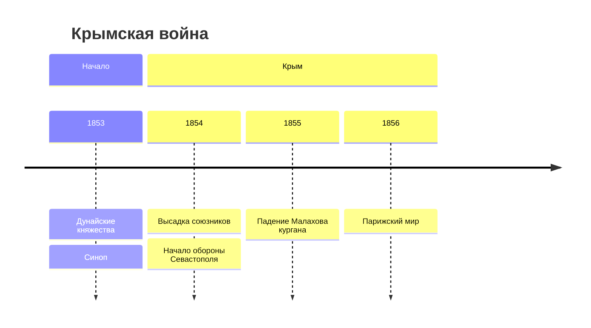
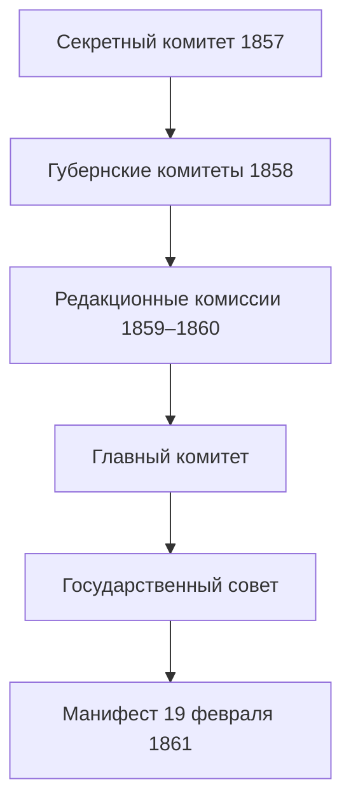

# Начало буржуазной модернизации

## План лекции
1. [[#Николай I (мрачное 30-ти летие)⁠​‌​‌​​‌‌​‌​​​​​‌​‌​​​‌‌​​‌​​​​​‌​‌​‌​‌​‌​‌​‌​‌​​​‌​​‌​​​​​‌‌​​​‌‌‌​‌​​​​‌​‌​​​​‌‌‌​‌​​​​‌​‌‌​​​​‌‌​‌​​​‌‌​​​​‌​​‌‌​‌​​​‌‌​​​‌‌​​‌‌​‌​​​‌‌​​​‌‌‌‌‌‌​‌​​​​‌​‌‌‌‌​‌‌‌​‌​​​​‌​‌‌‌‌‌​‌‌​‌​​​​‌​‌‌​​‌​​​‌​​​​​‌‌​‌​​​​‌​]]​‌‌​‌​‌‌​‌​​​​‌​‌‌​​​​‌‌​‌​​​​‌​‌‌‌‌​​‌‌​‌​​​​‌​‌‌‌​​​‌‌​‌​​​​‌​‌‌‌​‌‌‌‌​‌​​​‌‌​​​‌‌​​​​‌​​​​​‌‌​‌​​​​‌​‌​​​​‌‌‌​‌​​​​‌​‌‌​​​​‌‌​‌​​​​‌​‌‌‌‌​​‌‌​‌​​​​‌​‌‌​​​​‌‌​‌​​​‌‌​​​​​‌​‌‌​‌​​​​‌​‌‌‌‌‌​‌‌​‌​​​​‌​‌‌​​‌​‌‌​‌​​​​‌​‌‌‌​​​‌‌​‌​​​‌‌​​​​‌‌‌​‌‌‌‌‌​​‌‌​‌​​​​‌​​‌‌​​​‌‌​‌​​​‌‌​​​​​​‌‌‌​‌​​​‌‌​​​​​‌​‌‌​‌​​​​‌​‌‌‌‌‌​‌‌​‌​​​‌‌​​​​​​​‌‌​‌​​​​‌​‌‌‌​​​‌‌​‌​​​‌‌​​​‌‌‌‌​​‌​​​​​‌‌​‌​​​​‌​‌​​​​​‌‌​‌​​​​‌​‌‌‌‌‌​‌‌​‌​​​‌‌​​​​​​‌‌‌​‌​​​‌‌​​​​​​‌‌‌​‌​​​​‌​‌‌‌​​​‌‌​‌​​​​‌​‌‌‌​​​​​‌​‌‌‌‌‌‌​‌​​​​‌​​‌‌​‌​‌‌​‌​​​​‌​‌‌‌‌‌​‌‌​‌​​​​‌​‌‌‌‌​‌‌‌​‌​​​‌‌​​​​​​‌‌‌​‌​​​​‌​‌‌‌‌‌‌‌‌​‌​​​​‌​‌‌​‌​‌‌‌​‌​​​​‌​‌‌‌​‌​‌‌​‌​​​‌‌​​​​​‌​‌‌​‌​​​‌‌​​​‌​‌‌​​‌​​​​​‌‌​‌​​​​‌​‌‌‌​‌‌‌‌​‌​​​​‌​‌‌​‌​‌‌‌​‌​​​​‌​‌‌‌​‌​‌‌​‌​​​‌‌​​​​‌‌​‌‌​‌​​​​‌​‌‌‌​​​‌‌​‌​​​​‌​‌‌‌​​‌​​‌​‌‌‌‌‌‌​‌​​​​‌​​‌‌​​​‌‌​‌​​​‌‌​​​​​​‌‌‌​‌​​​‌‌​​​​​‌​‌‌​‌​​​​‌​‌‌‌‌‌​‌‌​‌​​​‌‌​​​​​​​‌‌​‌​​​​‌​‌‌‌​​​‌‌​‌​​​‌‌​​​‌‌‌‌​​‌​​​​​‌‌​‌​​​​‌​‌​​​​​‌‌​‌​​​​‌​‌‌‌‌‌​‌‌​‌​​​‌‌​​​​​​‌‌‌​‌​​​‌‌​​​​​​‌‌‌​‌​​​​‌​‌‌‌​​​‌‌​‌​​​​‌​‌‌‌​​​​​‌​​​​​​​‌‌​​‌​​​‌‌​​​​​​‌​‌‌‌​​​‌‌​​​‌​​‌‌​​​‌​​‌​‌‌‌​​​‌‌​​‌​​​‌‌​‌‌​​​‌​‌‌‌​​‌‌​‌‌​‌​‌‌​​‌​​‌​‌‌​‌​​‌‌‌‌‌​​‌​​​​​​​‌‌​​​‌​​​⁣⁠​‌​‌​​‌‌​‌​​​​​‌​‌​​​‌‌​​‌​​​​​‌​‌​‌​‌​‌​‌​‌​‌​​​‌​​‌​​​​​‌‌​​​‌‌‌​‌​​​​‌​‌​​​​‌‌‌​‌​​​​‌​‌‌​​​​‌‌​‌​​​‌‌​​​​‌​​‌‌​‌​​​‌‌​​​‌‌​​‌‌​‌​​​‌‌​​​‌‌‌‌‌‌​‌​​​​‌​‌‌‌‌​‌‌‌​‌​​​​‌​‌‌‌‌‌​‌‌​‌​​​​‌​‌‌​​‌​​​‌​​​​​‌‌​‌​​​​‌​​‌‌​‌​‌‌​‌​​​​‌​‌‌​​​​‌‌​‌​​​​‌​‌‌‌‌​​‌‌​‌​​​​‌​‌‌‌​​​‌‌​‌​​​​‌​‌‌‌​‌‌‌‌​‌​​​‌‌​​​‌‌​​​​‌​​​​​‌‌​‌​​​​‌​‌​​​​‌‌‌​‌​​​​‌​‌‌​​​​‌‌​‌​​​​‌​‌‌‌‌​​‌‌​‌​​​​‌​‌‌​​​​‌‌​‌​​​‌‌​​​​​‌​‌‌​‌​​​​‌​‌‌‌‌‌​‌‌​‌​​​​‌​‌‌​​‌​‌‌​‌​​​​‌​‌‌‌​​​‌‌​‌​​​‌‌​​​​‌‌‌​‌‌‌‌‌​​‌‌​‌​​​​‌​​‌‌​​​‌‌​‌​​​‌‌​​​​​​‌‌‌​‌​​​‌‌​​​​​‌​‌‌​‌​​​​‌​‌‌‌‌‌​‌‌​‌​​​‌‌​​​​​​​‌‌​‌​​​​‌​‌‌‌​​​‌‌​‌​​​‌‌​​​‌‌‌‌​​‌​​​​​‌‌​‌​​​​‌​‌​​​​​‌‌​‌​​​​‌​‌‌‌‌‌​‌‌​‌​​​‌‌​​​​​​‌‌‌​‌​​​‌‌​​​​​​‌‌‌​‌​​​​‌​‌‌‌​​​‌‌​‌​​​​‌​‌‌‌​​​​​‌​‌‌‌‌‌‌​‌​​​​‌​​‌‌​‌​‌‌​‌​​​​‌​‌‌‌‌‌​‌‌​‌​​​​‌​‌‌‌‌​‌‌‌​‌​​​‌‌​​​​​​‌‌‌​‌​​​​‌​‌‌‌‌‌‌‌‌​‌​​​​‌​‌‌​‌​‌‌‌​‌​​​​‌​‌‌‌​‌​‌‌​‌​​​‌‌​​​​​‌​‌‌​‌​​​‌‌​​​‌​‌‌​​‌​​​​​‌‌​‌​​​​‌​‌‌‌​‌‌‌‌​‌​​​​‌​‌‌​‌​‌‌‌​‌​​​​‌​‌‌‌​‌​‌‌​‌​​​‌‌​​​​‌‌​‌‌​‌​​​​‌​‌‌‌​​​‌‌​‌​​​​‌​‌‌‌​​‌​​‌​‌‌‌‌‌‌​‌​​​​‌​​‌‌​​​‌‌​‌​​​‌‌​​​​​​‌‌‌​‌​​​‌‌​​​​​‌​‌‌​‌​​​​‌​‌‌‌‌‌​‌‌​‌​​​‌‌​​​​​​​‌‌​‌​​​​‌​‌‌‌​​​‌‌​‌​​​‌‌​​​‌‌‌‌​​‌​​​​​‌‌​‌​​​​‌​‌​​​​​‌‌​‌​​​​‌​‌‌‌‌‌​‌‌​‌​​​‌‌​​​​​​‌‌‌​‌​​​‌‌​​​​​​‌‌‌​‌​​​​‌​‌‌‌​​​‌‌​‌​​​​‌​‌‌‌​​​​​‌​​​​​​​‌‌​​‌​​​‌‌​​​​​​‌​‌‌‌​​​‌‌​​​‌​​‌‌​​​‌​​‌​‌‌‌​​​‌‌​​‌​​​‌‌​‌‌​​​‌​‌‌‌​​‌‌​‌‌​‌​‌‌​​‌​​‌​‌‌​‌​​‌‌‌‌‌​​‌​​​​​​​‌‌​​​‌​​​⁣
2. [[#Нулевая мировая война (Крымская 1853–1856)]]
3. [[#Тенденции второй половины XIX века в мире|Тенденции второй половины 19-го века в мире.]]
4. [[#Начало великих реформ. Александр II (1855–1881)|Начало великих реформ 1860-1870]]

> *У России 2 беды: дураки и дороги. 
> - М. Задорнов*

---

## Николай I (мрачное 30-ти летие)⁠​‌​‌​​‌‌​‌​​​​​‌​‌​​​‌‌​​‌​​​​​‌​‌​‌​‌​‌​‌​‌​‌​​​‌​​‌​​​​​‌‌​​​‌‌‌​‌​​​​‌​‌​

Николай I (1825–1855) — «солдат по призванию»: к государству он относился по-солдатски, через порядок и дисциплину. Его правление называют «мрачным тридцатилетием» — время цензуры, сыска и консервации существующего строя.

### Апогей самодержавия

- **1826 г.** — Третье отделение и корпус жандармов; «чугунный» цензурный устав.
- **1832 г.** — Свод законов Российской империи (Сперанский).
- **1833 г.** — теория официальной народности Уварова: «православие, самодержавие, народность».

### Крестьянский вопрос

Николай понимал вред [[Крепостное право|крепостного права]], но отменить не решился — боялся дворянства и нового Пугачёва.

- **1837–1841 гг.** — реформа Киселёва: улучшено положение государственных крестьян.
- **1842 г.** — указ об обязанных крестьянах (почти не применялся).

Крепостное право сохранилось и досталось преемнику как нерешённая проблема.

### Экономика и культура

Начался промышленный переворот: **1837 г.** — первая железная дорога, **1851 г.** — Петербурго-Московская. Темпы низкие, отставание от Европы росло. В культуре — **Н. В. Гоголь** (1809–1852); после революций **1848 г.** наступило «мрачное семилетие» с ужесточением цензуры.

### Кавказская война (1817–1864)

Война за присоединение Северного Кавказа. Основа сопротивления — [[Мюридизм]] и газават; в Чечне и Дагестане сложился имамат.

- **1834 г.** — имамом стал Шамиль.
- **1859 г.** — пленение Шамиля в Гунибе; **1864 г.** — конец войны.

Россия победила, но ценой почти полувека боевых действий.

---

## Нулевая мировая война (Крымская 1853–1856)

Первая война великих держав, шедшая на нескольких театрах: Дунай, Крым, Кавказ, Балтика, Камчатка. Противники — Османская империя, Англия, Франция, Сардинское королевство.

Причина — **восточный вопрос**: борьба за наследие Османской империи и контроль над проливами. Повод — спор о святых местах в Палестине.

- **1853 г.** — занятие Дунайских княжеств; **18 (30) ноября** — Синоп: Нахимов уничтожил турецкий флот.
- **1854 г.** — высадка союзников в Крыму; Альма, Балаклава, Инкерман.
- **349 дней** — оборона Севастополя. Корнилов, Нахимов, Истомин погибли; в августе 1855 г. пал Малахов курган.

Поражение выявило отсталость: гладкоствольное оружие против нарезного, парусный флот против парового, бездорожье, рекрутчина, казнокрадство.

**Парижский мир 1856 г.**: Чёрное море нейтрально (флота нет), устье Дуная уступлено, Севастополь возвращён в обмен на Карс. Ограничения сняты в 1871 г.

---

## Тенденции второй половины XIX века в мире

Эпоха индустриализации, национальных государств и колониальной экспансии.

- **США, 1861–1865** — Гражданская война Севера и Юга; отмена рабства (13-я поправка).
- **Германия** — Бисмарк объединяет страну «железом и кровью»: 1864 — Дания, 1866 — Австрия, 1870–1871 — Франция; 1871 — Германская империя.
- **Япония, 1868** — революция Мэйдзи: реформы по западному образцу, «догоняющая модернизация».
- **Италия, 1861** — объединение (Рисорджименто).

### Либерализм и общественная мысль в России

**[[Либерализм]]** — права и свободы, равенство перед законом, ограничение произвола власти. В России он жил в кружках, а не в парламенте.

В 1840-е годы спорят **славянофилы** (Хомяков, Киреевские — самобытный путь: православие, община) и **западники** (Грановский, Кавелин — западные правовые институты). Обе стороны за отмену крепостного права.

Из кружков выросло радикальное крыло: петрашевцы, затем Герцен — Вольная типография (1853) и «Колокол» (1857). Булгаков, Франк, Бердяев — уже рубеж XIX–XX вв., сборник «Вехи» (1909).

---

## Начало великих реформ. Александр II (1855–1881)

Александр II принял страну в разгар войны. Формула власти: «Лучше отменить крепостное право сверху, чем дожидаться, когда оно само начнёт отменяться снизу» (1856).

### Как готовилась реформа

- **1857 г.** — Секретный комитет, затем рескрипт Назимову и губернские комитеты.
- **1858 г.** — Главный комитет по крестьянскому делу.
- **1859–1860 гг.** — Редакционные комиссии.

Ключевые фигуры: Ростовцев (председатель комиссий), Милютин (главный разработчик), Ланской (министр внутренних дел), Кавелин (либеральный юрист).

### Манифест 19 февраля 1861 г.

- Личная свобода крестьян и гражданские права.
- Земля — у помещика; надел по уставной грамоте, за **выкуп**.
- До выкупа — **временнообязанное** состояние; наделы урезались (**отрезки**); платежи на 49 лет (отменены в 1906 г.).

Освобождено около 23 млн крестьян, но сохранены помещичье землевладение, община и малоземелье.

### Последующие реформы

- **1864 г.** — земская (школы, медицина, дороги) и судебная (всесословный, гласный суд, присяжные).
- **1870 г.** — городская (думы и управы).
- **1874 г.** — военная Милютина: всеобщая воинская повинность.
- **1863 г.** — автономия университетов; **1865 г.** — ослабление цензуры.

---

%%Самостоятельный вопрос%%​​​​‌‌​‌​​​​‌​
⁠​‌​‌​​‌‌​‌​​​​​‌​‌​​​‌‌​​‌​​​​​‌​‌​‌​‌​‌​‌​‌​‌​​​‌​​‌​​​​​‌‌​​​‌‌‌​‌​​​​‌​‌​​​​‌‌‌​‌​​​​‌​‌‌​​​​‌‌​‌​​​‌‌​​​​‌​​‌‌​‌​​​‌‌​​​‌‌​​‌‌​‌​​​‌‌​​​‌‌‌‌‌‌​‌​​​​‌​‌‌‌‌​‌‌‌​‌​​​​‌​‌‌‌‌‌​‌‌​‌​​​​‌​‌‌​​‌​​​‌​​​​​‌‌​‌​​​​‌​​‌‌​‌​‌‌​‌​​​​‌​‌‌​​​​‌‌​‌​​​​‌​‌‌‌‌​​‌‌​‌​​Почему необходимы реформы Александра II ? Что к этому подвело ?​​‌​‌‌‌​​​‌‌​‌​​​​‌​‌‌‌​‌‌‌‌​‌​​​‌‌​​​‌‌​​​​‌​​​​​‌‌​‌​​​​‌​‌​​​​‌‌‌​‌​​​​‌​‌‌​​​​‌‌​‌​​​​‌​‌‌‌‌​​‌‌​‌​​​​‌​‌‌​​​​‌‌​‌​​​‌‌​​​​​‌​‌‌​‌​​​​‌​‌‌‌‌‌​‌‌​‌​​​​‌​‌‌​​‌​‌‌​‌​​​​‌​‌‌‌​​​‌‌​‌​​​‌‌​​​​‌‌‌​‌‌‌‌‌​​‌‌​‌​​​​‌​​‌‌​​​‌‌​‌​​​‌‌​​​​​​‌‌‌​‌​​​‌‌​​​​​‌​‌‌​‌​​​​‌​‌‌‌‌‌​‌‌​‌​​​‌‌​​​​​​​‌‌​‌​​​​‌​‌‌‌​​​‌‌​‌​​​‌‌​​​‌‌‌‌​​‌​​​​​‌‌​‌​​​​‌​‌​​​​​‌‌​‌​​​​‌​‌‌‌‌‌​‌‌​‌​​​‌‌​​​​​​‌‌‌​‌​​​‌‌​​​​​​‌‌‌​‌​​​​‌​‌‌‌​​​‌‌​‌​​​​‌​‌‌‌​​​​​‌​‌‌‌‌‌‌​‌​​​​‌​​‌‌​‌​‌‌​‌​​​​‌​‌‌‌‌‌​‌‌​‌​​​​‌​‌‌‌‌​‌‌‌​‌​​​‌‌​​​​​​‌‌‌​‌​​​​‌​‌‌‌‌‌‌‌‌​‌​​​​‌​‌‌​‌​‌‌‌​‌​​​​‌​‌‌‌​‌​‌‌​‌​​​‌‌​​​​​‌​‌‌​‌​​​‌‌​​​‌​‌‌​​‌​​​​​‌‌​‌​​​​‌​‌‌‌​‌‌‌‌​‌​​​​‌​‌‌​‌​‌‌‌​‌​​​​‌​‌‌‌​‌​‌‌​‌​​​‌‌​​​​‌‌​‌‌​‌​​​​‌​‌‌‌​​​‌‌​‌​​​​‌​‌‌‌​​‌​​‌​‌‌‌‌‌‌​‌​​​​‌​​‌‌​​​‌‌​‌​​​‌‌​​​​​​‌‌‌​‌​​​‌‌​​​​​‌​‌‌​‌​​​​‌​‌‌‌‌‌​‌‌​‌​​​‌‌​​​​​​​‌‌​‌​​​​‌​‌‌‌​​​‌‌​‌​​​‌‌​​​‌‌‌‌​​‌​​​​​‌‌​‌​​​​‌​‌​​​​​‌‌​‌​​​​‌​‌‌‌‌‌​‌‌​‌​​​‌‌​​​​​​‌‌‌​‌​​​‌‌​​​​​​‌‌‌​‌​​​​‌​‌‌‌​​​‌‌​‌​​​​‌​‌‌‌​​​​​‌​​​​​​​‌‌​​‌​​​‌‌​​​​​​‌​‌‌‌​​​‌‌​​​‌​​‌‌​​​‌​​‌​‌‌‌​​​‌‌​​‌​​​‌‌​‌‌​​​‌​‌‌‌​​‌‌​‌‌​‌​‌‌​​‌​​‌​‌‌​‌​​‌‌‌‌‌​​‌​​​​​​​‌‌​​​‌​​​⁣

## Ответ: почему реформы стали неизбежны

Реформы были ответом на системный кризис, а не доброй волей императора.

1. **Крепостное право тормозило экономику:** подневольный труд неэффективен, нет рынка рабочих рук, помещичьи хозяйства в долгах.
2. **Поражение в Крымской войне** показало военно-техническую отсталость: без реформ Россия теряла статус великой державы.
3. **Социальное напряжение:** рост крестьянских волнений и память о пугачёвщине — отсюда логика «отменить сверху, пока не отменили снизу».
4. **Гласность и общественное мнение:** записки Кавелина и Самарина, эмигрантская печать Герцена.
5. **Внешний пример:** объединённая Германия и реформирующаяся Япония показали, что «догоняющая модернизация» возможна.
⁠​‌​‌​​‌‌​‌​​​​​‌​‌​​​‌‌​​‌​​​​​‌​‌​‌​‌​‌​‌​‌​‌​​​‌​​‌​​​​​‌‌​​​‌‌‌​‌​​​​‌​‌​​​​‌‌‌​‌​​​​‌​‌‌​​​​‌‌​‌​​​‌‌​​​​‌​​‌‌​‌​​​‌‌​​​‌‌​​‌‌​‌​​​‌‌​​​‌‌‌‌‌‌​‌​​​​‌​‌‌‌‌​‌‌‌​‌​​​​‌​‌‌‌‌‌​‌‌​‌​​​​‌​‌‌​​‌​​​‌​​​​​‌‌​‌​​​​‌​​‌‌​‌​‌‌​‌​​​​‌​‌‌​​​​‌‌​‌​​​​‌​‌‌‌‌​​‌‌​‌​​​​‌​‌‌‌​​​‌‌​‌​​​​‌​‌‌‌​‌‌‌‌​‌​​​‌‌​​​‌‌​​​​‌​​​​​‌‌​‌​​​​‌​‌​​​​‌‌‌​‌​​​​‌​‌‌​​​​‌‌​‌​​​​‌​‌‌‌‌​​‌‌​‌​​​​‌​‌‌​​​​‌‌​‌​​​‌‌​​​​​‌​‌‌​‌​​​​‌​‌‌‌‌‌​‌‌​‌​​​​‌​‌‌​​‌​‌‌​‌​​​​‌​‌‌‌​​​‌‌​‌​​​‌‌​​​​‌‌‌​‌‌‌‌‌​​‌‌​‌​​​​‌​​‌‌​​​‌‌​‌​​​‌‌​​​​​​‌‌‌​‌​​​‌‌​​​​​‌​‌‌​‌​​​​‌​‌‌‌‌‌​‌‌​‌​​​‌‌​​​​​​​‌‌​‌​​​​‌​‌‌‌​​​‌‌​‌​​​‌‌​​​‌‌‌‌​​‌​​​​​‌‌​‌​​​​‌​‌​​​​​‌‌​‌​​​​‌​‌‌‌‌‌​‌‌​‌​​​‌‌​​​​​​‌‌‌​‌​​​‌‌​​​​​​‌‌‌​‌​​​​‌​‌‌‌​​​‌‌​‌​​​​‌​‌‌‌​​​​​‌​‌‌‌‌‌‌​‌​​​​‌​​‌‌​‌​‌‌​‌​​​​‌​‌‌‌‌‌​‌‌​‌​​​​‌​‌‌‌‌​‌‌‌​‌​​​‌‌​​​​​​‌‌‌​‌​​​​‌​‌‌‌‌‌‌‌‌​‌​​​​‌​‌‌​‌​‌‌‌​‌​​​​‌​‌‌‌​‌​‌‌​‌​​​‌‌​​​​​‌​‌‌​‌​​​‌‌​​​‌​‌‌​​‌​​​​​‌‌​‌​​​​‌​‌‌‌​‌‌‌‌​‌​​​​‌​‌‌​‌​‌‌‌​‌​​​​‌​‌‌‌​‌​‌‌​‌​​​‌‌​​​​‌‌​‌‌​‌​​​​‌​‌‌‌​​​‌‌​‌​​​​‌​‌‌‌​​‌​​‌​‌‌‌‌‌‌​‌​​​​‌​​‌‌​​​‌‌​‌​​​‌‌​​​​​​‌‌‌​‌​​​‌‌​​​​​‌​‌‌​‌​​​​‌​‌‌‌‌‌​‌‌​‌​​​‌‌​​​​​​​‌‌​‌​​​​‌​‌‌‌​​​‌‌​‌​​​‌‌​​​‌‌‌‌​​‌​​​​​‌‌​‌​​​​‌​‌​​​​​‌‌​‌​​​​‌​‌‌‌‌‌​‌‌​‌​​​‌‌​​​​​​‌‌‌​‌​​​‌‌​​​​​​‌‌‌​‌​​​​‌​‌‌‌​​​‌‌​‌​​​​‌​‌‌‌​​​​​‌​​​​​​​‌‌​​‌​​​‌‌​​​​​​‌​‌‌‌​​​‌‌​​​‌​​‌‌​​​‌​​‌​‌‌‌​​​‌‌​​‌​​​‌‌​‌‌​​​‌​‌‌‌​​‌‌​‌‌​‌​‌‌​​‌​​‌​‌‌​‌​​‌‌‌‌‌​​‌​​​​​​​‌‌​​​‌​​​⁣
