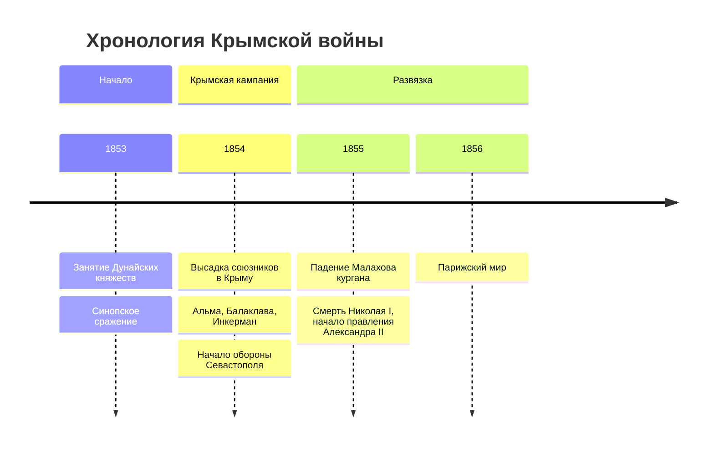
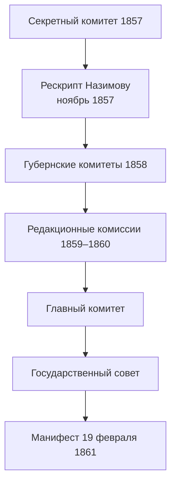

# Начало буржуазной модернизации
## План лекции
1. [[#Николай I (мрачное 30-ти летие)⁠​‌​‌​​‌‌​‌​​​​​‌​‌​​​‌‌​​‌​​​​​‌​‌​‌​‌​‌​‌​‌​‌​​​‌​​‌​​​​​‌‌​​​‌‌‌​‌​​​​‌​‌​​​​‌‌‌​‌​​​​‌​‌‌​​​​‌‌​‌​​​‌‌​​​​‌​​‌‌​‌​​​‌‌​​​‌‌​​‌‌​‌​​​‌‌​​​‌‌‌‌‌‌​‌​​​​‌​‌‌‌‌​‌‌‌​‌​​​​‌​‌‌‌‌‌​‌‌​‌​​​​‌​‌‌​​‌​​​‌​​​​​‌‌​‌​​​​‌​]]​‌‌​‌​‌‌​‌​​​​‌​‌‌​​​​‌‌​‌​​​​‌​‌‌‌‌​​‌‌​‌​​​​‌​‌‌‌​​​‌‌​‌​​​​‌​‌‌‌​‌‌‌‌​‌​​​‌‌​​​‌‌​​​​‌​​​​​‌‌​‌​​​​‌​‌​​​​‌‌‌​‌​​​​‌​‌‌​​​​‌‌​‌​​​​‌​‌‌‌‌​​‌‌​‌​​​​‌​‌‌​​​​‌‌​‌​​​‌‌​​​​​‌​‌‌​‌​​​​‌​‌‌‌‌‌​‌‌​‌​​​​‌​‌‌​​‌​‌‌​‌​​​​‌​‌‌‌​​​‌‌​‌​​​‌‌​​​​‌‌‌​‌‌‌‌‌​​‌‌​‌​​​​‌​​‌‌​​​‌‌​‌​​​‌‌​​​​​​‌‌‌​‌​​​‌‌​​​​​‌​‌‌​‌​​​​‌​‌‌‌‌‌​‌‌​‌​​​‌‌​​​​​​​‌‌​‌​​​​‌​‌‌‌​​​‌‌​‌​​​‌‌​​​‌‌‌‌​​‌​​​​​‌‌​‌​​​​‌​‌​​​​​‌‌​‌​​​​‌​‌‌‌‌‌​‌‌​‌​​​‌‌​​​​​​‌‌‌​‌​​​‌‌​​​​​​‌‌‌​‌​​​​‌​‌‌‌​​​‌‌​‌​​​​‌​‌‌‌​​​​​‌​‌‌‌‌‌‌​‌​​​​‌​​‌‌​‌​‌‌​‌​​​​‌​‌‌‌‌‌​‌‌​‌​​​​‌​‌‌‌‌​‌‌‌​‌​​​‌‌​​​​​​‌‌‌​‌​​​​‌​‌‌‌‌‌‌‌‌​‌​​​​‌​‌‌​‌​‌‌‌​‌​​​​‌​‌‌‌​‌​‌‌​‌​​​‌‌​​​​​‌​‌‌​‌​​​‌‌​​​‌​‌‌​​‌​​​​​‌‌​‌​​​​‌​‌‌‌​‌‌‌‌​‌​​​​‌​‌‌​‌​‌‌‌​‌​​​​‌​‌‌‌​‌​‌‌​‌​​​‌‌​​​​‌‌​‌‌​‌​​​​‌​‌‌‌​​​‌‌​‌​​​​‌​‌‌‌​​‌​​‌​‌‌‌‌‌‌​‌​​​​‌​​‌‌​​​‌‌​‌​​​‌‌​​​​​​‌‌‌​‌​​​‌‌​​​​​‌​‌‌​‌​​​​‌​‌‌‌‌‌​‌‌​‌​​​‌‌​​​​​​​‌‌​‌​​​​‌​‌‌‌​​​‌‌​‌​​​‌‌​​​‌‌‌‌​​‌​​​​​‌‌​‌​​​​‌​‌​​​​​‌‌​‌​​​​‌​‌‌‌‌‌​‌‌​‌​​​‌‌​​​​​​‌‌‌​‌​​​‌‌​​​​​​‌‌‌​‌​​​​‌​‌‌‌​​​‌‌​‌​​​​‌​‌‌‌​​​​​‌​​​​​​​‌‌​​‌​​​‌‌​​​​​​‌​‌‌‌​​​‌‌​​​‌​​‌‌​​​‌​​‌​‌‌‌​​​‌‌​​‌​​​‌‌​‌‌​​​‌​‌‌‌​​‌‌​‌‌​‌​‌‌​​‌​​‌​‌‌​‌​​‌‌‌‌‌​​‌​​​​​​​‌‌​​​‌​​​⁣⁠​‌​‌​​‌‌​‌​​​​​‌​‌​​​‌‌​​‌​​​​​‌​‌​‌​‌​‌​‌​‌​‌​​​‌​​‌​​​​​‌‌​​​‌‌‌​‌​​​​‌​‌​​​​‌‌‌​‌​​​​‌​‌‌​​​​‌‌​‌​​​‌‌​​​​‌​​‌‌​‌​​​‌‌​​​‌‌​​‌‌​‌​​​‌‌​​​‌‌‌‌‌‌​‌​​​​‌​‌‌‌‌​‌‌‌​‌​​​​‌​‌‌‌‌‌​‌‌​‌​​​​‌​‌‌​​‌​​​‌​​​​​‌‌​‌​​​​‌​​‌‌​‌​‌‌​‌​​​​‌​‌‌​​​​‌‌​‌​​​​‌​‌‌‌‌​​‌‌​‌​​​​‌​‌‌‌​​​‌‌​‌​​​​‌​‌‌‌​‌‌‌‌​‌​​​‌‌​​​‌‌​​​​‌​​​​​‌‌​‌​​​​‌​‌​​​​‌‌‌​‌​​​​‌​‌‌​​​​‌‌​‌​​​​‌​‌‌‌‌​​‌‌​‌​​​​‌​‌‌​​​​‌‌​‌​​​‌‌​​​​​‌​‌‌​‌​​​​‌​‌‌‌‌‌​‌‌​‌​​​​‌​‌‌​​‌​‌‌​‌​​​​‌​‌‌‌​​​‌‌​‌​​​‌‌​​​​‌‌‌​‌‌‌‌‌​​‌‌​‌​​​​‌​​‌‌​​​‌‌​‌​​​‌‌​​​​​​‌‌‌​‌​​​‌‌​​​​​‌​‌‌​‌​​​​‌​‌‌‌‌‌​‌‌​‌​​​‌‌​​​​​​​‌‌​‌​​​​‌​‌‌‌​​​‌‌​‌​​​‌‌​​​‌‌‌‌​​‌​​​​​‌‌​‌​​​​‌​‌​​​​​‌‌​‌​​​​‌​‌‌‌‌‌​‌‌​‌​​​‌‌​​​​​​‌‌‌​‌​​​‌‌​​​​​​‌‌‌​‌​​​​‌​‌‌‌​​​‌‌​‌​​​​‌​‌‌‌​​​​​‌​‌‌‌‌‌‌​‌​​​​‌​​‌‌​‌​‌‌​‌​​​​‌​‌‌‌‌‌​‌‌​‌​​​​‌​‌‌‌‌​‌‌‌​‌​​​‌‌​​​​​​‌‌‌​‌​​​​‌​‌‌‌‌‌‌‌‌​‌​​​​‌​‌‌​‌​‌‌‌​‌​​​​‌​‌‌‌​‌​‌‌​‌​​​‌‌​​​​​‌​‌‌​‌​​​‌‌​​​‌​‌‌​​‌​​​​​‌‌​‌​​​​‌​‌‌‌​‌‌‌‌​‌​​​​‌​‌‌​‌​‌‌‌​‌​​​​‌​‌‌‌​‌​‌‌​‌​​​‌‌​​​​‌‌​‌‌​‌​​​​‌​‌‌‌​​​‌‌​‌​​​​‌​‌‌‌​​‌​​‌​‌‌‌‌‌‌​‌​​​​‌​​‌‌​​​‌‌​‌​​​‌‌​​​​​​‌‌‌​‌​​​‌‌​​​​​‌​‌‌​‌​​​​‌​‌‌‌‌‌​‌‌​‌​​​‌‌​​​​​​​‌‌​‌​​​​‌​‌‌‌​​​‌‌​‌​​​‌‌​​​‌‌‌‌​​‌​​​​​‌‌​‌​​​​‌​‌​​​​​‌‌​‌​​​​‌​‌‌‌‌‌​‌‌​‌​​​‌‌​​​​​​‌‌‌​‌​​​‌‌​​​​​​‌‌‌​‌​​​​‌​‌‌‌​​​‌‌​‌​​​​‌​‌‌‌​​​​​‌​​​​​​​‌‌​​‌​​​‌‌​​​​​​‌​‌‌‌​​​‌‌​​​‌​​‌‌​​​‌​​‌​‌‌‌​​​‌‌​​‌​​​‌‌​‌‌​​​‌​‌‌‌​​‌‌​‌‌​‌​‌‌​​‌​​‌​‌‌​‌​​‌‌‌‌‌​​‌​​​​​​​‌‌​​​‌​​​⁣
2. [[#Нулевая мировая война (Крымская 1853–1856)]]
3. [[#Тенденции второй половины XIX века в мире|Тенденции второй половины 19-го века в мире.]]
4. [[#Начало великих реформ. Александр II (1855–1881)|Начало великих реформ 1860-1870]]

> *У России 2 беды: дураки и дороги. 
> - М. Задорнов*

> **Ключевая мысль.** Николай I законсервировал самодержавие и крепостное право, а Крымская война показала, что без модернизации Россия не удержит статус великой державы. Отсюда — неизбежность великих реформ Александра II.

---
## Николай I (мрачное 30-ти летие)⁠​‌​‌​​‌‌​‌​​​​​‌​‌​​​‌‌​​‌​​​​​‌​‌​‌​‌​‌​‌​‌​‌​​​‌​​‌​​​​​‌‌​​​‌‌‌​‌​​​​‌​‌​
Николай I (1825–1855) вступил на престол в день восстания декабристов и правил тридцать лет. Его правление в историографии часто называют «мрачным тридцатилетием»: это время политического сыска, жёсткой цензуры и сознательной консервации существующего порядка.

Современники и историки сходятся в одном: Николай был **солдатом по призванию**. К государственным проблемам он подходил по-солдатски — через порядок, дисциплину, субординацию и личную ответственность, — а не через реформы и правовые механизмы. Отсюда его любовь к армии, плацу и регламенту и недоверие к общественному мнению.

### Апогей самодержавия

Правление Николая I называют **апогеем самодержавия** — предельной концентрацией власти в руках монарха.

- **1826 г.** — создано Третье отделение Собственной его императорского величества канцелярии и корпус жандармов: политический сыск выведен в отдельное ведомство.
- **1826 г.** — принят новый цензурный устав, получивший у современников название «чугунного».
- **1832 г.** — М. М. Сперанский завершил кодификацию: издан Свод законов Российской империи, упорядочивший законодательство за полтора века.
- **1833 г.** — С. С. Уваров сформулировал теорию официальной народности: «православие, самодержавие, народность». Она стала государственной идеологией.

### Крестьянский вопрос при Николае I

Николай понимал порочность крепостного права, но отменять его не решился: боялся дворянства и нового Пугачёва. Власть ограничилась паллиативами.

- **1837–1841 гг.** — реформа П. Д. Киселёва: государственные крестьяне переведены на денежный оброк, получили самоуправление, школы и больницы.
- **1842 г.** — указ об обязанных крестьянах: помещик мог освободить крестьянина с землёй, но за повинности, а не за выкуп. Практически не применялся.
- **1844–1848 гг.** — инвентарная реформа в западных губерниях зафиксировала размеры помещичьих повинностей.

Итог: положение государственных крестьян улучшилось, крепостное право в целом сохранилось. Крестьянский вопрос был отложен и достался преемнику уже как нерешённая проблема.

### Экономика и культура

В 1830–1840-е годы в России начался **промышленный переворот**: переход от мануфактуры к фабрике, появление паровых машин. В **1837 г.** открыта первая железная дорога Петербург — Царское Село, в **1851 г.** — Петербурго-Московская (Николаевская) дорога. Но темпы оставались низкими: страна отставала от Англии и Франции по выплавке металла, машиностроению и транспорту.

Культура этого времени дала **Н. В. Гоголя** (1809–1852) — автора «Ревизора» и «Мёртвых душ», основоположника натуральной школы. Одновременно действовала цензура, а после европейских революций **1848 г.** наступило «мрачное семилетие» — период максимального ужесточения надзора за печатью и университетами.

### Кавказская война (1817–1864)

**Кавказская война** — затяжной военный конфликт России с горскими народами Северного Кавказа, завершившийся присоединением региона. Война была выиграна Россией, но ценой огромных людских и финансовых затрат и почти полувека боевых действий.

Причины: стратегический контроль над путями к Закавказью и Персии, обеспечение безопасности торговли, стремление ликвидировать набеговую экономику горских владетелей.

Религиозно-политической основой сопротивления стал [[Мюридизм]] — течение в исламе, требовавшее строгого исполнения религиозных предписаний и «газавата» (священной войны против неверных). На этой почве на территории Чечни и Дагестана сложился имамат — военно-теократическое государство.

- **1834 г.** — имамом становится Шамиль; он создаёт имамат с жёсткой дисциплиной, налоговой и военной системой.
- **1839 г.** — штурм Ахульго; Шамиль уходит в горы и продолжает войну.
- **1845 г.** — неудачная Даргинская экспедиция русских войск.
- Сопротивление подорвано только после Крымской войны, когда Шамиль лишился внешней поддержки.
- **1859 г.** — пленение Шамиля в ауле Гуниб; **1864 г.** — подавление последних очагов сопротивления на Северо-Западном Кавказе, формальное окончание войны.

Кавказская война стала для Николая I постоянным фронтом, отвлекавшим силы и средства накануне Крымской войны.

---

## Нулевая мировая война (Крымская 1853–1856)

**Крымская война (1853–1856)** — война России против коалиции Османской империи, Великобритании, Франции и Сардинского королевства. Её называют «нулевой мировой»: впервые боевые действия вели великие державы, и шли они сразу на нескольких театрах — на Дунае, в Крыму, на Кавказе, на Балтике, в Белом море и даже на Камчатке.

### Причины и начало

Формальный повод — спор о святых местах в Палестине между православной и католической церквями. Глубинная причина — **восточный вопрос**: борьба за наследие слабеющей Османской империи и за контроль над проливами Босфор и Дарданеллы.

Николай I рассчитывал на раздел Османской империи и покровительство её православным подданным, но Англия и Франция не желали усиления России. В **1853 г.** русские войска заняли Дунайские княжества; в ответ Османская империя объявила войну.

- **18 (30) ноября 1853 г.** — Синопское сражение: эскадра П. С. Нахимова уничтожила турецкий флот. Победа стала поводом для вступления в войну Англии и Франции.
- **1854 г.** — союзный флот вошёл в Чёрное море, высадка десанта в Крыму; сражения на Альме, под Балаклавой и Инкерманом не дали решающего результата.
- **Сентябрь 1854 — август 1855 г.** — оборона Севастополя, 349 дней.

### Оборона Севастополя

Главным событием войны стала **оборона Севастополя**. Город защищали флот и гарнизон под командованием В. А. Корнилова, П. С. Нахимова и В. И. Истомина — все трое погибли в ходе обороны.

- **5 (17) октября 1854 г.** — первая бомбардировка; Корнилов смертельно ранен на Малаховом кургане.
- **7 (19) марта 1855 г.** — погиб Истомин.
- **28 июня (10 июля) 1855 г.** — смертельно ранен Нахимов.
- **27 августа (8 сентября) 1855 г.** — взят Малахов курган; русские войска оставили южную сторону Севастополя.

В обороне участвовали хирург Н. И. Пирогов, впервые применивший полевую сортировку раненых, и сестра милосердия Даша Севастопольская. Оборона стала символом массового героизма — и одновременно обнажила техническую отсталость армии.

### Итоги войны

Война закончилась **Парижским миром 18 (30) марта 1856 г.** Условия были тяжёлыми, но не катастрофическими: Севастополь возвращён России в обмен на Карс.

- Чёрное море объявлено нейтральным: России и Турции запрещалось держать там военный флот и арсеналы.
- Россия уступила устье Дуная и часть Южной Бессарабии.
- Ограничения по Чёрному морю отменены лишь в **1871 г.** на Лондонской конференции.

Причины поражения: гладкоствольное оружие против нарезного, парусный флот против парового, отсутствие железных дорог на юге, рекрутская армия против всеобщей воинской повинности, казнокрадство интендантства. Поражение показало, что без модернизации Россия не может быть великой державой.

---

## Тенденции второй половины XIX века в мире

Вторая половина XIX века — эпоха **индустриализации и национальных государств**. Промышленный переворот завершается в Западной Европе, растёт значение фабрик, железных дорог, парового флота и телеграфа. Экономическая мощь становится главным мерилом силы державы, а вместе с ней усиливаются национализм и колониальная экспансия.

### Гражданская война в США (1861–1865)

Причины войны — конфликт между промышленным Севером и рабовладельческим Югом: вопрос о распространении рабства на новые территории, тарифы и политическое представительство. После избрания президентом А. Линкольна (1860) южные штаты объявили о выходе из союза.

- **1863 г.** — Прокламация об освобождении рабов на территории мятежных штатов.
- **1865 г.** — победа Севера; 13-я поправка к Конституции отменила рабство.

Война ускорила индустриализацию США и превратила их в одну из ведущих экономик мира. Для России война обернулась «хлопковым голодом» — сокращением поставок американского хлопка для текстильной промышленности, а также сближением с Севером: в 1863–1864 гг. русские эскадры побывали в американских портах.

### Объединение Германии

**Отто фон Бисмарк**, с 1862 г. канцлер Пруссии, проводил политику «железа и крови»: объединение силой оружия под главенством Пруссии.

- **1864 г.** — война с Данией и присоединение Шлезвига и Гольштейна.
- **1866 г.** — разгром Австрии при Кёниггреце; создан Северогерманский союз.
- **1870–1871 гг.** — Франко-прусская война, разгром Франции.
- **18 января 1871 г.** — провозглашение Германской империи в Версале.

### Революция Мэйдзи и «догоняющая модернизация»

В **1868 г.** в Японии произошла **революция Мэйдзи**: власть императора восстановлена, сёгунат ликвидирован. Реформы — отмена сословий, всеобщая воинская повинность, земельная реформа, промышленность и армия по западному образцу — за несколько десятилетий превратили закрытую страну в современную державу. Это пример успешной «догоняющей модернизации», проведённой сверху.

В том же ряду стоит объединение Италии (Рисорджименто, 1861): национальное государство собирается вокруг Пьемонта и фигуры Кавура.

### Либерализм и общественная мысль в России

**[[Либерализм]]** — течение, выступающее за гражданские права и свободы, равенство перед законом и ограничение произвола власти. В России он развивался в интеллектуальных кружках, а не в парламентской борьбе.

В 1840-е годы идёт спор **славянофилов** и **западников**. Славянофилы (А. С. Хомяков, братья Киреевские) видели самобытный путь России в православии, общине и соборности. Западники (Т. Н. Грановский, К. Д. Кавелин, В. Г. Белинский) считали необходимым перенять западные правовые и политические институты. Обе стороны сходились на необходимости отмены крепостного права.

Из кружков выросли радикальные направления: у петрашевцев (1845–1849) обсуждались освобождение крестьян и республика. А. И. Герцен, уехав в эмиграцию, в **1853 г.** основал Вольную русскую типографию, а с **1857 г.** издавал «Колокол» — он стал главным рупором освободительных требований.

С. Н. Булгаков, С. Л. Франк и Н. А. Бердяев, названные на доске, относятся к более позднему этапу: они прошли путь от легального марксизма к религиозной философии и были авторами сборника «Вехи» (1909). Это уже либерально-философская мысль начала XX века, а не эпохи Александра II.

---

## Начало великих реформ. Александр II (1855–1881)

**Александр II** принял страну в разгар Крымской войны. Война закончилась поражением, и новый император быстро понял: сохранение крепостного права и прежней военной системы означает утрату статуса великой державы.

Формула, приписываемая Александру II в речи перед московским дворянством в 1856 г., объясняет логику власти: «Лучше отменить крепостное право сверху, чем дожидаться того времени, когда оно само собою начнёт отменяться снизу».

### Как готовилась реформа

Крестьянская реформа готовилась несколько лет и в обстановке секретности.

- **1857 г.** — образован Секретный комитет по крестьянскому делу; в ноябре издан рескрипт Назимову о создании губернских комитетов, что сделало подготовку гласной.
- **1858 г.** — Секретный комитет преобразован в **Главный комитет по крестьянскому делу**.
- **1859–1860 гг.** — работают **Редакционные комиссии** при Главном комитете: они сводят проекты губернских комитетов в единый законопроект.

Ключевые фигуры: Я. И. Ростовцев (председатель Редакционных комиссий), Н. А. Милютин (фактический руководитель разработки, «главный архитектор» реформы), С. С. Ланской (министр внутренних дел), К. Д. Кавелин (либеральный юрист, автор записки о крепостном состоянии).

### Манифест 19 февраля 1861 г.

**19 февраля (5 марта) 1861 г.** Александр II подписал Манифест об отмене крепостного права и «Положения о крестьянах, вышедших из крепостной зависимости».

- Крестьяне получили **личную свободу** и гражданские права.
- Земля оставалась собственностью помещика; крестьяне получали **надел** по норме, зафиксированной в уставной грамоте.
- За землю платился **выкуп**; до его заключения крестьяне считались **временнообязанными** и несли прежние повинности.
- Размер надела мог быть урезан — так называемые **отрезки**; выкупные платежи растянулись на 49 лет и были отменены только в 1906 г.
- Споры разбирали **мировые посредники** из числа местных дворян.

Реформа освободила около 23 млн помещичьих крестьян, но сохранила помещичье землевладение, общину и малоземелье. Именно эти нерешённые вопросы определили дальнейшую историю России.

### Последующие реформы

Отмена крепостного права потянула за собой преобразование всех сфер управления.

- **1864 г.** — земская реформа: всесословные земства ведали школами, медициной, дорогами.
- **1864 г.** — судебная реформа: всесословный, гласный, состязательный суд, суд присяжных, независимость судей.
- **1870 г.** — городская реформа: городские думы и управы.
- **1874 г.** — военная реформа Д. А. Милютина: всеобщая воинская повинность вместо рекрутчины, сокращение срока службы, перевооружение.
- **1863 г.** — университетский устав вернул автономию университетам; в **1865 г.** ослаблена цензура.

Реформы 1860–1870-х годов называют **великими реформами**. Они создали основы гражданского общества и правового государства, но остались незавершёнными: конституции и представительного органа не появилось, а земства и суд сосуществовали с самодержавием.

---

%%Самостоятельный вопрос%%​​​​‌‌​‌​​​​‌​
⁠​‌​‌​​‌‌​‌​​​​​‌​‌​​​‌‌​​‌​​​​​‌​‌​‌​‌​‌​‌​‌​‌​​​‌​​‌​​​​​‌‌​​​‌‌‌​‌​​​​‌​‌​​​​‌‌‌​‌​​​​‌​‌‌​​​​‌‌​‌​​​‌‌​​​​‌​​‌‌​‌​​​‌‌​​​‌‌​​‌‌​‌​​​‌‌​​​‌‌‌‌‌‌​‌​​​​‌​‌‌‌‌​‌‌‌​‌​​​​‌​‌‌‌‌‌​‌‌​‌​​​​‌​‌‌​​‌​​​‌​​​​​‌‌​‌​​​​‌​​‌‌​‌​‌‌​‌​​​​‌​‌‌​​​​‌‌​‌​​​​‌​‌‌‌‌​​‌‌​‌​​Почему необходимы реформы Александра II ? Что к этому подвело ?​​‌​‌‌‌​​​‌‌​‌​​​​‌​‌‌‌​‌‌‌‌​‌​​​‌‌​​​‌‌​​​​‌​​​​​‌‌​‌​​​​‌​‌​​​​‌‌‌​‌​​​​‌​‌‌​​​​‌‌​‌​​​​‌​‌‌‌‌​​‌‌​‌​​​​‌​‌‌​​​​‌‌​‌​​​‌‌​​​​​‌​‌‌​‌​​​​‌​‌‌‌‌‌​‌‌​‌​​​​‌​‌‌​​‌​‌‌​‌​​​​‌​‌‌‌​​​‌‌​‌​​​‌‌​​​​‌‌‌​‌‌‌‌‌​​‌‌​‌​​​​‌​​‌‌​​​‌‌​‌​​​‌‌​​​​​​‌‌‌​‌​​​‌‌​​​​​‌​‌‌​‌​​​​‌​‌‌‌‌‌​‌‌​‌​​​‌‌​​​​​​​‌‌​‌​​​​‌​‌‌‌​​​‌‌​‌​​​‌‌​​​‌‌‌‌​​‌​​​​​‌‌​‌​​​​‌​‌​​​​​‌‌​‌​​​​‌​‌‌‌‌‌​‌‌​‌​​​‌‌​​​​​​‌‌‌​‌​​​‌‌​​​​​​‌‌‌​‌​​​​‌​‌‌‌​​​‌‌​‌​​​​‌​‌‌‌​​​​​‌​‌‌‌‌‌‌​‌​​​​‌​​‌‌​‌​‌‌​‌​​​​‌​‌‌‌‌‌​‌‌​‌​​​​‌​‌‌‌‌​‌‌‌​‌​​​‌‌​​​​​​‌‌‌​‌​​​​‌​‌‌‌‌‌‌‌‌​‌​​​​‌​‌‌​‌​‌‌‌​‌​​​​‌​‌‌‌​‌​‌‌​‌​​​‌‌​​​​​‌​‌‌​‌​​​‌‌​​​‌​‌‌​​‌​​​​​‌‌​‌​​​​‌​‌‌‌​‌‌‌‌​‌​​​​‌​‌‌​‌​‌‌‌​‌​​​​‌​‌‌‌​‌​‌‌​‌​​​‌‌​​​​‌‌​‌‌​‌​​​​‌​‌‌‌​​​‌‌​‌​​​​‌​‌‌‌​​‌​​‌​‌‌‌‌‌‌​‌​​​​‌​​‌‌​​​‌‌​‌​​​‌‌​​​​​​‌‌‌​‌​​​‌‌​​​​​‌​‌‌​‌​​​​‌​‌‌‌‌‌​‌‌​‌​​​‌‌​​​​​​​‌‌​‌​​​​‌​‌‌‌​​​‌‌​‌​​​‌‌​​​‌‌‌‌​​‌​​​​​‌‌​‌​​​​‌​‌​​​​​‌‌​‌​​​​‌​‌‌‌‌‌​‌‌​‌​​​‌‌​​​​​​‌‌‌​‌​​​‌‌​​​​​​‌‌‌​‌​​​​‌​‌‌‌​​​‌‌​‌​​​​‌​‌‌‌​​​​​‌​​​​​​​‌‌​​‌​​​‌‌​​​​​​‌​‌‌‌​​​‌‌​​​‌​​‌‌​​​‌​​‌​‌‌‌​​​‌‌​​‌​​​‌‌​‌‌​​​‌​‌‌‌​​‌‌​‌‌​‌​‌‌​​‌​​‌​‌‌​‌​​‌‌‌‌‌​​‌​​​​​​​‌‌​​​‌​​​⁣

## Ответ: почему реформы стали неизбежны

Реформы Александра II были не результатом доброй воли императора, а ответом на системный кризис, в котором оказалась Россия к середине 1850-х годов. К ним подвели несколько причин, действовавших одновременно.

1. **Экономическая неэффективность крепостного права.** Подневольный труд не создавал заинтересованности в результате: производительность барщины падала, помещичьи хозяйства разорялись и закладывались в банках. Отсутствовал рынок свободной рабочей силы, без которого невозможен промышленный переворот. Крепостное право тормозило и промышленность, и сельское хозяйство, и внутренний рынок.
2. **Военно-техническое поражение в Крымской войне.** Гладкоствольные ружья против нарезных, парусный флот против парового, бездорожье и отсутствие железных дорог, рекрутская система набора и казнокрадство показали: военная мощь империи держалась на устаревших институтах. Поражение 1856 г. стало прямым толчком — реформа армии без отмены крепостного права была невозможна.
3. **Социальное напряжение в деревне.** Крестьянские волнения учащались, а память о пугачёвщине оставалась для власти политическим аргументом. Отсюда формула «лучше отменить сверху, чем ждать, когда отменят снизу»: реформа была способом предотвратить революцию.
4. **Общественный подъём и гласность.** После смерти Николая I ослабла цензура, появились записки либеральных чиновников и юристов (К. Д. Кавелин, Ю. Ф. Самарин), оживилась эмигрантская печать (Герцен). Власть впервые столкнулась с публичным требованием преобразований.
5. **Потеря международного статуса.** Без модернизации Россия не могла соперничать с индустриальными державами ни в Европе, ни на Востоке. Пример объединённой Германии и реформирующейся Японии показывал, что «догоняющая модернизация» возможна — но требует перестройки институтов.

Таким образом, реформы были необходимы потому, что старый порядок одновременно не давал экономического роста, проигрывал войну, вызывал социальный протест и лишал страну статуса великой державы. Их незавершённость — сохранение самодержавия, помещичьего землевладения и малоземелья крестьян — стала источником новых конфликтов, которые привели к революциям начала XX века.
