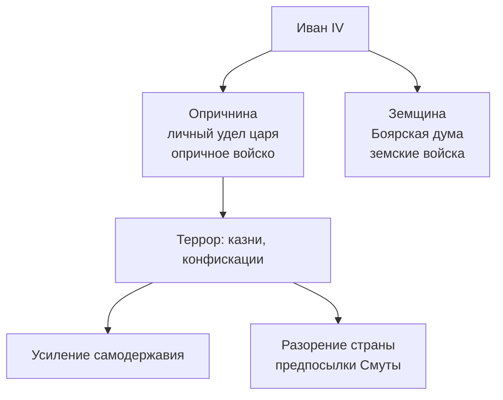

*Продолжение лекции [[История России 17.10.26|«Московская Русь и Иван IV»]].⁠​‌​‌​​‌‌​‌​​​​​‌​‌​​​‌‌​​‌​​​​​‌​‌​‌​‌​‌​‌​‌​‌​​​‌​​‌​​​​​‌‌​​​‌‌‌​‌​​​​‌​‌​​​​‌‌‌​‌​​​​‌​‌‌​​​​‌‌​‌​​​‌‌​​​​‌​​‌‌​‌​​​‌‌​​​‌‌​​‌‌​‌​​​‌‌​​​‌‌‌‌‌‌​‌​​​​‌​‌‌‌‌​‌‌‌​‌​​​​‌​‌‌‌‌‌​‌‌​‌​​​​‌​‌‌​​‌​​​‌​​​​​‌‌​‌​​​​‌​​‌‌​‌​‌‌​‌​​​​‌​‌‌​​​​‌‌​‌​​​​‌​‌‌‌‌​​‌‌​‌​​​​‌​‌‌‌​​​‌‌​‌​​​​‌​‌‌‌​‌‌‌‌​‌​​​‌‌​​​‌‌​​​​‌​​​​​‌‌​‌​​​​‌​‌​​​​‌‌‌​‌​​​​‌​‌‌​​​​‌‌​‌​​​​‌​‌‌‌‌​​‌‌​‌​​​​‌​‌‌​​​​‌‌​‌​​​‌‌​​​​​‌​‌‌​‌​​​​‌​‌‌‌‌‌​‌‌​‌​​​​‌​‌‌​​‌​‌‌​‌​​​​‌​‌‌‌​​​‌‌​‌​​​‌‌​​​​‌‌‌​‌‌‌‌‌​​‌‌​‌​​​​‌​​‌‌​​​‌‌​‌​​​‌‌​​​​​​‌‌‌​‌​​​‌‌​​​​​‌​‌‌​‌​​​​‌​‌‌‌‌‌​‌‌​‌​​​‌‌​​​​​​​‌‌​‌​​​​‌​‌‌‌​​​‌‌​‌​​​‌‌​​​‌‌‌‌​​‌​​​​​‌‌​‌​​​​‌​‌​​​​​‌‌​‌​​​​‌​‌‌‌‌‌​‌‌​‌​​​‌‌​​​​​​‌‌‌​‌​​​‌‌​​​​​​‌‌‌​‌​​​​‌​‌‌‌​​​‌‌​‌​​​​‌​‌‌‌​​​​​‌​‌‌‌‌‌‌​‌​​​​‌​​‌‌​‌​‌‌​‌​​​​‌​‌‌‌‌‌​‌‌​‌​​​​‌​‌‌‌‌​‌‌‌​‌​​​‌‌​​​​​​‌‌‌​‌​​​​‌​‌‌‌‌‌‌‌‌​‌​​​​‌​‌‌​‌​‌‌‌​‌​​​​‌​‌‌‌​‌​‌‌​‌​​​‌‌​​​​​‌​‌‌​‌​​​‌‌​​​‌​‌‌​​‌​​​​​‌‌​‌​​​​‌​‌‌‌​‌‌‌‌​‌​​​​‌​‌‌​‌​‌‌‌​‌​​​​‌​‌‌‌​‌​‌‌​‌​​​‌‌​​​​‌‌​‌‌​‌​​​​‌​‌‌‌​​​‌‌​‌​​​​‌​‌‌‌​​‌​​‌​‌‌‌‌‌‌​‌​​​​‌​​‌‌​​​‌‌​‌​​​‌‌​​​​​​‌‌‌​‌​​​‌‌​​​​​‌​‌‌​‌​​​​‌​‌‌‌‌‌​‌‌​‌​​​‌‌​​​​​​​‌‌​‌​​​​‌​‌‌‌​​​‌‌​‌​​​‌‌​​​‌‌‌‌​​‌​​​​​‌‌​‌​​​​‌​‌​​​​​‌‌​‌​​​​‌​‌‌‌‌‌​‌‌​‌​​​‌‌​​​​​​‌‌‌​‌​​​‌‌​​​​​​‌‌‌​‌​​​​‌​‌‌‌​​​‌‌​‌​​​​‌​‌‌‌​​​​​‌​​​​​​​‌‌​​‌​​​‌‌​​‌‌​​‌​‌‌‌​​​‌‌​​​‌​​‌‌​​​​​​‌​‌‌‌​​​‌‌​​‌​​​‌‌​‌‌​​​‌​‌‌‌​​‌‌​‌‌​‌​‌‌​​‌​​‌‌​‌​‌‌​​​‌‌​‌‌‌‌‌​‌​‌​​‌​​‌‌‌​​⁣

# Опричнина и Смутное время

## План лекции

1. [[#Опричнина (1565–1572)]]
2. [[#Смутное время]]
3. [[#Бунты XVII века]]

---

# Опричнина (1565–1572)

> **Контекст.** В предыдущей лекции Иван IV провёл реформы [[Избранная рада|Избранной рады]], взял Казань и после этого резко сменил политику.

- **1564 г.** — князь Андрей Курбский бежал в Литву. Для царя это стало доказательством «измены» и поводом для перехода к террору.
- **1565 г.** — Иван IV ввёл [[Опричнина|опричнину]]. Государство разделили на две части:
	- **опричнина** — личный удел царя с особым войском ([[Опричник|опричниками]]) и управлением;
	- **[[Земщина|земщина]]** — остальная часть страны под управлением Боярской думы.

==Главная цель — ослабить влияние княжеских родов и бояр и укрепить личную власть царя.==

## Террор

- Начались массовые казни: сначала казнили «неправильных» людей, затем — всех, кто не нравился царю.
- **1569 г.** — Иван IV обвинил Владимира Старицкого, своего двоюродного брата. Владимир не имел амбиций, но царь на всякий случай пригласил его в гости и отравил вместе с семьёй.
- Митрополит Филипп обвинил царя в кровопролитии: «князь противен Богу». Иван IV не стерпел — сослал митрополита в монастырь, где его убил Малюта Скуратов.
- **1570 г.** — царь пошёл на Новгород: город громили и грабили, страдали простые горожане. Убивали чиновников и бояр — «по итогу страдают свои».

## Итоги опричнины

- Влияние княжеских родов и бояр ослаблено, власть царя усилилась.
- Хозяйство разорено, земли запустели.
- Проиграна Ливонская война с Польшей ([[Ям-Запольский мирный договор]], 1582).
- Бояре затаили злобу: в Смутное время часть знати перешла на сторону врагов.
- **1572 г., село Молоди** — крымских ханов разбили не опричники, а земское войско (народное ополчение). В том же году опричнина была отменена.

---

# Смутное время

> **Смутное время (1598–1613)** — династический, экономический и социальный кризис, переросший в гражданскую войну и иностранную интервенцию.

## Причины

1. Запустение пашен и хозяйственный упадок после опричнины и Ливонской войны.
2. Похолодание и голод (1601–1603). Крестьяне решили, что это кара Божья за убийство царевича Дмитрия и избрание «убийцы» — Бориса Годунова.
3. Появление [[Лжедмитрий|Лжедмитрия I]] с поляками. Поляки раздражали москвичей своими обычаями; Лжедмитрия убрали.

## Этапы

| Этап          | Годы      | Содержание                                                            |
| ------------- | --------- | --------------------------------------------------------------------- |
| Династический | 1598–1605 | Правление Бориса Годунова                                             |
| Социальный    | 1606–1610 | Василий Шуйский, восстание Болотникова, Лжедмитрий II, [[Семибоярщина]] |
| Национальный  | 1611–1612 | Первое и Второе ополчения, освобождение Москвы                        |

## Борис Годунов

- «Человек своего времени» — бывший [[Опричник|опричник]]. По происхождению татарин, удачно женился и начал учиться.
- Был опекуном при больном сыне Ивана Грозного — Фёдоре — и фактически правил вместо него; в **1598 г.** избран царём.
- Приглашал иностранцев, хотел создать университет, основал типографию, провёл водопровод, поставил линию обороны от крымских набегов.

## Второй этап (1606–1610)

- **1606 г.** — крестьянское восстание Ивана Болотникова.
- Параллельно появился **[[Лжедмитрий|Лжедмитрий II]]**; его войска около 20 месяцев осаждали Москву.
- Василий Шуйский позвал на помощь шведов. Узнав об этом, в войну включились поляки с казаками.
- Бояре провозгласили русским царём поляка — королевича Владислава. Наступил крах государства: армии нет, торговли нет, грабят, закон не работает — убивают кого попало.

## Национальный этап (1611–1612)

- Патриарх Гермоген (до патриаршества — митрополит Казанский) рассылал по церквям письма с призывом к общему сбору.
- **Первое ополчение (1611)** — Прокопий Ляпунов и Дмитрий Трубецкой. Провалилось из-за внутренних разногласий.
- **[[Народное ополчение|Второе ополчение]] (1611–1612)** — Кузьма Минин и князь Дмитрий Пожарский. Создали «Совет всея земли»; в 1612 г. освободили Москву.

## Итоги

- **1613 г.** — [[Земский собор]] избрал царём Михаила Романова. Смутное время закончилось.
- Народ получил «прививку от безвластия»: стала понятна ценность сильной государственной власти.
- Страна осталась многонациональным государством, но хозяйство и государственность пришлось восстанавливать заново.

---

# Бунты XVII века

| Бунт                        | Год  | Причина и итог                                                                                                                                                                |
| --------------------------- | ---- | ----------------------------------------------------------------------------------------------------------------------------------------------------------------------------- |
| [[Соляной бунт]]            | 1648 | Недовольство налогами и произволом властей. Созван [[Земский собор]], который принял [[Соборное уложение]] 1649 г. и окончательно закрепил крестьян ([[Крепостное право]]).      |
| [[Медный бунт]]             | 1662 | Обесценивание медных денег и рост цен. Восстание подавлено, медные монеты изъяты из обращения.                                                                                |

> **Как закрепощали крестьян:** [[Юрьев день]] (1497) → [[Заповедные лета]] (с 1581) → [[Урочные лета]] (1597) → [[Соборное уложение]] 1649 г. (бессрочный сыск беглых).
⁠​‌​‌​​‌‌​‌​​​​​‌​‌​​​‌‌​​‌​​​​​‌​‌​‌​‌​‌​‌​‌​‌​​​‌​​‌​​​​​‌‌​​​‌‌‌​‌​​​​‌​‌​​​​‌‌‌​‌​​​​‌​‌‌​​​​‌‌​‌​​​‌‌​​​​‌​​‌‌​‌​​​‌‌​​​‌‌​​‌‌​‌​​​‌‌​​​‌‌‌‌‌‌​‌​​​​‌​‌‌‌‌​‌‌‌​‌​​​​‌​‌‌‌‌‌​‌‌​‌​​​​‌​‌‌​​‌​​​‌​​​​​‌‌​‌​​​​‌​​‌‌​‌​‌‌​‌​​​​‌​‌‌​​​​‌‌​‌​​​​‌​‌‌‌‌​​‌‌​‌​​​​‌​‌‌‌​​​‌‌​‌​​​​‌​‌‌‌​‌‌‌‌​‌​​​‌‌​​​‌‌​​​​‌​​​​​‌‌​‌​​​​‌​‌​​​​‌‌‌​‌​​​​‌​‌‌​​​​‌‌​‌​​​​‌​‌‌‌‌​​‌‌​‌​​​​‌​‌‌​​​​‌‌​‌​​​‌‌​​​​​‌​‌‌​‌​​​​‌​‌‌‌‌‌​‌‌​‌​​​​‌​‌‌​​‌​‌‌​‌​​​​‌​‌‌‌​​​‌‌​‌​​​‌‌​​​​‌‌‌​‌‌‌‌‌​​‌‌​‌​​​​‌​​‌‌​​​‌‌​‌​​​‌‌​​​​​​‌‌‌​‌​​​‌‌​​​​​‌​‌‌​‌​​​​‌​‌‌‌‌‌​‌‌​‌​​​‌‌​​​​​​​‌‌​‌​​​​‌​‌‌‌​​​‌‌​‌​​​‌‌​​​‌‌‌‌​​‌​​​​​‌‌​‌​​​​‌​‌​​​​​‌‌​‌​​​​‌​‌‌‌‌‌​‌‌​‌​​​‌‌​​​​​​‌‌‌​‌​​​‌‌​​​​​​‌‌‌​‌​​​​‌​‌‌‌​​​‌‌​‌​​​​‌​‌‌‌​​​​​‌​‌‌‌‌‌‌​‌​​​​‌​​‌‌​‌​‌‌​‌​​​​‌​‌‌‌‌‌​‌‌​‌​​​​‌​‌‌‌‌​‌‌‌​‌​​​‌‌​​​​​​‌‌‌​‌​​​​‌​‌‌‌‌‌‌‌‌​‌​​​​‌​‌‌​‌​‌‌‌​‌​​​​‌​‌‌‌​‌​‌‌​‌​​​‌‌​​​​​‌​‌‌​‌​​​‌‌​​​‌​‌‌​​‌​​​​​‌‌​‌​​​​‌​‌‌‌​‌‌‌‌​‌​​​​‌​‌‌​‌​‌‌‌​‌​​​​‌​‌‌‌​‌​‌‌​‌​​​‌‌​​​​‌‌​‌‌​‌​​​​‌​‌‌‌​​​‌‌​‌​​​​‌​‌‌‌​​‌​​‌​‌‌‌‌‌‌​‌​​​​‌​​‌‌​​​‌‌​‌​​​‌‌​​​​​​‌‌‌​‌​​​‌‌​​​​​‌​‌‌​‌​​​​‌​‌‌‌‌‌​‌‌​‌​​​‌‌​​​​​​​‌‌​‌​​​​‌​‌‌‌​​​‌‌​‌​​​‌‌​​​‌‌‌‌​​‌​​​​​‌‌​‌​​​​‌​‌​​​​​‌‌​‌​​​​‌​‌‌‌‌‌​‌‌​‌​​​‌‌​​​​​​‌‌‌​‌​​​‌‌​​​​​​‌‌‌​‌​​​​‌​‌‌‌​​​‌‌​‌​​​​‌​‌‌‌​​​​​‌​​​​​​​‌‌​​‌​​​‌‌​​‌‌​​‌​‌‌‌​​​‌‌​​​‌​​‌‌​​​​​​‌​‌‌‌​​​‌‌​​‌​​​‌‌​‌‌​​​‌​‌‌‌​​‌‌​‌‌​‌​‌‌​​‌​​‌‌​‌​‌‌​​​‌‌​‌‌‌‌‌​‌​‌​​‌​​‌‌‌​​⁣
