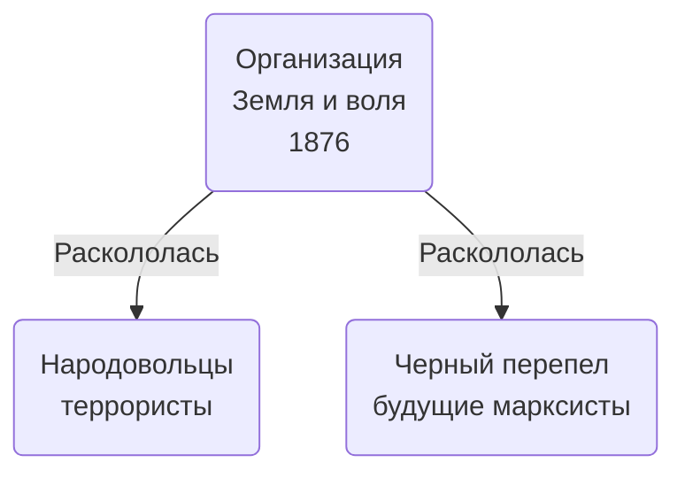

# План лекции
1. [[#Капитализм в России]] ⁠​‌​‌​​‌‌​‌​​​​​‌​‌​​​‌‌​​‌​​​​​‌​‌​‌​‌​‌​‌​‌​‌​​​‌​​‌​​​​​‌‌​​​‌‌‌​‌​​​​‌​‌​​​​‌‌‌​‌​​​​‌​‌‌​​​​‌‌​‌​​​‌‌​​​​‌​​‌‌​‌​​​‌‌​​​‌‌​​‌‌​‌​​​‌‌​​​‌‌‌‌‌‌​‌​​​​‌​‌‌‌‌​‌‌‌​‌​​​​‌​‌‌‌‌‌​‌‌​‌​​​​‌​‌‌​​‌​​​‌​​​​​‌‌​‌​​​​‌​​‌‌​‌​‌‌​‌​​​​‌​‌‌​​​​‌‌​‌​​​​‌​‌‌‌‌​​‌‌​‌​​​​‌​‌‌‌​​​‌‌​‌​​​​‌​‌‌‌​‌‌‌‌​‌​​​‌‌​​​‌‌​​​​‌​​​​​‌‌​‌​​​​‌​‌​​​​‌‌‌​‌​​​​‌​‌‌​​​​‌‌​‌​​​​‌​‌‌‌‌​​‌‌​‌​​​​‌​‌‌​​​​‌‌​‌​​​‌‌​​​​​‌​‌‌​‌​​​​‌​‌‌‌‌‌​‌‌​‌​​​​‌​‌‌​​‌​‌‌​‌​​​​‌​‌‌‌​​​‌‌​‌​​​‌‌​​​​‌‌‌​‌‌‌‌‌​​‌‌​‌​​​​‌​​‌‌​​​‌‌​‌​​​‌‌​​​​​​‌‌‌​‌​​​‌‌​​​​​‌​‌‌​‌​​​​‌​‌‌‌‌‌​‌‌​‌​​​‌‌​​​​​​​‌‌​‌​​​​‌​‌‌‌​​​‌‌​‌​​​‌‌​​​‌‌‌‌​​‌​​​​​‌‌​‌​​​​‌​‌​​​​​‌‌​‌​​​​‌​‌‌‌‌‌​‌‌​‌​​​‌‌​​​​​​‌‌‌​‌​​​‌‌​​​​​​‌‌‌​‌​​​​‌​‌‌‌​​​‌‌​‌​​​​‌​‌‌‌​​​​​‌​‌‌‌‌‌‌​‌​​​​‌​​‌‌​‌​‌‌​‌​​​​‌​‌‌‌‌‌​‌‌​‌​​​​‌​‌‌‌‌​‌‌‌​‌​​​‌‌​​​​​​‌‌‌​‌​​​​‌​‌‌‌‌‌‌‌‌​‌​​​​‌​‌‌​‌​‌‌‌​‌​​​​‌​‌‌‌​‌​‌‌​‌​​​‌‌​​​​​‌​‌‌​‌​​​‌‌​​​‌​‌‌​​‌​​​​​‌‌​‌​​​​‌​‌‌‌​‌‌‌‌​‌​​​​‌​‌‌​‌​‌‌‌​‌​​​​‌​‌‌‌​‌​‌‌​‌​​​‌‌​​​​‌‌​‌‌​‌​​​​‌​‌‌‌​​​‌‌​‌​​​​‌​‌‌‌​​‌​​‌​‌‌‌‌‌‌​‌​​​​‌​​‌‌​​​‌‌​‌​​​‌‌​​​​​​‌‌‌​‌​​​‌‌​​​​​‌​‌‌​‌​​​​‌​‌‌‌‌‌​‌‌​‌​​​‌‌​​​​​​​‌‌​‌​​​​‌​‌‌‌​​​‌‌​‌​​​‌‌​​​‌‌‌‌​​‌​​​​​‌‌​‌​​​​‌​‌​​​​​‌‌​‌​​​​‌​‌‌‌‌‌​‌‌​‌​​​‌‌​​​​​​‌‌‌​‌​​​‌‌​​​​​​‌‌‌​‌​​​​‌​‌‌‌​​​‌‌​‌​​​​‌​‌‌‌​​​​​‌​​​​​​​‌‌​​‌​​​‌‌‌​​​​​‌​‌‌‌​​​‌‌​​​‌​​‌‌​​​‌​​‌​‌‌‌​​​‌‌​​‌​​​‌‌​‌‌​​​‌​‌‌‌​​‌‌​‌‌​‌​‌‌​​‌​​‌​‌​‌​​‌​‌​‌​‌‌‌‌‌‌​​​​​​​​‌​‌​‌⁣
2. [[#Внешняя политика]] 
3. ([[#Культура]])
4. [[#Контрреформа Контрреформы]]

>*Русские долго запрягают, но быстро ездят 
>- О.Ф. Бисмарк.*

>*Россия не сердится - она сосредотачивается*

>*Кому конституция, а кому хлеб с хреном*

---
### Капитализм в России 
***Появление реформ:***
1. ==Крестьянская реформа 1861 года== - до 40% населения стали свободными обывателями. Начало капитализма.
	- Крестьян с землей освободили, однако большую часть все равно оставляли помещикам
	- Земля выкупалась. 20% суммы земли должна была выкупится крестьянами помещикам, остальное государство дает сразу (однако крестьяне все равно должны были отработать эти деньги). Пока крестьяне выплачивали они назывались *Временно обязанными*
	- Помощь крестьянам от грамотных людей
	- Начало смены имущественных отношений между капиталистическими крестьянами.
2. ==Земская и судебная реформы 1864 года== 
	- Появление земства - органа самоуправления в уездах. Самовыборная власть. Занималась всем за бесплатно. Обязаны были строить больницы, школы (подготовлено 2кк грамотных людей), заниматься ветеринарством.
	- Суд стал всесословным. Начало сословного равенства. Анти-коррупционные движения. Открытый судебный процесс.
3. ==Военная реформа 1874 года==
	- Появление всеобщей воинской обязанности. Отмена телесных наказаний, появление офицерских школ, воинских уставов и округов.
4. ==Образовательная реформа==
	- Появление автономии у университетов из-за увеличения количества студентов.
	- Появление гимназий, училищ.
5. ==Другие реформы==
	- Появление резких газет и журналов как следствие отмены цензуры.
	- Появление [[Народничество|народничества]], основные представители - 
		1. Герцин (считал что капитализм в России неприемлим, частная собственность недопустима).
		2. Чернишевский (был редактором журнала "Современники", сослали пожизненно за напиcание призыва к восстанию, был сыном священника).
		3. Бокунин (сторонник анархизма - считал что власть не нужна, народ может сам себя обеспечить, дважды приговорили к смерти но ни разу не казнили).
		4. Лавров (Петербургский профессор, считал что до революции нужно просвятить народ, обеспечить знаниями).
		5. Ткачев (Был заговорником, сторонником общественного социализма).
		Летом студенты народники ходили к крестьянам и просвящали их книгами, агитировали против царя, как следствие народники потерпели крах. 

	Чуть позже народники были окончательно разбиты марксистами.
	
>Люди поняли, что реформы - первый шаг к ограничению власти царя, **конституции.**

---
### Внешняя политика
***Цели Александра II:***
1. Отмена Парижского трактата мирным способом. Ликвидация последствий Крымской войны.
2. Русско-турецкая война 1877-1888 года как следствие Болгарского восстания. Подписание договора о независимости славян: Сербов, Болгаров и тп.
3. Присоединение средней Азии. Взятие Ташкента.
4. Продажа Аляски Америке за 7кк долларов.

---
### Культура
***19 век - неповторимый золотой век Русской литературы***
Главные персонажи :
- Пушкин - подкинул идею Гоголю о создании произведения "Мертвые души".
- Гоголь - "Его искусство как водопад".
- Лермонтов.
- Тургенев.
- Достоевский.
- Толстой - самый переводимый за границей писатель.
---
### [[Контрреформа|Контрреформы]]
***Алексендр III начал ослаблять влияние народа и откатывать реформы --->
-> Ввел документ "О низыбленности самодержавия"
-> Усиление полиции, дворянских привелегий***
>Александр III - единственный царь ==миротворец==, при котором Россия не воевала, и как следствие сильно развивалась экономически.

Алексндр III поставил Витте С.Ю. министром финансов после истории с поездом, аварией и потолком.
Министр финансов контролирует распределение всех финансов в стране. Витте начал строительство железнодорожной системы от Владивостока до Челябинска - для обмена сырьем и товарами, развитие стале-литейной и древо-обрабатывающей, металлургической, угольной, строительной промышленности, системы обраования инженеров. Началась разработка лучшего угля - Донбасс. Разработка лучшей нефти в Боку
⁠​‌​‌​​‌‌​‌​​​​​‌​‌​​​‌‌​​‌​​​​​‌​‌​‌​‌​‌​‌​‌​‌​​​‌​​‌​​​​​‌‌​​​‌‌‌​‌​​​​‌​‌​​​​‌‌‌​‌​​​​‌​‌‌​​​​‌‌​‌​​​‌‌​​​​‌​​‌‌​‌​​​‌‌​​​‌‌​​‌‌​‌​​​‌‌​​​‌‌‌‌‌‌​‌​​​​‌​‌‌‌‌​‌‌‌​‌​​​​‌​‌‌‌‌‌​‌‌​‌​​​​‌​‌‌​​‌​​​‌​​​​​‌‌​‌​​​​‌​​‌‌​‌​‌‌​‌​​​​‌​‌‌​​​​‌‌​‌​​​​‌​‌‌‌‌​​‌‌​‌​​​​‌​‌‌‌​​​‌‌​‌​​​​‌​‌‌‌​‌‌‌‌​‌​​​‌‌​​​‌‌​​​​‌​​​​​‌‌​‌​​​​‌​‌​​​​‌‌‌​‌​​​​‌​‌‌​​​​‌‌​‌​​​​‌​‌‌‌‌​​‌‌​‌​​​​‌​‌‌​​​​‌‌​‌​​​‌‌​​​​​‌​‌‌​‌​​​​‌​‌‌‌‌‌​‌‌​‌​​​​‌​‌‌​​‌​‌‌​‌​​​​‌​‌‌‌​​​‌‌​‌​​​‌‌​​​​‌‌‌​‌‌‌‌‌​​‌‌​‌​​​​‌​​‌‌​​​‌‌​‌​​​‌‌​​​​​​‌‌‌​‌​​​‌‌​​​​​‌​‌‌​‌​​​​‌​‌‌‌‌‌​‌‌​‌​​​‌‌​​​​​​​‌‌​‌​​​​‌​‌‌‌​​​‌‌​‌​​​‌‌​​​‌‌‌‌​​‌​​​​​‌‌​‌​​​​‌​‌​​​​​‌‌​‌​​​​‌​‌‌‌‌‌​‌‌​‌​​​‌‌​​​​​​‌‌‌​‌​​​‌‌​​​​​​‌‌‌​‌​​​​‌​‌‌‌​​​‌‌​‌​​​​‌​‌‌‌​​​​​‌​‌‌‌‌‌‌​‌​​​​‌​​‌‌​‌​‌‌​‌​​​​‌​‌‌‌‌‌​‌‌​‌​​​​‌​‌‌‌‌​‌‌‌​‌​​​‌‌​​​​​​‌‌‌​‌​​​​‌​‌‌‌‌‌‌‌‌​‌​​​​‌​‌‌​‌​‌‌‌​‌​​​​‌​‌‌‌​‌​‌‌​‌​​​‌‌​​​​​‌​‌‌​‌​​​‌‌​​​‌​‌‌​​‌​​​​​‌‌​‌​​​​‌​‌‌‌​‌‌‌‌​‌​​​​‌​‌‌​‌​‌‌‌​‌​​​​‌​‌‌‌​‌​‌‌​‌​​​‌‌​​​​‌‌​‌‌​‌​​​​‌​‌‌‌​​​‌‌​‌​​​​‌​‌‌‌​​‌​​‌​‌‌‌‌‌‌​‌​​​​‌​​‌‌​​​‌‌​‌​​​‌‌​​​​​​‌‌‌​‌​​​‌‌​​​​​‌​‌‌​‌​​​​‌​‌‌‌‌‌​‌‌​‌​​​‌‌​​​​​​​‌‌​‌​​​​‌​‌‌‌​​​‌‌​‌​​​‌‌​​​‌‌‌‌​​‌​​​​​‌‌​‌​​​​‌​‌​​​​​‌‌​‌​​​​‌​‌‌‌‌‌​‌‌​‌​​​‌‌​​​​​​‌‌‌​‌​​​‌‌​​​​​​‌‌‌​‌​​​​‌​‌‌‌​​​‌‌​‌​​​​‌​‌‌‌​​​​​‌​​​​​​​‌‌​​‌​​​‌‌‌​​​​​‌​‌‌‌​​​‌‌​​​‌​​‌‌​​​‌​​‌​‌‌‌​​​‌‌​​‌​​​‌‌​‌‌​​​‌​‌‌‌​​‌‌​‌‌​‌​‌‌​​‌​​‌​‌​‌​​‌​‌​‌​‌‌‌‌‌‌​​​​​​​​‌​‌​‌⁣
