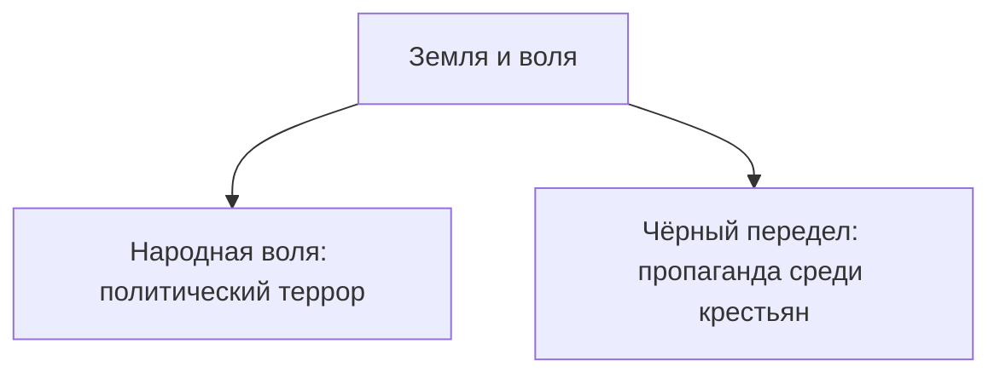
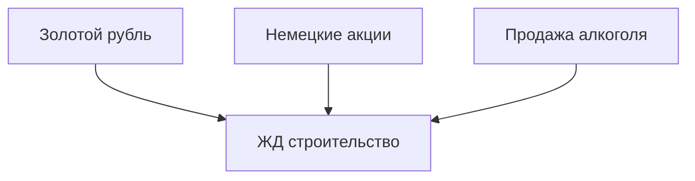

# Россия во второй половине XIX века: реформы и контрреформы

> **Ключевая мысль.** Реформы Александра II ускорили развитие капитализма в России и изменили её общественный уклад. При Александре III часть преобразований пересмотрели, но промышленность и железные дороги продолжали развиваться.⁠​‌​‌​​‌‌​‌​​​​​‌​‌​​​‌‌​​‌​​​​​‌​‌​‌​‌​‌​‌​‌​‌​​​‌​​‌​​​​​‌‌​​​‌‌‌​‌​​​​‌​‌​​​​‌‌‌​‌​​​​‌​‌‌​​​​‌‌​‌​​​‌‌​​​​‌​​‌‌​‌​​​‌‌​​​‌‌​​‌‌​‌​​​‌‌​​​‌‌‌‌‌‌​‌​​​​‌​‌‌‌‌​‌‌‌​‌​​​​‌​‌‌‌‌‌​‌‌​‌​​​​‌​‌‌​​‌​​​‌​​​​​‌‌​‌​​​​‌​​‌‌​‌​‌‌​‌​​​​‌​‌‌​​​​‌‌​‌​​​​‌​‌‌‌‌​​‌‌​‌​​​​‌​‌‌‌​​​‌‌​‌​​​​‌​‌‌‌​‌‌‌‌​‌​​​‌‌​​​‌‌​​​​‌​​​​​‌‌​‌​​​​‌​‌​​​​‌‌‌​‌​​​​‌​‌‌​​​​‌‌​‌​​​​‌​‌‌‌‌​​‌‌​‌​​​​‌​‌‌​​​​‌‌​‌​​​‌‌​​​​​‌​‌‌​‌​​​​‌​‌‌‌‌‌​‌‌​‌​​​​‌​‌‌​​‌​‌‌​‌​​​​‌​‌‌‌​​​‌‌​‌​​​‌‌​​​​‌‌‌​‌‌‌‌‌​​‌‌​‌​​​​‌​​‌‌​​​‌‌​‌​​​‌‌​​​​​​‌‌‌​‌​​​‌‌​​​​​‌​‌‌​‌​​​​‌​‌‌‌‌‌​‌‌​‌​​​‌‌​​​​​​​‌‌​‌​​​​‌​‌‌‌​​​‌‌​‌​​​‌‌​​​‌‌‌‌​​‌​​​​​‌‌​‌​​​​‌​‌​​​​​‌‌​‌​​​​‌​‌‌‌‌‌​‌‌​‌​​​‌‌​​​​​​‌‌‌​‌​​​‌‌​​​​​​‌‌‌​‌​​​​‌​‌‌‌​​​‌‌​‌​​​​‌​‌‌‌​​​​​‌​‌‌‌‌‌‌​‌​​​​‌​​‌‌​‌​‌‌​‌​​​​‌​‌‌‌‌‌​‌‌​‌​​​​‌​‌‌‌‌​‌‌‌​‌​​​‌‌​​​​​​‌‌‌​‌​​​​‌​‌‌‌‌‌‌‌‌​‌​​​​‌​‌‌​‌​‌‌‌​‌​​​​‌​‌‌‌​‌​‌‌​‌​​​‌‌​​​​​‌​‌‌​‌​​​‌‌​​​‌​‌‌​​‌​​​​​‌‌​‌​​​​‌​‌‌‌​‌‌‌‌​‌​​​​‌​‌‌​‌​‌‌‌​‌​​​​‌​‌‌‌​‌​‌‌​‌​​​‌‌​​​​‌‌​‌‌​‌​​​​‌​‌‌‌​​​‌‌​‌​​​​‌​‌‌‌​​‌​​‌​‌‌‌‌‌‌​‌​​​​‌​​‌‌​​​‌‌​‌​​​‌‌​​​​​​‌‌‌​‌​​​‌‌​​​​​‌​‌‌​‌​​​​‌​‌‌‌‌‌​‌‌​‌​​​‌‌​​​​​​​‌‌​‌​​​​‌​‌‌‌​​​‌‌​‌​​​‌‌​​​‌‌‌‌​​‌​​​​​‌‌​‌​​​​‌​‌​​​​​‌‌​‌​​​​‌​‌‌‌‌‌​‌‌​‌​​​‌‌​​​​​​‌‌‌​‌​​​‌‌​​​​​​‌‌‌​‌​​​​‌​‌‌‌​​​‌‌​‌​​​​‌​‌‌‌​​​​​‌​​​​​​​‌‌​​‌​​​‌‌‌​​​​​‌​‌‌‌​​​‌‌​​​‌​​‌‌​​​‌​​‌​‌‌‌​​​‌‌​​‌​​​‌‌​‌‌​​​‌​‌‌‌​​‌‌​‌‌​‌​‌‌​​‌​​‌​‌​‌​​‌​‌​‌​‌‌‌‌‌‌​​​​​​​​‌​‌​‌⁣

## План лекции

1. [[#Реформы Александра II и развитие капитализма]]
2. [[#Народничество]]
3. [[#Внешняя политика Александра II]]
4. [[#Культура XIX века]]
5. [[#Контрреформы Александра III]]

> «Русские долго запрягают, но быстро ездят».
>
> — Приписывается О. фон Бисмарку.

> «Россия не сердится, она сосредотачивается».
>
> — А. М. Горчаков.

> «Кому конституция, а кому хлеб с хреном».

---

## Реформы Александра II и развитие капитализма

Подготовка преобразований разобрана в [[История России 20.11.26#Начало великих реформ. Александр II (1855–1881)|предыдущей лекции]].

### Крестьянская реформа 1861 года

Отмена [[Крепостное право|крепостного права]] дала бывшим крепостным личную свободу. Значительная часть земли осталась у помещиков, а крестьяне получали наделы за выкуп. Реформа изменила имущественные отношения в деревне и ускорила развитие капитализма.

При выкупе государство выплачивало помещику основную часть суммы. Остаток (обычно 20–25 %) вносили крестьяне, которые затем погашали долг перед государством. **Временнообязанными** называли крестьян, которые до перехода на выкуп продолжали нести повинности перед помещиком.

### Земская и судебная реформы 1864 года

- **Земства** — выборные органы местного самоуправления в губерниях и уездах. Они занимались школами, больницами, ветеринарной помощью и другими местными делами. В конспекте названо около 2 млн обученных грамоте; **нужно уточнить**, за какой период приведена эта оценка.
- **Судебная реформа** ввела всесословный суд и открытое разбирательство. Гласность процесса должна была ограничить судебный произвол и злоупотребления.

### Военные, образовательные и цензурные преобразования

- **Военная реформа.** В **1874 г.** введена всеобщая воинская повинность. Военные преобразования также включали ограничение телесных наказаний, создание военных округов, обновление уставов и системы подготовки офицеров.
- **Образование.** Университеты получили больше самостоятельности; росло число студентов, развивалась сеть гимназий и училищ.
- **Печать.** Ослабление цензуры дало газетам и журналам больше возможностей для критики.

## Народничество

**[[Народничество]]** — общественно-политическое движение, участники которого связывали будущее России с крестьянской [[Община|общиной]] и возможностью перехода к социализму.

- **А. И. Герцен** отвергал капиталистический путь для России и связывал её будущее с общинным землевладением.
- **Н. Г. Чернышевский**, сын священника, был одним из редакторов журнала «Современник». Его обвинили в составлении прокламации с призывом к восстанию и приговорили к каторге с последующим поселением в Сибири.
- **М. А. Бакунин** выступал за анархизм: считал, что народ способен организовать жизнь без государственной власти. Его дважды приговаривали к смерти, но оба приговора не были исполнены.
- **П. Л. Лавров**, преподававший в Петербурге, считал, что революции должно предшествовать просвещение народа.
- **П. Н. Ткачёв** выступал за революционный заговор и захват власти организованным меньшинством ради социалистических преобразований.

Во время **хождения в народ** студенты и другие участники движения отправлялись в деревни, распространяли книги и агитировали против самодержавия. Массовой поддержки среди крестьян движение не получило.

В **1879 г.** организация «Земля и воля», созданная в **1876 г.**, раскололась из-за разногласий о методах борьбы:

Часть участников «Чёрного передела» позднее перешла к марксизму. Марксисты спорили с народниками о том, как будет развиваться Россия.

---

## Внешняя политика Александра II

| Дата | Событие и значение |
| --- | --- |
| **1865 г.** | Взятие Ташкента — один из этапов продвижения России в Средней Азии. |
| **1867 г.** | Россия продала Аляску США за 7,2 млн долларов. |
| **1871 г.** | Россия дипломатическим путём добилась отмены ограничений Парижского мира на военный флот и арсеналы в Чёрном море. |
| **1877–1878 гг.** | Русско-турецкая война. Одной из предпосылок стало подавление Апрельского восстания в Болгарии. По итогам войны независимость Сербии, Черногории и Румынии была признана, а Болгария получила автономию. |

## Культура XIX века

XIX век называют **золотым веком русской литературы**:

- **А. С. Пушкин** — подсказал Гоголю сюжет «Мёртвых душ».
- **Н. В. Гоголь** — в лекции его искусство сравнили с водопадом.
- **М. Ю. Лермонтов, И. С. Тургенев и Ф. М. Достоевский** — ключевые авторы золотого века.
- **Л. Н. Толстой** — один из наиболее переводимых русских писателей.

---

## Контрреформы Александра III

**[[Контрреформа|Контрреформы]]** Александра III ограничили некоторые изменения, проведённые при Александре II. В **1881 г.** вышел манифест «О незыблемости [[Самодержавие|самодержавия]]». Усилились полицейский надзор и позиции дворянства.

Александра III называли **Миротворцем**: при нём Россия не участвовала в крупных войнах. В лекции мирный период связывали с экономическим ростом.

### С. Ю. Витте и промышленное развитие

В **1892 г.** С. Ю. Витте стал министром финансов. На выбор именно этой персоны в качестве министра финансов повлияла история с железнодорожной катастрофой, в которой пострадал императорский поезд. 

Строительство **Транссибирской магистрали** началось при Александре III. Витте поддерживал этот проект: железная дорога между европейской частью России и Дальним Востоком облегчала перевозку сырья и товаров.

Расширение железнодорожной сети поддерживало металлургию, угольную, деревообрабатывающую и строительную отрасли, а также повышало спрос на инженеров. Отдельно отмечались добыча угля в Донбассе и добыча нефти в Баку.

Основным источником финансов Витте стала конвертация золота на рубль. Также начал раздувать в иностранных газетах пиар рубля, что привело к повышению ценности рубля за границей. Другим же источником стала винно-алкогольная торговля:

### Второй эшелон капитализма

- Инвестиции через Европу, главный спонсор России — Франция.
- Необычная последовательность развития отраслей.

### От кружков к РСДРП

- **1864 г.** — «Интернаука» — Маркса.
- **1883 г.** — «Освобождение труда» — Плеханов.
- **1887 г.** — студент → «Союз борьбы за освобождение рабочего класса» — Ленин.

В **1903 г.** на II съезде РСДРП — создание двух партий: большевиков и меньшевиков. Ленин ввёл строгую дисциплину и централизацию в партии. Сначала просто издавала газету «Искра» (нелегально).

> «Из искры возгорится пламя».

### Причины социалистической революции 1905–1907 гг.

1. **Отсталая технология власти.** Не подходит под экономику.
2. **Крестьянский вопрос** так и остался. Идея примитивных крестьян: земля божья, значит, не может кому-нибудь принадлежать. Негодование по поводу помещичьих земель.
3. **Тяготы модернизации, рабочий вопрос.** Крестьяне стали рабочими. Рабочий день — 14 часов.
4. **Личность Николая II.** Он был императором, но не любил политику и общественные дела. Был посредственным человеком, на уровне полковника, верил в предзнаменования, был противником реформ, ненавидел интеллигенцию (людей, которые любят народ). Влип в войну с Японией, имел плохое окружение — мать, жена Александра.
### Причины Русско-Японской войны 1904-1905 гг.
- Маньчжурией и Корейским полуостровом
- Борьба за Корею и Маньчжурию
- Дипломатическое трение после японско-китайской войны (1894–1895)
- Внешнеполитическая поддержка Японии
- Внутриполитические расчёты в Петербурге

%%Самостоятельный вопрос%%
Роль Витте в истории России? Чем знаменит?

1. **Экономический реформатор.** На посту министра финансов Витте ускорял индустриализацию: поддерживал строительство Транссибирской магистрали и привлекал иностранные инвестиции. В **1897 г.** провёл денежную реформу, которая закрепила золотое обеспечение рубля и позволила обменивать бумажные деньги на золото.
2. **Дипломат и государственный деятель.** В **1905 г.** возглавил российскую делегацию на переговорах с Японией и подписал Портсмутский мир, завершивший Русско-японскую войну. Россия уступила южную часть Сахалина, но не выплачивала контрибуцию. В том же году Витте участвовал в подготовке Манифеста 17 октября, который обещал гражданские свободы и участие Государственной думы в принятии законов, а затем возглавил Совет министров.

⁠​‌​‌​​‌‌​‌​​​​​‌​‌​​​‌‌​​‌​​​​​‌​‌​‌​‌​‌​‌​‌​‌​​​‌​​‌​​​​​‌‌​​​‌‌‌​‌​​​​‌​‌​​​​‌‌‌​‌​​​​‌​‌‌​​​​‌‌​‌​​​‌‌​​​​‌​​‌‌​‌​​​‌‌​​​‌‌​​‌‌​‌​​​‌‌​​​‌‌‌‌‌‌​‌​​​​‌​‌‌‌‌​‌‌‌​‌​​​​‌​‌‌‌‌‌​‌‌​‌​​​​‌​‌‌​​‌​​​‌​​​​​‌‌​‌​​​​‌​​‌‌​‌​‌‌​‌​​​​‌​‌‌​​​​‌‌​‌​​​​‌​‌‌‌‌​​‌‌​‌​​​​‌​‌‌‌​​​‌‌​‌​​​​‌​‌‌‌​‌‌‌‌​‌​​​‌‌​​​‌‌​​​​‌​​​​​‌‌​‌​​​​‌​‌​​​​‌‌‌​‌​​​​‌​‌‌​​​​‌‌​‌​​​​‌​‌‌‌‌​​‌‌​‌​​​​‌​‌‌​​​​‌‌​‌​​​‌‌​​​​​‌​‌‌​‌​​​​‌​‌‌‌‌‌​‌‌​‌​​​​‌​‌‌​​‌​‌‌​‌​​​​‌​‌‌‌​​​‌‌​‌​​​‌‌​​​​‌‌‌​‌‌‌‌‌​​‌‌​‌​​​​‌​​‌‌​​​‌‌​‌​​​‌‌​​​​​​‌‌‌​‌​​​‌‌​​​​​‌​‌‌​‌​​​​‌​‌‌‌‌‌​‌‌​‌​​​‌‌​​​​​​​‌‌​‌​​​​‌​‌‌‌​​​‌‌​‌​​​‌‌​​​‌‌‌‌​​‌​​​​​‌‌​‌​​​​‌​‌​​​​​‌‌​‌​​​​‌​‌‌‌‌‌​‌‌​‌​​​‌‌​​​​​​‌‌‌​‌​​​‌‌​​​​​​‌‌‌​‌​​​​‌​‌‌‌​​​‌‌​‌​​​​‌​‌‌‌​​​​​‌​‌‌‌‌‌‌​‌​​​​‌​​‌‌​‌​‌‌​‌​​​​‌​‌‌‌‌‌​‌‌​‌​​​​‌​‌‌‌‌​‌‌‌​‌​​​‌‌​​​​​​‌‌‌​‌​​​​‌​‌‌‌‌‌‌‌‌​‌​​​​‌​‌‌​‌​‌‌‌​‌​​​​‌​‌‌‌​‌​‌‌​‌​​​‌‌​​​​​‌​‌‌​‌​​​‌‌​​​‌​‌‌​​‌​​​​​‌‌​‌​​​​‌​‌‌‌​‌‌‌‌​‌​​​​‌​‌‌​‌​‌‌‌​‌​​​​‌​‌‌‌​‌​‌‌​‌​​​‌‌​​​​‌‌​‌‌​‌​​​​‌​‌‌‌​​​‌‌​‌​​​​‌​‌‌‌​​‌​​‌​‌‌‌‌‌‌​‌​​​​‌​​‌‌​​​‌‌​‌​​​‌‌​​​​​​‌‌‌​‌​​​‌‌​​​​​‌​‌‌​‌​​​​‌​‌‌‌‌‌​‌‌​‌​​​‌‌​​​​​​​‌‌​‌​​​​‌​‌‌‌​​​‌‌​‌​​​‌‌​​​‌‌‌‌​​‌​​​​​‌‌​‌​​​​‌​‌​​​​​‌‌​‌​​​​‌​‌‌‌‌‌​‌‌​‌​​​‌‌​​​​​​‌‌‌​‌​​​‌‌​​​​​​‌‌‌​‌​​​​‌​‌‌‌​​​‌‌​‌​​​​‌​‌‌‌​​​​​‌​​​​​​​‌‌​​‌​​​‌‌‌​​​​​‌​‌‌‌​​​‌‌​​​‌​​‌‌​​​‌​​‌​‌‌‌​​​‌‌​​‌​​​‌‌​‌‌​​​‌​‌‌‌​​‌‌​‌‌​‌​‌‌​​‌​​‌​‌​‌​​‌​‌​‌​‌‌‌‌‌‌​​​​​​​​‌​‌​‌⁣
