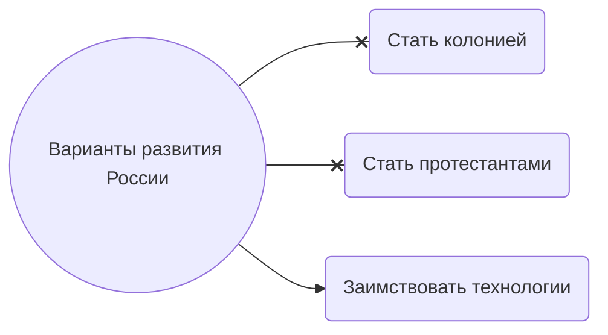
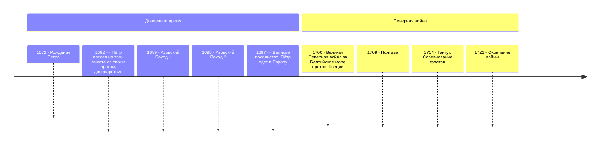

# Петровская эпоха (1689–1725) [[Модернизация]]

>Канун реформ Петра? Его личность (харизма, аура)?⁠​‌​‌​​‌‌​‌​​​​​‌​‌​​​‌‌​​‌​​​​​‌​‌​‌​‌​‌​‌​‌​‌​​​‌​​‌​​​​​‌‌​​​‌‌‌​‌​​​​‌​‌​​​​‌‌‌​‌​​​​‌​‌‌​​​​‌‌​‌​​​‌‌​​​​‌​​‌‌​‌​​​‌‌​​​‌‌​​‌‌​‌​​​‌‌​​​‌‌‌‌‌‌​‌​​​​‌​‌‌‌‌​‌‌‌​‌​​​​‌​‌‌‌‌‌​‌‌​‌​​​​‌​‌‌​​‌​​​‌​​​​​‌‌​‌​​​​‌​​‌‌​‌​‌‌​‌​​​​‌​‌‌​​​​‌‌​‌​​​​‌​‌‌‌‌​​‌‌​‌​​​​‌​‌‌‌​​​‌‌​‌​​​​‌​‌‌‌​‌‌‌‌​‌​​​‌‌​​​‌‌​​​​‌​​​​​‌‌​‌​​​​‌​‌​​​​‌‌‌​‌​​​​‌​‌‌​​​​‌‌​‌​​​​‌​‌‌‌‌​​‌‌​‌​​​​‌​‌‌​​​​‌‌​‌​​​‌‌​​​​​‌​‌‌​‌​​​​‌​‌‌‌‌‌​‌‌​‌​​​​‌​‌‌​​‌​‌‌​‌​​​​‌​‌‌‌​​​‌‌​‌​​​‌‌​​​​‌‌‌​‌‌‌‌‌​​‌‌​‌​​​​‌​​‌‌​​​‌‌​‌​​​‌‌​​​​​​‌‌‌​‌​​​‌‌​​​​​‌​‌‌​‌​​​​‌​‌‌‌‌‌​‌‌​‌​​​‌‌​​​​​​​‌‌​‌​​​​‌​‌‌‌​​​‌‌​‌​​​‌‌​​​‌‌‌‌​​‌​​​​​‌‌​‌​​​​‌​‌​​​​​‌‌​‌​​​​‌​‌‌‌‌‌​‌‌​‌​​​‌‌​​​​​​‌‌‌​‌​​​‌‌​​​​​​‌‌‌​‌​​​​‌​‌‌‌​​​‌‌​‌​​​​‌​‌‌‌​​​​​‌​‌‌‌‌‌‌​‌​​​​‌​​‌‌​‌​‌‌​‌​​​​‌​‌‌‌‌‌​‌‌​‌​​​​‌​‌‌‌‌​‌‌‌​‌​​​‌‌​​​​​​‌‌‌​‌​​​​‌​‌‌‌‌‌‌‌‌​‌​​​​‌​‌‌​‌​‌‌‌​‌​​​​‌​‌‌‌​‌​‌‌​‌​​​‌‌​​​​​‌​‌‌​‌​​​‌‌​​​‌​‌‌​​‌​​​​​‌‌​‌​​​​‌​‌‌‌​‌‌‌‌​‌​​​​‌​‌‌​‌​‌‌‌​‌​​​​‌​‌‌‌​‌​‌‌​‌​​​‌‌​​​​‌‌​‌‌​‌​​​​‌​‌‌‌​​​‌‌​‌​​​​‌​‌‌‌​​‌​​‌​‌‌‌‌‌‌​‌​​​​‌​​‌‌​​​‌‌​‌​​​‌‌​​​​​​‌‌‌​‌​​​‌‌​​​​​‌​‌‌​‌​​​​‌​‌‌‌‌‌​‌‌​‌​​​‌‌​​​​​​​‌‌​‌​​​​‌​‌‌‌​​​‌‌​‌​​​‌‌​​​‌‌‌‌​​‌​​​​​‌‌​‌​​​​‌​‌​​​​​‌‌​‌​​​​‌​‌‌‌‌‌​‌‌​‌​​​‌‌​​​​​​‌‌‌​‌​​​‌‌​​​​​​‌‌‌​‌​​​​‌​‌‌‌​​​‌‌​‌​​​​‌​‌‌‌​​​​​‌​​​​​​​‌‌​​‌‌​​‌‌​​​‌​​‌​‌‌‌​​​‌‌​​​‌​​‌‌​​​​​​‌​‌‌‌​​​‌‌​​‌​​​‌‌​‌‌​​​‌​‌‌‌​​‌‌​‌‌​‌​‌‌​​‌​​‌​‌​‌‌‌‌​‌‌​​‌‌​​​​‌‌​​​​​​​​​​‌⁣
>Россия — [[Империя]].
>Противоречие реформ?

---
### Предпосылки к реформам Петра
1. Мало мануфактур, нет промышленности. (в Англии промышленный переворот)
	   Нужна была революция, к власти пришли «денежные мешки», Англия стала буржуазной и начала развиваться.
2. Нет науки и церковных школ.
3. Отсталая политическая культура
	Царь — хранитель православия.
4. Люди жили медлительно
	Спали до обеда, ходили медленно.
5. Недоверие крестьян к дворянам
6. Не разрабатываются, не изучаются полезные ископаемые

>*«Нам Европа нужна на 10 лет, потом мы повернёмся от неё назад».*
>*«Промедление смерти подобно». — Пётр I.*
>*«Россия — страна с азиатским туловищем и пришитой Петром европейской головой».*
>*«Пётр — машина, ведомая верной рукой».*

---

---

# Пётр I 
***Его качества:***
- Имел хорошую генетику (в отличие от своих родных), из-за этого существовал миф, что его подменили в Голландии.
- Хорошая интуиция.
- Энергичен.
- Идеал общества — Корабль.
- Страсть к военным играм.
- Очень любил поражения.
### Начало правления
==В начале правления==
	Часто играл в войну в селе Преображенском, в атмосфере обычных людей.
	Из деревни выросли элитные части Армии.
	Поехал в Европу, поучиться у них кораблестроению, выстроить дипломатию, просветиться культурой, взять в Россию инструменты и материалы для кораблей.
==Во время войны==
	 **Деньги — артерии войны**
	 Начало в 1700
	 Первая битва — город Нарва, результат: поражение, начало формирования армии. Офицерские школы, военные школы, цифирные школы (обучение кораблестроителей), создание рекрутов. Реформа государственного управления: создание Сената — 1711 год, Губернская реформа — 8 губерний, обязывает всех губернаторов поставлять рекрутов, создание коллегий (органов центрального управления). `(Подражает шведам)`
	Санкт-Петербург около фронта — по образцу Амстердама.  
	Похвальную речь Петру после Полтавы и победы над Швецией произнёс священник Прокопович — основатель церковной реформы.
	Пётр обязал монахов ходить на государственные работы, курировать раненых и инвалидов. Верховным органом над церковью стал Синод — светский орган из чиновников. 
==После войны==
	После подписания Ништадтского мирного договора с Швецией: Россия провозглашена Империей.
	Пётр сочинил Табель о рангах в 1722 году — механизм повышения в должности незнатных людей.
	В России утвердился абсолютизм.

### Культура
 - Светская культура и образование.
 - Введение ассамблей.
 - Неграмотные дворяне не могли жениться.
 - Дворяне обязаны служить.
 - Академия наук началась в 1724 году.
 - Создал первый музей, первую газету «Ведомости» и сам пишет в неё (по образцу Европы)
 - Заложил основы Золотого Века культуры

### Противоречия реформ 
- Догоняя Европу, усилил крепостное право, закрепил крепостничество в мануфактурах
- Произошёл культурный раскол: народ жил азиатской культурой, а дворянство европейской.
- Понизил авторитет церкви как своей опоры.
- Пытался рабов заставить служить Отечеству.

### Минусы Петра
- Создал особые собрания и давал в них звания в честь церкви, чтобы высмеять её.
- Написал морской устав.
- Не успел указать наследника перед смертью.

---

%%Самостоятельный ответ%%
Можно ли считать, что Пётр слепо копировал европейские образцы?

| Что Пётр перенял из Европы                                                                           | Что не взял / не захотел брать                                                                                           |
| ---------------------------------------------------------------------------------------------------- | ----------------------------------------------------------------------------------------------------------------------- |
| **Технику и военное дело:** корабли, оружие, инструменты, морской устав, рекрутская армия, флот      | **Парламент и выборность.** В Европе были парламенты, а Пётр, наоборот, сделал власть царя полной ([[Абсолютизм]])      |
| **Управление по-шведски:** [[Коллегии]] вместо старых приказов, губернии, [[Сенат]]                  | **Права и свободы людей.** Пётр не дал крестьянам личной свободы, а наоборот, усилил [[Крепостное право]]                |
| **Науку и школы:** офицерские, цифирные школы, Академия наук, первый музей (Кунсткамера)             | **Свободу церкви.** В Европе церковь жила своей жизнью, а Пётр подчинил её государству через Синод                      |
| **Светскую культуру:** ассамблеи, европейская одежда, бритье бород, новые праздники                  | **Равенство в культуре.** Европейскую культуру получили только дворяне, народ остался со своей — отсюда раскол общества |
| **Печать и газеты:** первая газета «Ведомости», типографии                                           | **Гуманизм и уважение к человеку.** Свои же крепостные оставались для Петра «материалом» для заводов и армии            |
| **Промышленность:** мануфактуры, [[Меркантилизм]] (больше продавать, меньше покупать)                | **Частную инициативу.** Заводы работали в основном на государство, а не на свободный рынок                              |
| **Идею «[[Регулярное государство \| регулярного государства]]»:** всё расписано, все обязаны служить | **Терпимость к противникам.** Несогласных не переубеждали, а наказывали                                                 |

> **Простыми словами:** Пётр взял из Европы **«инструменты»** — технику, армию, школы, управление, моду. А **«содержание»** — права человека, парламент, свободу крестьянина, независимость церкви — не взял, потому что это мешало бы ему править единолично. Поэтому и говорят, что он не копировал Европу слепо: Европа была ему нужна, чтобы сделать Россию сильной, а власть — крепче. Пришил голову, а туловище оставил прежним.
⁠​‌​‌​​‌‌​‌​​​​​‌​‌​​​‌‌​​‌​​​​​‌​‌​‌​‌​‌​‌​‌​‌​​​‌​​‌​​​​​‌‌​​​‌‌‌​‌​​​​‌​‌​​​​‌‌‌​‌​​​​‌​‌‌​​​​‌‌​‌​​​‌‌​​​​‌​​‌‌​‌​​​‌‌​​​‌‌​​‌‌​‌​​​‌‌​​​‌‌‌‌‌‌​‌​​​​‌​‌‌‌‌​‌‌‌​‌​​​​‌​‌‌‌‌‌​‌‌​‌​​​​‌​‌‌​​‌​​​‌​​​​​‌‌​‌​​​​‌​​‌‌​‌​‌‌​‌​​​​‌​‌‌​​​​‌‌​‌​​​​‌​‌‌‌‌​​‌‌​‌​​​​‌​‌‌‌​​​‌‌​‌​​​​‌​‌‌‌​‌‌‌‌​‌​​​‌‌​​​‌‌​​​​‌​​​​​‌‌​‌​​​​‌​‌​​​​‌‌‌​‌​​​​‌​‌‌​​​​‌‌​‌​​​​‌​‌‌‌‌​​‌‌​‌​​​​‌​‌‌​​​​‌‌​‌​​​‌‌​​​​​‌​‌‌​‌​​​​‌​‌‌‌‌‌​‌‌​‌​​​​‌​‌‌​​‌​‌‌​‌​​​​‌​‌‌‌​​​‌‌​‌​​​‌‌​​​​‌‌‌​‌‌‌‌‌​​‌‌​‌​​​​‌​​‌‌​​​‌‌​‌​​​‌‌​​​​​​‌‌‌​‌​​​‌‌​​​​​‌​‌‌​‌​​​​‌​‌‌‌‌‌​‌‌​‌​​​‌‌​​​​​​​‌‌​‌​​​​‌​‌‌‌​​​‌‌​‌​​​‌‌​​​‌‌‌‌​​‌​​​​​‌‌​‌​​​​‌​‌​​​​​‌‌​‌​​​​‌​‌‌‌‌‌​‌‌​‌​​​‌‌​​​​​​‌‌‌​‌​​​‌‌​​​​​​‌‌‌​‌​​​​‌​‌‌‌​​​‌‌​‌​​​​‌​‌‌‌​​​​​‌​‌‌‌‌‌‌​‌​​​​‌​​‌‌​‌​‌‌​‌​​​​‌​‌‌‌‌‌​‌‌​‌​​​​‌​‌‌‌‌​‌‌‌​‌​​​‌‌​​​​​​‌‌‌​‌​​​​‌​‌‌‌‌‌‌‌‌​‌​​​​‌​‌‌​‌​‌‌‌​‌​​​​‌​‌‌‌​‌​‌‌​‌​​​‌‌​​​​​‌​‌‌​‌​​​‌‌​​​‌​‌‌​​‌​​​​​‌‌​‌​​​​‌​‌‌‌​‌‌‌‌​‌​​​​‌​‌‌​‌​‌‌‌​‌​​​​‌​‌‌‌​‌​‌‌​‌​​​‌‌​​​​‌‌​‌‌​‌​​​​‌​‌‌‌​​​‌‌​‌​​​​‌​‌‌‌​​‌​​‌​‌‌‌‌‌‌​‌​​​​‌​​‌‌​​​‌‌​‌​​​‌‌​​​​​​‌‌‌​‌​​​‌‌​​​​​‌​‌‌​‌​​​​‌​‌‌‌‌‌​‌‌​‌​​​‌‌​​​​​​​‌‌​‌​​​​‌​‌‌‌​​​‌‌​‌​​​‌‌​​​‌‌‌‌​​‌​​​​​‌‌​‌​​​​‌​‌​​​​​‌‌​‌​​​​‌​‌‌‌‌‌​‌‌​‌​​​‌‌​​​​​​‌‌‌​‌​​​‌‌​​​​​​‌‌‌​‌​​​​‌​‌‌‌​​​‌‌​‌​​​​‌​‌‌‌​​​​​‌​​​​​​​‌‌​​‌‌​​‌‌​​​‌​​‌​‌‌‌​​​‌‌​​​‌​​‌‌​​​​​​‌​‌‌‌​​​‌‌​​‌​​​‌‌​‌‌​​​‌​‌‌‌​​‌‌​‌‌​‌​‌‌​​‌​​‌​‌​‌‌‌‌​‌‌​​‌‌​​​​‌‌​​​​​​​​​​‌⁣
